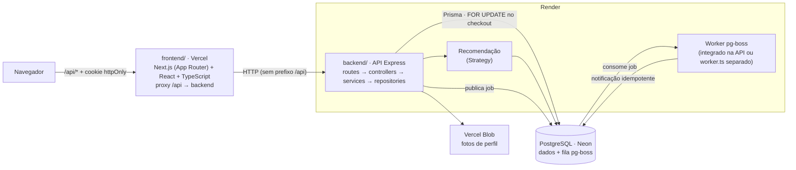

# Origem

[](https://github.com/devpedrois/Projeto-Integrador/actions/workflows/ci.yml)

Marketplace web full stack que conecta artesãos e produtores criativos de Pernambuco a compradores de todo o Brasil, dando visibilidade digital, canal de venda direto e valorização da origem, da técnica e da história de cada peça.

Projeto Integrador do 4º semestre de Análise e Desenvolvimento de Sistemas — **CESAR School**, 2026.2.

## Acesse a aplicação

**Frontend publicado:** <https://origem-marketplace.vercel.app/>

O frontend (Vercel) consome o backend real em Express (Render) com PostgreSQL (Neon). O navegador chama `/api/*` no próprio domínio da Vercel. O Next.js repassa essas chamadas ao backend, e a sessão fica num cookie `httpOnly` (`origem_sessao`).

**Documentação da API (Swagger):** `/api/docs` no domínio publicado (no backend, `GET /docs` e `GET /docs/openapi.json`).

Para avaliar os fluxos, use as credenciais sintéticas da carga demo (`backend/prisma/seeds/demo.ts`):

| Papel | Email | Senha |
|---|---|---|
| Comprador | `ana.compradora@origem.test` | `senha-sintetica-comprador` |
| Comprador | `bruno.comprador@origem.test` | `senha-sintetica-comprador-02` |
| Artesão | `joao.artesao@origem.test` | `senha-sintetica-artesao` |
| Artesã | `maria.artesa@origem.test` | `senha-sintetica-artesao-02` |
| Admin | `admin@origem.test` | `senha-sintetica-admin` |

> Os dados ficam no PostgreSQL e são compartilhados entre todos os visitantes: um pedido, uma avaliação ou uma moderação feita por um avaliador aparece para os outros. O backend roda no plano gratuito do Render, que dorme após 15 min sem tráfego e leva cerca de 1 min para acordar. Abra a aplicação um pouco antes de demonstrar.

**Branch principal:** `main` (cada push publica o frontend na Vercel).

> **Histórico (Avaliação 1):** na AV1 o frontend rodava com uma Fake API no navegador e `localStorage`. Esse modo ainda existe para desenvolvimento offline (`NEXT_PUBLIC_DATA_SOURCE=fake`), mas não é o modo publicado. Documentação em [`docs/fake-api.md`](docs/fake-api.md).

## O problema

Artesãos e produtores criativos têm pouca visibilidade digital, dependem de intermediários e têm gestão precária de catálogo, pedidos e estoque. Falta um canal que conecte essa produção a compradores destacando origem, técnica e o impacto de comprar direto de quem faz.

O projeto nasce com uma âncora real: a **Comunidade do Pilar** (Recife), com expansão possível para **Alto do Moura/Caruaru** e **Tracunhaém**.

## O que o produto faz

- **Vitrine do comprador** — busca, filtros, perfil do artesão, carrinho e avaliações.
- **Painel do artesão** — catálogo, estoque e gestão de pedidos.
- **Painel administrativo** — curadoria e indicadores da plataforma.
- **Recomendação de produtos** — módulo de IA exposto como serviço, consumido pela vitrine.
- **Indicadores de venda** para artesãos e administração.

Escopo deliberadamente controlado para caber em um semestre: poucas categorias, dados representativos/sintéticos, pagamento simulado (sem gateway real) e recomendação em nível didático antes de modelos sofisticados.

## Arquitetura

Monorepo com dois projetos independentes, `frontend/` e `backend/`, que se comunicam por HTTP.



Diagrama completo, com justificativa de cada componente e limites do deploy, em [`docs/arquitetura-distribuida.md`](docs/arquitetura-distribuida.md).

**Camadas do backend:** `routes` → `controllers` → `services` → `repositories`, com `middlewares` para cross-cutting concerns e `validators` para DTO/validação na borda (Zod). Padrões aplicados de forma pontual e justificada — Repository, Service layer, Strategy (integração de recomendação) e a chain de middlewares do Express — sem Clean Architecture completa, CQRS ou framework de DI, que não se justificam para o tamanho do projeto.

**Concorrência (FCCPD):** o ponto mais sensível do domínio é a baixa de estoque no checkout. A abordagem escolhida é lock pessimista explícito em transação (`SELECT ... FOR UPDATE`) em vez de update condicional otimista — mais simples de implementar, mas o lock explícito demonstra de forma mais didática o controle de concorrência que a disciplina avalia.

**Processamento assíncrono:** após a confirmação de um pedido, um job é publicado em uma fila (`pg-boss`, sobre o próprio PostgreSQL) e processado por um worker idempotente com retry — desacoplando o fluxo síncrono de checkout de efeitos colaterais como notificação ao artesão. O consumidor tem entrypoint próprio (`backend/src/worker.ts`) e pode rodar em processos separados da API. No deploy, ele roda dentro da API (`RUN_WORKER_IN_API=true`), porque o plano gratuito do Render não oferece Background Worker.

**Recomendação (IA):** a vitrine e a página de produto consomem `GET /recomendacoes` pelo `HttpRecommendationAdapter`. O backend aplica uma Strategy sobre o PostgreSQL. A página de produto mostra um carrossel de relacionados com até 8 itens, sem repetir o produto atual.

## Decisões de stack

| Camada | Escolha | Por quê |
|---|---|---|
| Frontend | Next.js (App Router) + React + TypeScript + Tailwind CSS | Padrão da disciplina de Desenvolvimento Web; SSR/roteamento por arquivos reduz boilerplate |
| Backend | Node.js + TypeScript + Express | Projeto separado do frontend, seguindo a stack de referência da disciplina (Express + Prisma + JWT) |
| Banco de dados | PostgreSQL (Neon) | Serverless, branch de banco para testes de integração |
| ORM | Prisma | Migrations versionadas e tipagem gerada a partir do schema |
| Fila assíncrona | pg-boss | Fila sobre o próprio Postgres — sem infra extra para atender ao critério de processamento assíncrono do FCCPD |
| Autenticação | JWT (emitido pelo Express) + bcrypt + cookie `httpOnly` | Backend é projeto separado do frontend; descarta NextAuth |
| Storage de imagens | Vercel Blob | SDK/token funciona a partir de qualquer backend, independente de onde ele está hospedado |
| Deploy frontend | Vercel | Integração nativa com Next.js |
| Deploy backend | Render (free tier) | Sem cartão de crédito, processo persistente (compatível com fila/cache); dorme após 15 min de inatividade |
| Testes | Vitest/Jest (unitário e integração), Playwright (E2E), script dedicado com `Promise.all` (concorrência) | Cobre desde unidade até evidência de concorrência exigida pela rubrica de FCCPD |

Pagamento é sempre simulado — este projeto não integra nem deve integrar gateways de pagamento reais.

## Estrutura de pastas

```
Projeto integrador/
├── backend/                 # API Node.js + TypeScript (Express)
│   ├── src/
│   │   ├── routes/          # definição de endpoints
│   │   ├── controllers/     # entrada HTTP
│   │   ├── services/        # regras de negócio
│   │   ├── repositories/    # acesso a dados (Prisma)
│   │   ├── middlewares/     # cross-cutting concerns
│   │   ├── validators/      # DTO/validação na borda (Zod)
│   │   ├── queues/ e jobs/  # fila assíncrona (pg-boss)
│   │   ├── integrations/    # ex.: Strategy de recomendação
│   │   ├── docs/            # OpenAPI (Swagger)
│   │   ├── server.ts        # API + publicador da fila
│   │   └── worker.ts        # só consumidores da fila
│   ├── prisma/               # schema, migrations, seed demo e seed de volume
│   ├── scripts/              # concorrência, benchmarks, p95 da busca, métricas
│   └── tests/                # unit, integration e integridade (PostgreSQL real)
├── frontend/                # aplicação Next.js
│   ├── src/
│   │   ├── app/              # rotas (App Router)
│   │   ├── components/       # componentes por domínio de tela
│   │   ├── services/         # services; adapters HTTP (padrão) e Fake API (offline)
│   │   ├── fake-api/         # Fake API da Avaliação 1, mantida para dev offline
│   │   └── domain/, store/, hooks/, types/, validators/
│   └── e2e/                  # fluxos Playwright
├── docs/                    # arquitetura, relatórios, matriz de aceitação, uso de IA
├── sprints/                 # entregáveis formais por sprint/checkpoint
└── CLAUDE.md                # contexto vivo do projeto (decisões, modelo de dados, cronograma)
```

## Como rodar localmente

Pré-requisitos: Node.js 22+ (versão usada na CI e nas evidências), npm e um banco PostgreSQL (recomendado: Neon).

### Backend

```bash
cd backend
npm install
npm run prisma:generate

# copie .env.example para .env e preencha, no mínimo:
# DATABASE_URL, DIRECT_URL, JWT_SECRET, FRONTEND_ORIGIN=http://localhost:3000
# (BLOB_READ_WRITE_TOKEN só é necessário para o upload de foto de perfil)

npm run db:migrate
npm run db:seed
npm run dev        # API + consumidor da fila em http://127.0.0.1:3001
```

Para rodar o worker em processo separado: `RUN_WORKER_IN_API=false` no terminal da API (`npm run dev:api`) e `npm run dev:worker` em outro terminal. Todas as variáveis estão descritas em [`backend/README.md`](backend/README.md).

`GET /health` confirma o acesso ao banco (`200` com banco disponível, `503` caso contrário). As rotas da API não usam prefixo `/api` (ex.: `/pedidos`).

Antes de qualquer entrega, rodar também:

```bash
npm run typecheck
npm run lint
npm test
npm run test:concorrencia   # script dedicado de evidência de concorrência
```

### Frontend

```bash
cd frontend
npm install

# frontend/.env.local
# BACKEND_URL=http://127.0.0.1:3001
# NEXT_PUBLIC_DATA_SOURCE=http

npm run dev         # http://localhost:3000
```

Com `NEXT_PUBLIC_DATA_SOURCE=http`, o frontend usa os adapters HTTP e o Next.js repassa `/api/*` para `BACKEND_URL`. Erros HTTP nunca caem para a Fake API. Sem essa variável, o padrão continua `fake`, que é o modo offline herdado da AV1 ([`docs/fake-api.md`](docs/fake-api.md)). A troca acontece só na composição dos services, sem mudar páginas nem componentes ([`docs/refatoracoes-u2.md`](docs/refatoracoes-u2.md)).

E2E (sobe Express e Next.js reais num schema isolado, nos viewports 360 e 1280px):

```bash
cd frontend
npm run test:e2e
```

Imagens ilustrativas geradas com IA (Gemini).

## Executar com Docker

Requisitos: Docker Engine e Compose v2 atualizado.
No Windows, use Docker Desktop com containers Linux.
Execute os comandos seguintes na raiz do repositório.

Copie o exemplo apenas quando `.env.compose` não existir:

```bash
cp -n .env.compose.example .env.compose
export COMPOSE_ENV_FILES=.env.compose
```

No PowerShell:

```powershell
if (!(Test-Path .env.compose)) { Copy-Item .env.compose.example .env.compose }
$env:COMPOSE_ENV_FILES = ".env.compose"
```

Troque as senhas e tokens fictícios antes de iniciar.
Use senhas alfanuméricas com pelo menos 32 caracteres.
Este Compose usa essas senhas diretamente nas URLs locais.
Nunca versione `.env.compose`.
`COMPOSE_ENV_FILES` seleciona esse arquivo para interpolação do Compose.
Alternativamente, informe `--env-file .env.compose` em cada comando.

```bash
docker compose up --build
```

Em outro terminal, selecione o mesmo arquivo de ambiente.
Confira a preparação, os serviços e a saúde:

```bash
docker compose ps --all
curl http://127.0.0.1:3001/health
docker compose logs -f postgres
docker compose logs -f migrate recomendacao-setup
docker compose logs -f api
docker compose logs -f worker
docker compose logs -f recomendacao
```

`migrate` aplica migrations, views e o seed demo compilado.
`recomendacao-setup` cria os papéis e aplica migrations privadas.
Ambos encerram com código zero.
Postgres, API, worker e recomendação devem aparecer saudáveis.
O worker verifica processo e acesso à fila PostgreSQL.
Ele não abre uma porta HTTP.
Os demais serviços usam seus healthchecks próprios.

A API publica intenções, com `RUN_WORKER_IN_API=false`.
Somente o worker consome os jobs e registra `notificacao-processada`.
O log inclui `pedidoId`, sem credenciais ou dados pessoais.
Para demonstrar, pare o worker antes de criar um pedido:

```bash
docker compose stop worker
# Crie o pedido pelo frontend ou Swagger em http://127.0.0.1:3001/docs.
docker compose start worker
docker compose logs -f worker
```

Apenas a API publica porta, limitada ao loopback local.
Postgres e recomendação ficam na rede padrão do Compose.
A API chama `http://recomendacao:3002` com token interno.
API e worker usam `origem_api_app`, sem privilégios administrativos.
O bootstrap cria o schema `pgboss` para esse papel.
`PG_BOSS_CREATE_SCHEMA=false` evita exigir criação de schemas no runtime.
A recomendação usa somente `recomendacao_app`.
Conexões administrativas existem apenas nos serviços de preparação.
As imagens recebem segredos somente durante a execução.

As dependências são instaladas com `npm ci`.
As bases usam Alpine 3.24 e o binário oficial Node 22.
O npm 12.2.1 recebe undici 6.29.1 para corrigir alertas herdados.
O target `migrate` mantém o Prisma CLI para migrations.
API e worker recebem apenas dependências de produção.
O seed executa JavaScript compilado, sem `tsx`.
Na imagem da recomendação, os scripts npm executam JavaScript compilado.
Instalações locais preservam os scripts TypeScript existentes.

O volume nomeado preserva os dados entre execuções.
O init instala `pg_trgm` somente ao criar o banco.
Recriar `migrate` reaplica o seed e seus dados sintéticos.
Isso inclui senhas demo e estoque dos produtos demo.
Alterar senhas administrativas exige atualizar o banco existente.
Para uma demonstração descartável, recrie o volume conscientemente.

Para encerrar preservando dados:

```bash
docker compose down
```

Para remover também todos os dados locais desta demonstração:

```bash
docker compose down --volumes
```

### Frontend local com a API dos containers

Requer Node.js e npm instalados no computador.
O frontend permanece fora do Compose.
Execute em outro terminal:

```bash
cd frontend
npm ci
cp -n .env.example .env.local
npm run dev
```

No PowerShell, copie sem sobrescrever configurações existentes:

```powershell
if (!(Test-Path .env.local)) { Copy-Item .env.example .env.local }
```

Se `.env.local` existir, confira estes valores:

```dotenv
NEXT_PUBLIC_DATA_SOURCE=http
BACKEND_URL=http://127.0.0.1:3001
```

Reinicie Next.js após alterar essas variáveis.
Abra `http://localhost:3000` para usar a vitrine.
As recomendações percorrem frontend, API e microsserviço real.
`COOKIE_SECURE=false` permite o cookie no HTTP local.
O Compose não altera o deploy Neon ou Render.

### Verificação automatizada da demonstração

Após instalar as dependências locais do backend:

```bash
node --test backend/tests/docker/compose.smoke.mjs
node --test backend/tests/docker/base-security.mjs
docker history --no-trunc origem-backend:local
docker history --no-trunc origem-recomendacao:local
```

O teste usa o projeto isolado `origem-35-3-smoke`.
Ele reserva a porta 3001 e usa valores fictícios.
Verifica saúde, isolamento SQL, runtime e processamento pelo worker.
Deixa os containers ativos para inspeção das evidências.
Para encerrá-los, acrescente `-p origem-35-3-smoke` ao Compose.
O teste da base exige Docker Scout e acesso ao registry.
Ele rejeita vulnerabilidades altas ou críticas na imagem-base.

## Integração contínua

O workflow `CI` executa em cada push e pull request.
Frontend e backend usam Node.js 22 e caches npm separados.
O frontend passa por lint, typecheck, testes e build.
Seus testes de contrato exigem dependências e tipos do backend.
Essa preparação gera o Prisma sem conexão ou credenciais.
O backend gera o Prisma, aplica migrations e executa verificações.
Prazos padrão na CI: 60s/teste e 120s/preparação.
O job backend tem limite total de 30 minutos.

Configure estes repository secrets em **Settings → Secrets and variables → Actions**:

| Secret | Valor |
|---|---|
| `DATABASE_URL_TEST` | Conexão PostgreSQL da branch Neon exclusiva de CI |
| `DIRECT_URL_TEST` | Conexão direta da mesma branch, sem pooler |

O `JWT_SECRET` é gerado com `openssl rand` no job backend.
As credenciais ficam restritas ao job backend e são mascaradas.
Pull requests de forks não recebem os secrets do repositório.
Nesse caso, o backend informa somente a variável ausente.

A CI não executa scripts de concorrência, benchmarks ou seed de volume.
Também exclui quatro testes de integração que acionam essas cargas:
`concorrencia-script`, `db-explain`, `recomendacao-volume` e `seed-volume`.
Os demais testes unitários e de integração permanecem incluídos.
A suíte local completa continua disponível com `npm test`.

## Testes de FCCPD

Seção dedicada aos dois critérios centrais da rubrica de FCCPD — controle de concorrência no checkout e fila assíncrona — com o que rodar para gerar evidência real, não só descrita.

Pré-requisito: backend configurado (`npm install`, `npm run prisma:generate`, `DATABASE_URL` setada) — ver [Como rodar localmente](#como-rodar-localmente).

### Concorrência no checkout (lock pessimista)

Valida que `SELECT ... FOR UPDATE` impede overselling quando dois pedidos concorrem pelo mesmo item em estoque.

```bash
cd backend
npm test -- tests/integration/pedidos.integration.test.ts
npm run test:concorrencia   # scripts/concorrencia-checkout.ts — sobe o servidor real e dispara requisições HTTP concorrentes
```

`test:concorrencia` é o script de evidência exigido pela rubrica: cria produto/estoque, dispara `POST /pedidos` simultâneos de verdade contra o servidor e falha se qualquer rodada permitir estoque negativo. A saída do terminal (rounds + falhas) é a evidência a anexar na entrega.

### Fila assíncrona (pg-boss)

Valida publicação, processamento idempotente, retry e desacoplamento do job de notificação ao artesão.

```bash
cd backend
npm test -- tests/integration/fila-notificacao.integration.test.ts
npm test -- tests/integration/notificacao-auto-publish.integration.test.ts
npm test -- tests/integration/server-queue-bootstrap.integration.test.ts
```

| Teste | O que cobre |
|---|---|
| `fila-notificacao.integration.test.ts` | Publicação do job, handler idempotente, retry após falha simulada |
| `notificacao-auto-publish.integration.test.ts` | Publicação automática da intenção de notificação a partir de um pedido confirmado |
| `server-queue-bootstrap.integration.test.ts` | Bootstrap da fila (`boss.start()` + worker registrado) na subida real do servidor |

Implementação em `backend/src/queues/` (publisher, cliente pg-boss) e `backend/src/jobs/` (handler + worker do job `notificar-artesao`).

### Rodar tudo de uma vez

```bash
cd backend
npm test          # suíte completa (unit + integration), inclui os testes acima
npm run typecheck
npm run lint
```

## Documentação

| Documento | Conteúdo |
|---|---|
| [`docs/arquitetura-distribuida.md`](docs/arquitetura-distribuida.md) | Componentes, implantação, API × worker e limites do deploy |
| [`docs/concorrencia-checkout-u2.md`](docs/concorrencia-checkout-u2.md) | Sequência do checkout, `FOR UPDATE` e ordenação de locks |
| [`docs/relatorio-desempenho-u2.md`](docs/relatorio-desempenho-u2.md) | Concorrência, benchmarks da fila e da recomendação, p95 da busca |
| [`docs/indices-u2.md`](docs/indices-u2.md) | Índices analisados com `EXPLAIN`, retidos e descartados |
| [`docs/metricas-recomendacao-u2.md`](docs/metricas-recomendacao-u2.md) | Métricas v0 da recomendação na massa de 1.000 produtos |
| [`docs/matriz-aceitacao-u2.md`](docs/matriz-aceitacao-u2.md) | Critérios de aceite × teste × resultado |
| [`docs/refatoracoes-u2.md`](docs/refatoracoes-u2.md) | Refatorações justificadas da U2 |
| [`docs/Relatorio-Testes-Origem-Sprint12-13.pdf`](docs/Relatorio-Testes-Origem-Sprint12-13.pdf) | Relatório consolidado de testes (Semanas 12–13) |
| [`docs/fake-api.md`](docs/fake-api.md) | Fake API da Avaliação 1 (histórico; hoje só para dev offline) |
| [`docs/uso-de-ia.md`](docs/uso-de-ia.md) | Declaração de uso de IA no desenvolvimento |

## Declaração de uso de IA

O uso de ferramentas de IA no desenvolvimento do projeto está declarado em [`docs/uso-de-ia.md`](docs/uso-de-ia.md).

## Disciplinas envolvidas

O Projeto Integrador é avaliado por 6 disciplinas do semestre, cada uma responsável por uma fatia do sistema. O bloco do PI vale no mínimo 40% da nota de cada unidade nas disciplinas técnicas.

| Disciplina | Papel no projeto |
|---|---|
| **Desenvolvimento Web** | Constrói a aplicação full stack — frontend responsivo e backend (API, regras de negócio) — integrando as contribuições das demais disciplinas |
| **Modelagem e Projeto de Banco de Dados** | Projeta e implementa o banco (modelo conceitual, lógico e físico), normalização e índices |
| **Requisitos, Projeto de Software e Validação** | Análise de domínio, requisitos, arquitetura (SOLID/GRASP/padrões) e estratégia de testes |
| **Fundamentos de Computação Concorrente, Paralela e Distribuída (FCCPD)** | Controle de concorrência no checkout/estoque e processamento assíncrono via fila |
| **Engenharia de Software e IA** (eletiva) | Módulo de recomendação de produtos, exposto como serviço consumido pela Web |
| **Projeto 4** | Acompanha processo, organização e integração entre as disciplinas — não avalia mérito técnico |

## Time

| Integrante | GitHub |
|---|---|
| Pedro Monteiro | [@devpedrois](https://github.com/devpedrois) |
| Andrews Queiroz | [@4ndrewss](https://github.com/4ndrewss) |
| Ricardo Severiano | [@byteric](https://github.com/byteric) |
| Eduardo Borges | [@Eduardo-Borges18](https://github.com/Eduardo-Borges18) |
| Eliziane Mota | [@Lizimota](https://github.com/Lizimota) |
| Luiz Henrique Rocha | [@Luizrocha0](https://github.com/Luizrocha0) |
| Sérgio Chousinho | [@sergiochou](https://github.com/sergiochou) |
| Luiza Vieira | [@vbluuiza](https://github.com/vbluuiza) |

## Licença

Projeto acadêmico desenvolvido para o Projeto Integrador da CESAR School. Sem licença de uso comercial.
