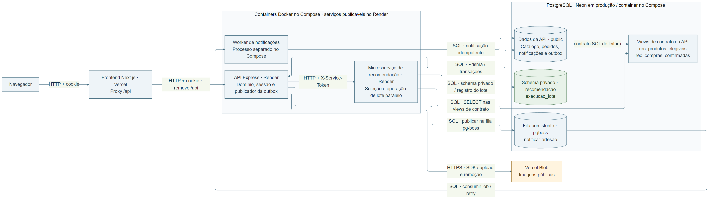

# Origem

[](https://github.com/devpedrois/Projeto-Integrador/actions/workflows/ci.yml)

Marketplace web full stack que conecta artesãos e produtores criativos de Pernambuco a compradores de todo o Brasil, dando visibilidade digital, canal de venda direto e valorização da origem, da técnica e da história de cada peça.

Projeto Integrador do 4º semestre de Análise e Desenvolvimento de Sistemas — **CESAR School**, 2026.2.

## Acesse a aplicação

**Frontend publicado:** <https://origem-marketplace.vercel.app/>

O frontend (Vercel) consome o backend real em Express (Render) com PostgreSQL (Neon). O navegador chama `/api/*` no próprio domínio da Vercel. O Next.js repassa essas chamadas ao backend, e a sessão fica num cookie `httpOnly` (`origem_sessao`).

**Documentação da API (Swagger):** `/api/docs` no domínio publicado (no backend, `GET /docs` e `GET /docs/openapi.json`).

Para avaliar os fluxos, use as credenciais sintéticas da carga demo (`backend/prisma/seeds/demo.ts`):

| Papel     | Email                         | Senha                          |
| --------- | ----------------------------- | ------------------------------ |
| Comprador | `ana.compradora@origem.test`  | `senha-sintetica-comprador`    |
| Comprador | `bruno.comprador@origem.test` | `senha-sintetica-comprador-02` |
| Artesão   | `joao.artesao@origem.test`    | `senha-sintetica-artesao`      |
| Artesã    | `maria.artesa@origem.test`    | `senha-sintetica-artesao-02`   |
| Admin     | `admin@origem.test`           | `senha-sintetica-admin`        |

> Os dados ficam no PostgreSQL e são compartilhados entre todos os visitantes: um pedido, uma avaliação ou uma moderação feita por um avaliador aparece para os outros. API e recomendação podem hibernar no Render. Siga a ordem de preparação descrita em [Deploy](#preparar-uma-demonstração).

**Branch principal:** `main` (cada push publica o frontend na Vercel).

> **Histórico (Avaliação 1):** na AV1 o frontend rodava com uma Fake API no navegador e `localStorage`. Esse modo ainda existe para desenvolvimento offline (`NEXT_PUBLIC_DATA_SOURCE=fake`), mas não é o modo publicado. Documentação em [`docs/fake-api.md`](docs/fake-api.md).

## O problema

Artesãos e produtores criativos têm pouca visibilidade digital, dependem de intermediários e têm gestão precária de catálogo, pedidos e estoque. Falta um canal que conecte essa produção a compradores destacando origem, técnica e o impacto de comprar direto de quem faz.

O projeto nasce com uma âncora real: a **Comunidade do Pilar** (Recife), com expansão possível para **Alto do Moura/Caruaru** e **Tracunhaém**.

## O que o produto faz

- **Vitrine do comprador** — busca, filtros, perfil do artesão, carrinho e avaliações.
- **Painel do artesão** — catálogo, estoque e gestão de pedidos.
- **Painel administrativo** — curadoria e indicadores da plataforma.
- **Recomendação de produtos** — módulo de IA exposto como serviço, consumido pela vitrine.
- **Indicadores de venda** para artesãos e administração.

Escopo deliberadamente controlado para caber em um semestre: poucas categorias, dados representativos/sintéticos, pagamento simulado (sem gateway real) e recomendação em nível didático antes de modelos sofisticados.

## Arquitetura

Monorepo com `frontend/`, `backend/` e `services/recomendacao/` independentes.
Frontend, API e recomendação comunicam-se por HTTP.
API e worker utilizam a fila persistente pg-boss.



Diagrama completo, com justificativa de cada componente e limites do deploy, em [`docs/arquitetura-distribuida.md`](docs/arquitetura-distribuida.md).

**Camadas do backend:** `routes` → `controllers` → `services` → `repositories`, com `middlewares` para cross-cutting concerns e `validators` para DTO/validação na borda (Zod). Padrões aplicados de forma pontual e justificada — Repository, Service layer, Strategy (integração de recomendação) e a chain de middlewares do Express — sem Clean Architecture completa, CQRS ou framework de DI, que não se justificam para o tamanho do projeto.

**Concorrência (FCCPD):** o ponto mais sensível do domínio é a baixa de estoque no checkout. A abordagem escolhida é lock pessimista explícito em transação (`SELECT ... FOR UPDATE`) em vez de update condicional otimista — mais simples de implementar, mas o lock explícito demonstra de forma mais didática o controle de concorrência que a disciplina avalia.

**Processamento assíncrono:** o checkout grava uma intenção transacional.
O publicador envia essa intenção ao pg-boss após commit.
Um consumidor com retry grava notificações idempotentes.
No Compose, ele executa em container próprio.
O modo integrado continua disponível com `RUN_WORKER_IN_API=true`.
Os limites e evidências estão no documento distribuído vinculado.

**Recomendação:** a vitrine utiliza o `HttpRecommendationAdapter`.
A API chama o microsserviço usando `X-Service-Token`.
A seleção consulta as views de contrato da API.
Quando necessário, a API aplica fallback local identificado.

## FCCPD — Parte 2

O relatório está organizado pelos itens da rubrica distribuída.

| Item exigido                                 | Documento ou implementação                                                               |
| -------------------------------------------- | ---------------------------------------------------------------------------------------- |
| Diagrama, responsabilidades e justificativas | [Arquitetura distribuída](docs/arquitetura-distribuida.md)                               |
| Propriedade dos dados e isolamento           | [Dados por serviço](docs/arquitetura-distribuida.md#dados-por-serviço-e-contrato-sql)    |
| Metodologia, resultados e interpretação      | [Relatório de desempenho](docs/relatorio-desempenho-u2.md)                               |
| Sequencial versus paralelo                   | [B2 histórico e após extração](docs/relatorio-desempenho-u2.md#b2-recomendações-em-lote) |
| Evidência funcional da comunicação           | [Capturas e logs correlacionados](evidencias/PI4-35/35.5-comunicacao/README.md)          |

Trecho paralelo do commit 14, `62991ad`:

- [`services/recomendacao/src/lote/pool.ts`](services/recomendacao/src/lote/pool.ts): `executarPool`, com concorrência limitada e `Promise.all`.
- [`services/recomendacao/src/lote/index.ts`](services/recomendacao/src/lote/index.ts): operação `gerarRecomendacoesEmLote`.
- [`services/recomendacao/scripts/metricas.ts`](services/recomendacao/scripts/metricas.ts): consumo real dessa operação.

Comunicação do commit 04, `8e17cab`, e commit 16, `001c6e7`:

- [`backend/src/integrations/recommendation/http-recomendacao.client.ts`](backend/src/integrations/recommendation/http-recomendacao.client.ts): `HttpRecomendacaoClient.obter`, HTTP autenticado e propagação do `X-Request-Id`.
- [`backend/src/middlewares/request-logging.middleware.ts`](backend/src/middlewares/request-logging.middleware.ts) e [`services/recomendacao/src/middlewares/request-logging.middleware.ts`](services/recomendacao/src/middlewares/request-logging.middleware.ts): logs REST correlacionados.
- [`backend/src/queues/notificacao.publisher.ts`](backend/src/queues/notificacao.publisher.ts): `publicarIntencoesPendentes`.
- [`backend/src/jobs/notificar-artesao.worker.ts`](backend/src/jobs/notificar-artesao.worker.ts): `registerNotificarArtesaoWorker` e registro do resultado.

Evidências do commit 16:

- [Estados e identificadores reais](evidencias/PI4-35/35.5-comunicacao/fluxos.json).
- [Vitrine e chamada REST](evidencias/PI4-35/35.5-comunicacao/01-vitrine-rest.png), [logs REST](evidencias/PI4-35/35.5-comunicacao/03-logs-rest.png).
- [Pedido confirmado](evidencias/PI4-35/35.5-comunicacao/02-checkout-confirmado.png), [logs e estados da fila](evidencias/PI4-35/35.5-comunicacao/04-logs-mensageria.png).
- [Log API](evidencias/PI4-35/35.5-comunicacao/logs-api.txt), [log recomendação](evidencias/PI4-35/35.5-comunicacao/logs-recomendacao.txt), [log worker](evidencias/PI4-35/35.5-comunicacao/logs-worker.txt).

O B2 comprova ganho no lote com os resultados preservados.
O salto HTTP apresenta custo na latência individual.
A separação permite isolamento de falha e deploy independente.
Também permite escalar o lote conforme as conexões disponíveis.
Valores e limites estão vinculados no relatório de desempenho.

## Decisões de stack

| Camada              | Escolha                                                                                                              | Por quê                                                                                                       |
| ------------------- | -------------------------------------------------------------------------------------------------------------------- | ------------------------------------------------------------------------------------------------------------- |
| Frontend            | Next.js (App Router) + React + TypeScript + Tailwind CSS                                                             | Padrão da disciplina de Desenvolvimento Web; SSR/roteamento por arquivos reduz boilerplate                    |
| Microsserviço       | Node.js + TypeScript + Express + `pg`                                                                                | Seleção de recomendações, Strategy e lote com deploy independente                                             |
| Containers          | Docker e Docker Compose                                                                                              | PostgreSQL, API, worker e recomendação locais, com preparação ordenada                                        |
| Backend             | Node.js + TypeScript + Express                                                                                       | Projeto separado do frontend, seguindo a stack de referência da disciplina (Express + Prisma + JWT)           |
| Banco de dados      | PostgreSQL (Neon)                                                                                                    | Serverless, branch de banco para testes de integração                                                         |
| ORM                 | Prisma                                                                                                               | Migrations versionadas e tipagem gerada a partir do schema                                                    |
| Fila assíncrona     | pg-boss                                                                                                              | Fila sobre o próprio Postgres — sem infra extra para atender ao critério de processamento assíncrono do FCCPD |
| Autenticação        | JWT (emitido pelo Express) + bcrypt + cookie `httpOnly`                                                              | Backend é projeto separado do frontend; descarta NextAuth                                                     |
| Storage de imagens  | Vercel Blob                                                                                                          | SDK/token funciona a partir de qualquer backend, independente de onde ele está hospedado                      |
| Deploy frontend     | Vercel                                                                                                               | Integração nativa com Next.js                                                                                 |
| Deploy recomendação | Render, Docker                                                                                                       | Serviço publicado separadamente da API                                                                        |
| Deploy backend      | Render (free tier)                                                                                                   | Processo persistente, compatível com fila e cache; sujeito a hibernação                                       |
| Testes              | Vitest e Testing Library (unitário e integração), Playwright (E2E), script dedicado com `Promise.all` (concorrência) | Cobre desde unidade até evidência de concorrência exigida pela rubrica de FCCPD                               |

Pagamento é sempre simulado — este projeto não integra nem deve integrar gateways de pagamento reais.

## Estrutura de pastas

```
Projeto integrador/
├── backend/                 # API Node.js + TypeScript (Express)
│   ├── src/
│   │   ├── routes/          # definição de endpoints
│   │   ├── controllers/     # entrada HTTP
│   │   ├── services/        # regras de negócio
│   │   ├── repositories/    # acesso a dados (Prisma)
│   │   ├── middlewares/     # cross-cutting concerns
│   │   ├── validators/      # DTO/validação na borda (Zod)
│   │   ├── queues/ e jobs/  # fila assíncrona (pg-boss)
│   │   ├── integrations/    # cliente HTTP de recomendação e storage
│   │   ├── docs/            # OpenAPI (Swagger)
│   │   ├── server.ts        # API + publicador da fila
│   │   └── worker.ts        # só consumidores da fila
│   ├── prisma/               # schema, migrations, seed demo e seed de volume
│   ├── scripts/              # concorrência, benchmarks, p95 da busca, métricas
│   └── tests/                # unit, integration e integridade (PostgreSQL real)
├── frontend/                # aplicação Next.js
│   ├── src/
│   │   ├── app/              # rotas (App Router)
│   │   ├── components/       # componentes por domínio de tela
│   │   ├── services/         # services; adapters HTTP (padrão) e Fake API (offline)
│   │   ├── fake-api/         # Fake API da Avaliação 1, mantida para dev offline
│   │   └── domain/, store/, hooks/, types/, validators/
│   └── e2e/                  # fluxos Playwright
├── services/
│   └── recomendacao/        # microsserviço HTTP e lote paralelo
│       ├── src/             # routes, controllers, services, repositories, strategies, lote
│       ├── migrations/      # schema privado da recomendação
│       ├── scripts/         # bootstrap, migrations, métricas e benchmarks
│       └── tests/           # PostgreSQL real e contratos
├── docker-compose.yml       # banco, preparação, API, worker e recomendação
├── .env.compose.example     # configuração fictícia dos containers
├── docs/                    # arquitetura, relatórios, matriz de aceitação, uso de IA
├── sprints/                 # entregáveis formais por sprint/checkpoint
└── README.md                # entrada para execução e deploy
```

## Como rodar localmente

Este caminho executa os quatro processos diretamente no computador.
Não exige Docker. O PostgreSQL deve estar previamente disponível.
Use um banco vazio de desenvolvimento, local ou no Neon.
Nunca execute o seed no banco publicado.

Pré-requisitos:

- Node.js 22.13 ou superior na linha 22 e npm.
- PostgreSQL 16 ou superior, com extensão `pg_trgm` disponível.
- Conexão administrativa nesse banco para migrations e criação dos papéis.
- PowerShell 7 para os comandos administrativos abaixo.
- Portas 3000, 3001 e 3002 disponíveis.

### 1. Instalar dependências e copiar exemplos

Clone o repositório e entre na pasta criada:

```powershell
git clone https://github.com/devpedrois/Projeto-Integrador.git
cd Projeto-Integrador
```

Execute na raiz:

```powershell
Push-Location backend
npm ci
if (!(Test-Path .env)) { Copy-Item .env.example .env }
Pop-Location

Push-Location services/recomendacao
npm ci
if (!(Test-Path .env)) { Copy-Item .env.example .env }
Pop-Location

Push-Location frontend
npm ci
if (!(Test-Path .env.local)) { Copy-Item .env.example .env.local }
Pop-Location
```

Não reutilize `.env` de outro integrante ou ambiente.
Preencha os arquivos copiados antes dos próximos passos:

| Arquivo                      | Configuração local                                                                                                                                                                                                                                                                                              |
| ---------------------------- | --------------------------------------------------------------------------------------------------------------------------------------------------------------------------------------------------------------------------------------------------------------------------------------------------------------- |
| `backend/.env`               | Inicialmente, `DATABASE_URL` e `DIRECT_URL` administrativas do mesmo banco vazio. Defina `JWT_SECRET` e `RECOMENDACAO_SERVICE_TOKEN` aleatórios e distintos. Mantenha `HOST=127.0.0.1`, `PORT=3001`, `RECOMENDACAO_URL=http://127.0.0.1:3002`, `FRONTEND_ORIGIN=http://localhost:3000` e `COOKIE_SECURE=false`. |
| `services/recomendacao/.env` | `DATABASE_URL` usará `recomendacao_app` após o bootstrap. Defina `API_SCHEMA=public`, `RECOMENDACAO_SCHEMA=recomendacao`, `HOST=127.0.0.1`, `PORT=3002` e o mesmo `RECOMENDACAO_SERVICE_TOKEN` da API.                                                                                                          |
| `frontend/.env.local`        | `NEXT_PUBLIC_DATA_SOURCE=http` e `BACKEND_URL=http://127.0.0.1:3001`.                                                                                                                                                                                                                                           |

Use segredos com pelo menos 32 caracteres alfanuméricos.
`BLOB_READ_WRITE_TOKEN` é opcional para executar o marketplace.
O upload de foto exige esse token exclusivamente no backend.

### 2. Preparar banco e dados sintéticos

Na raiz, execute:

```powershell
Push-Location backend
npm run prisma:generate
npm run db:migrate
npm run db:seed
Pop-Location
```

As migrations criam também as duas views de contrato.
O seed cria as contas demo apresentadas no início.
Ele reaplica senhas e estoque dos registros sintéticos existentes.

### 3. Criar papéis e preparar a recomendação

Execute uma vez no banco de desenvolvimento escolhido.
As entradas mascaradas não ficam no histórico de comandos:

```powershell
Push-Location services/recomendacao
$env:BOOTSTRAP_DATABASE_URL = Read-Host -MaskInput "URL administrativa do banco de desenvolvimento"
$env:RECOMENDACAO_DATABASE_PASSWORD = Read-Host -MaskInput "Senha nova de recomendacao_app, 32+ caracteres"
$env:API_DATABASE_PASSWORD = Read-Host -MaskInput "Senha nova de origem_api_app, 32+ caracteres"
$env:API_DATABASE_ROLE = "origem_api_app"
$env:API_QUEUE_SCHEMA = "pgboss"
npm run bootstrap:permissoes
Remove-Item Env:BOOTSTRAP_DATABASE_URL, Env:RECOMENDACAO_DATABASE_PASSWORD, Env:API_DATABASE_PASSWORD, Env:API_DATABASE_ROLE, Env:API_QUEUE_SCHEMA
Pop-Location
```

O bootstrap deve informar `Permissions configured.`.
Se já existir uma fila com outro dono, pare.
Revise a transferência no [guia do microsserviço](services/recomendacao/README.md#instalação-permissões-e-migrations).

Agora ajuste os arquivos, preservando banco e endereço:

- Em `backend/.env`, troque `DATABASE_URL` para `origem_api_app` e sua senha.
- Preserve `DIRECT_URL` administrativa para os comandos Prisma.
- Defina `PG_BOSS_CREATE_SCHEMA=false` e `RUN_WORKER_IN_API=false` no backend.
- Em `services/recomendacao/.env`, configure `DATABASE_URL` com `recomendacao_app` e sua senha.
- As URLs restritas usam o mesmo banco das migrations.

Aplique a migration privada com o papel da recomendação:

```powershell
Push-Location services/recomendacao
npm run migrate
Pop-Location
```

O comando deve informar `Migrations applied.`.
As variáveis administrativas não devem permanecer no terminal de runtime.

### 4. Iniciar os quatro processos

Abra quatro terminais, todos iniciados na raiz:

| Terminal         | Comandos                                         |
| ---------------- | ------------------------------------------------ |
| Microsserviço    | `cd services/recomendacao`, depois `npm run dev` |
| API e publicador | `cd backend`, depois `npm run dev:api`           |
| Worker           | `cd backend`, depois `npm run dev:worker`        |
| Frontend         | `cd frontend`, depois `npm run dev`              |

Aguarde o microsserviço antes de abrir a vitrine.
Confira as respostas em outro terminal:

```powershell
curl.exe --fail http://127.0.0.1:3002/health
curl.exe --fail http://127.0.0.1:3001/health
curl.exe --fail http://localhost:3000/api/health
curl.exe --fail http://localhost:3000/api/recomendacoes
```

Abra [a vitrine local](http://localhost:3000).
Confirme produtos e recomendações vindos da API real.
O worker não tem endpoint HTTP; acompanhe seu terminal.
Após um pedido demo, confira o evento JSON do worker.
Ele informa `servico`, `job`, `pedidoId`, `tentativa` e `resultado`.
O resultado `sucesso` confirma o processamento daquele pedido.

Para usar apenas três terminais, defina `RUN_WORKER_IN_API=true`.
Nesse caso, não inicie um worker separado.
Finalize cada processo usando `Ctrl+C` no respectivo terminal.

Sem `NEXT_PUBLIC_DATA_SOURCE`, o modo padrão permanece `fake`.
Esse modo offline histórico não valida a integração full stack.
No modo `http`, erros nunca trocam para Fake API.
Reinicie Next.js após alterar suas variáveis.

Detalhes: [backend](backend/README.md#execução-local) e
[microsserviço](services/recomendacao/README.md#instalação-permissões-e-migrations).
O resultado da reprodução está nas [evidências da 34.5](evidencias/PI4-34/34.5/README.md).

## Executar com Docker

Requisitos: Docker Engine e Compose v2 atualizado.
No Windows, use Docker Desktop com containers Linux.
Execute os comandos seguintes na raiz do repositório.

Copie o exemplo apenas quando `.env.compose` não existir:

```bash
cp -n .env.compose.example .env.compose
export COMPOSE_ENV_FILES=.env.compose
```

No PowerShell:

```powershell
if (!(Test-Path .env.compose)) { Copy-Item .env.compose.example .env.compose }
$env:COMPOSE_ENV_FILES = ".env.compose"
```

Troque as senhas e tokens fictícios antes de iniciar.
Use senhas alfanuméricas com pelo menos 32 caracteres.
Este Compose usa essas senhas diretamente nas URLs locais.
Nunca versione `.env.compose`.
`COMPOSE_ENV_FILES` seleciona esse arquivo para interpolação do Compose.
Alternativamente, informe `--env-file .env.compose` em cada comando.

```bash
docker compose up --build
```

Em outro terminal, selecione o mesmo arquivo de ambiente.
Confira a preparação, os serviços e a saúde:

```bash
docker compose ps --all
curl http://127.0.0.1:3001/health
docker compose logs -f postgres
docker compose logs -f migrate recomendacao-setup
docker compose logs -f api
docker compose logs -f worker
docker compose logs -f recomendacao
```

`migrate` aplica migrations, views e o seed demo compilado.
`recomendacao-setup` cria os papéis e aplica migrations privadas.
Ambos encerram com código zero.
Postgres, API, worker e recomendação devem aparecer saudáveis.
O worker verifica processo e acesso à fila PostgreSQL.
Ele não abre uma porta HTTP.
Os demais serviços usam seus healthchecks próprios.

A API publica intenções, com `RUN_WORKER_IN_API=false`.
Somente o worker consome os jobs e registra o resultado.
Confira `servico`, `job`, `pedidoId`, `tentativa` e `resultado` no JSON.
O log inclui `pedidoId`, sem credenciais ou dados pessoais.
Para demonstrar, pare o worker antes de criar um pedido:

```bash
docker compose stop worker
# Crie o pedido pelo frontend ou Swagger em http://127.0.0.1:3001/docs.
docker compose start worker
docker compose logs -f worker
```

Apenas a API publica porta, limitada ao loopback local.
Postgres e recomendação ficam na rede padrão do Compose.
A API chama `http://recomendacao:3002` com token interno.
API e worker usam `origem_api_app`, sem privilégios administrativos.
O bootstrap cria o schema `pgboss` para esse papel.
`PG_BOSS_CREATE_SCHEMA=false` evita exigir criação de schemas no runtime.
A recomendação usa somente `recomendacao_app`.
Conexões administrativas existem apenas nos serviços de preparação.
As imagens recebem segredos somente durante a execução.

As dependências são instaladas com `npm ci`.
As bases usam Alpine 3.24 e o binário oficial Node 22.
O npm 12.2.1 recebe undici 6.29.1 para corrigir alertas herdados.
O target `migrate` mantém o Prisma CLI para migrations.
API e worker recebem apenas dependências de produção.
O seed executa JavaScript compilado, sem `tsx`.
Na imagem da recomendação, os scripts npm executam JavaScript compilado.
Instalações locais preservam os scripts TypeScript existentes.

O volume nomeado preserva os dados entre execuções.
O init instala `pg_trgm` somente ao criar o banco.
Recriar `migrate` reaplica o seed e seus dados sintéticos.
Isso inclui senhas demo e estoque dos produtos demo.
Alterar senhas administrativas exige atualizar o banco existente.
Para uma demonstração descartável, recrie o volume conscientemente.

Para encerrar preservando dados:

```bash
docker compose down
```

Para remover também todos os dados locais desta demonstração:

```bash
docker compose down --volumes
```

### Frontend local com a API dos containers

Requer Node.js e npm instalados no computador.
O frontend permanece fora do Compose.
Execute em outro terminal:

```bash
cd frontend
npm ci
cp -n .env.example .env.local
npm run dev
```

No PowerShell, copie sem sobrescrever configurações existentes:

```powershell
if (!(Test-Path .env.local)) { Copy-Item .env.example .env.local }
```

Se `.env.local` existir, confira estes valores:

```dotenv
NEXT_PUBLIC_DATA_SOURCE=http
BACKEND_URL=http://127.0.0.1:3001
```

Reinicie Next.js após alterar essas variáveis.
Abra `http://localhost:3000` para usar a vitrine.
As recomendações percorrem frontend, API e microsserviço real.
`COOKIE_SECURE=false` permite o cookie no HTTP local.
O Compose não altera o deploy Neon ou Render.

### Primeiro uso e diagnóstico

O volume inicial deve estar vazio para esta reprodução.
O banco do Compose é independente do Neon configurado localmente.
Não copie `DATABASE_URL` do Neon para `.env.compose`.
O Compose constrói as URLs internas com seus próprios papéis.

Se a porta 3001 estiver ocupada, encerre sua API local.
Encerre também o frontend anterior antes de abrir outro Next.js.
Não inicie os processos nativos e os containers simultaneamente.
Reutilize o frontend local somente após conferir `BACKEND_URL`.

Em um primeiro acesso, aguarde compilação e preparação completas.
Se `migrate` ou `recomendacao-setup` falharem, examine seus logs.
Corrija a configuração antes de reiniciar os serviços dependentes.
Não remova volumes existentes para contornar erros sem revisar dados.

O [teste da cópia limpa](evidencias/PI4-34/34.5/README.md)
registra instalação, preparação, saúde e chamadas pelo proxy frontend.

### Verificação automatizada da demonstração

Após instalar as dependências locais do backend:

```bash
node --test backend/tests/docker/compose.smoke.mjs
node --test backend/tests/docker/base-security.mjs
docker history --no-trunc origem-backend:local
docker history --no-trunc origem-recomendacao:local
```

O teste usa o projeto isolado `origem-35-3-smoke`.
Ele reserva a porta 3001 e usa valores fictícios.
Verifica saúde, isolamento SQL, runtime e processamento pelo worker.
Deixa os containers ativos para inspeção das evidências.
Para encerrá-los, acrescente `-p origem-35-3-smoke` ao Compose.
O teste da base exige Docker Scout e acesso ao registry.
Ele rejeita vulnerabilidades altas ou críticas na imagem-base.

## Deploy

Há três serviços publicados, com bancos no PostgreSQL Neon.
As configurações abaixo refletem os arquivos e a implantação registrada.
Não foi realizado novo deploy nesta consolidação documental.

| Serviço       | Hospedagem e raiz                                | Build                                                                                  | Start                               | Verificação de saúde                                                |
| ------------- | ------------------------------------------------ | -------------------------------------------------------------------------------------- | ----------------------------------- | ------------------------------------------------------------------- |
| Frontend      | Vercel, `frontend/`                              | Instalação `npm ci`; build `npm run build`                                             | Gerenciado pela Vercel para Next.js | `/` abre a interface; `/api/health` verifica o encaminhamento à API |
| API           | Render, `backend/`, runtime Node                 | `npm ci --include=dev && npm run build`                                                | `npm run start:prod`                | `GET /health`, com resposta 200 e banco acessível                   |
| Microsserviço | Render, `services/recomendacao/`, runtime Docker | `Dockerfile` desta pasta; compilação `npm run build -- --project tsconfig.docker.json` | `npm start`, pelo `CMD` da imagem   | `GET /health`, público e com acesso PostgreSQL verificado           |

Frontend publicado: [Origem na Vercel](https://origem-marketplace.vercel.app/).
Healths publicados: [API](https://projeto-integrador-v1vf.onrender.com/health)
e [recomendação](https://origem-recomendacao.onrender.com/health).
As rotas da API continuam sem prefixo `/api`.
O navegador usa esse prefixo somente pelo proxy Next.js.

### Variáveis por serviço

A lista contém apenas nomes, sem valores ou credenciais.
Os valores pertencem aos painéis e ambientes de cada serviço.

| Serviço                                                    | Nomes das variáveis                                                                                                                                                                                                                                                                                                    |
| ---------------------------------------------------------- | ---------------------------------------------------------------------------------------------------------------------------------------------------------------------------------------------------------------------------------------------------------------------------------------------------------------------- |
| Frontend Vercel                                            | `BACKEND_URL`, `NEXT_PUBLIC_DATA_SOURCE`                                                                                                                                                                                                                                                                               |
| API Render                                                 | `DATABASE_URL`, `DIRECT_URL`, `NODE_ENV`, `HOST`, `PORT`, `JWT_SECRET`, `FRONTEND_ORIGIN`, `COOKIE_SECURE`, `CACHE_TTL_SECONDS`, `RECOMENDACAO_URL`, `RECOMENDACAO_SERVICE_TOKEN`, `RECOMENDACAO_TIMEOUT_MS`, `RUN_WORKER_IN_API`, `PG_BOSS_CREATE_SCHEMA`, `NOTIFICATION_PUBLISHER_INTERVAL_MS`, `WORKER_CONCURRENCY` |
| API, upload opcional                                       | `BLOB_READ_WRITE_TOKEN`                                                                                                                                                                                                                                                                                                |
| Microsserviço Render                                       | `DATABASE_URL`, `API_SCHEMA`, `RECOMENDACAO_SCHEMA`, `NODE_ENV`, `HOST`, `PORT`, `RECOMENDACAO_SERVICE_TOKEN`                                                                                                                                                                                                          |
| Preparação administrativa, fora do runtime da recomendação | `BOOTSTRAP_DATABASE_URL`, `RECOMENDACAO_DATABASE_PASSWORD`, `API_DATABASE_ROLE`, `API_DATABASE_PASSWORD`, `API_QUEUE_SCHEMA`                                                                                                                                                                                           |

O Render fornece `PORT` aos Web Services.
O frontend utiliza o modo HTTP na implantação publicada.
A conexão da API usa o papel restrito do domínio.
A recomendação usa seu próprio papel, limitado às views contratuais.
As conexões administrativas ficam restritas às migrations e preparação.
O token interno deve coincidir entre API e microsserviço.
Ele deve ser diferente do segredo de sessão JWT.
A API publicada mantém o consumidor integrado ao seu processo.
O worker separado é a composição local comprovada pelo Compose.

### Ordem das migrations e publicação

1. Prepare as migrations da API no Neon escolhido.
   `start:prod` executa `prisma migrate deploy` antes do HTTP.
   O build não aplica migrations; o start não executa seed.
   Uma falha de migration impede a inicialização da API.
2. Execute o bootstrap administrativo da recomendação naquele mesmo banco.
   Ele aplica papéis, grants, views acessíveis e schema privado.
3. Execute `npm run migrate` com o papel da recomendação.
   Aplique essa preparação antes do primeiro deploy Docker do serviço.
   O `npm start` da recomendação não executa migrations automaticamente.
4. Publique o microsserviço e aguarde seu health retornar 200.
5. Configure a integração na API e publique sua versão.
   Confirme o health da API antes de publicar o frontend.
6. Configure o destino do proxy na Vercel e publique.
   Confira `/api/health`, sessão, catálogo e recomendações pelo navegador.

Em uma implantação inicial, aplique as migrations da API antecipadamente.
Isso cria as views exigidas pelo bootstrap do microsserviço.
A configuração final evita dependência circular durante essa preparação.

Passos completos: [API no Render](backend/README.md#deploy-no-render)
e [microsserviço no Render](services/recomendacao/README.md#deploy-no-render).
A [evidência da 35.4](evidencias/PI4-35/35.4-deploy-render/README.md)
registra os serviços e o isolamento publicados.

### Preparar uma demonstração

Serviços gratuitos podem hibernar durante períodos sem tráfego.
Antes da demonstração, siga esta ordem:

1. Acesse o health do microsserviço e aguarde 200.
2. Acesse o health da API e aguarde 200.
3. Abra a vitrine publicada e confira `/api/health`.
4. Abra um produto e confirme o carrossel preenchido.
   Confira a estratégia retornada na aba Network do navegador.
   `fallback-local` indica degradação, exigindo conferir a integração.
5. Faça um pedido demo e acompanhe os logs da API.
   No deploy integrado, o processamento do worker aparece nesse processo.

Health da API confirma o banco, sem comprovar todo o fluxo.
O carrossel e os logs complementam essa verificação operacional.

## Integração contínua

O workflow `CI` executa em cada push e pull request.
Frontend e backend usam Node.js 22 e caches npm separados.
O frontend passa por lint, typecheck, testes e build.
Seus testes de contrato exigem dependências e tipos do backend.
Essa preparação gera o Prisma sem conexão ou credenciais.
O backend gera o Prisma, aplica migrations e executa verificações.
Prazos padrão na CI: 60s/teste e 120s/preparação.
O job backend tem limite total de 30 minutos.

Configure estes repository secrets em **Settings → Secrets and variables → Actions**:

| Secret              | Valor                                             |
| ------------------- | ------------------------------------------------- |
| `DATABASE_URL_TEST` | Conexão PostgreSQL da branch Neon exclusiva de CI |
| `DIRECT_URL_TEST`   | Conexão direta da mesma branch, sem pooler        |

O `JWT_SECRET` é gerado com `openssl rand` no job backend.
As credenciais ficam restritas ao job backend e são mascaradas.
Pull requests de forks não recebem os secrets do repositório.
Nesse caso, o backend informa somente a variável ausente.

A CI não executa scripts de concorrência, benchmarks ou seed de volume.
Também exclui quatro testes de integração que acionam essas cargas:
`concorrencia-script`, `db-explain`, `recomendacao-volume` e `seed-volume`.
Os demais testes unitários e de integração permanecem incluídos.
A suíte local completa continua disponível com `npm test`.

## Testes de FCCPD

Seção dedicada aos dois critérios centrais da rubrica de FCCPD — controle de concorrência no checkout e fila assíncrona — com o que rodar para gerar evidência real, não só descrita.

Pré-requisito: backend configurado (`npm ci`, `npm run prisma:generate`, `DATABASE_URL` setada) — ver [Como rodar localmente](#como-rodar-localmente).

### Concorrência no checkout (lock pessimista)

Valida que `SELECT ... FOR UPDATE` impede overselling quando dois pedidos concorrem pelo mesmo item em estoque.

```bash
cd backend
npm test -- tests/integration/pedidos.integration.test.ts
npm run test:concorrencia   # scripts/concorrencia-checkout.ts — sobe o servidor real e dispara requisições HTTP concorrentes
```

`test:concorrencia` é o script de evidência exigido pela rubrica: cria produto/estoque, dispara `POST /pedidos` simultâneos de verdade contra o servidor e falha se qualquer rodada permitir estoque negativo. A saída do terminal (rounds + falhas) é a evidência a anexar na entrega.

### Fila assíncrona (pg-boss)

Valida publicação, processamento idempotente, retry e desacoplamento do job de notificação ao artesão.

```bash
cd backend
npm test -- tests/integration/fila-notificacao.integration.test.ts
npm test -- tests/integration/notificacao-auto-publish.integration.test.ts
npm test -- tests/integration/server-queue-bootstrap.integration.test.ts
```

| Teste                                          | O que cobre                                                                       |
| ---------------------------------------------- | --------------------------------------------------------------------------------- |
| `fila-notificacao.integration.test.ts`         | Publicação do job, handler idempotente, retry após falha simulada                 |
| `notificacao-auto-publish.integration.test.ts` | Publicação automática da intenção de notificação a partir de um pedido confirmado |
| `server-queue-bootstrap.integration.test.ts`   | Bootstrap da fila (`boss.start()` + worker registrado) na subida real do servidor |

Implementação em `backend/src/queues/` (publisher, cliente pg-boss) e `backend/src/jobs/` (handler + worker do job `notificar-artesao`).

### Rodar tudo de uma vez

```bash
cd backend
npm test          # suíte completa (unit + integration), inclui os testes acima
npm run typecheck
npm run lint
```

## Documentação

| Documento                                                                                                  | Conteúdo                                                       |
| ---------------------------------------------------------------------------------------------------------- | -------------------------------------------------------------- |
| [`docs/arquitetura-distribuida.md`](docs/arquitetura-distribuida.md)                                       | Microsserviço, worker, protocolos, dados por serviço e limites |
| [`docs/cache-u2.md`](docs/cache-u2.md)                                                                     | Cache público, indicadores privados, invalidação e medições    |
| [`docs/modulo-recomendacao-u2.md`](docs/modulo-recomendacao-u2.md)                                         | Contratos, Strategies, fallback, lote e métricas               |
| [`docs/concorrencia-checkout-u2.md`](docs/concorrencia-checkout-u2.md)                                     | Sequência do checkout, `FOR UPDATE` e ordenação de locks       |
| [`docs/relatorio-desempenho-u2.md`](docs/relatorio-desempenho-u2.md)                                       | Checkout, busca, B2 sequencial/paralelo e custo do salto HTTP  |
| [`docs/indices-u2.md`](docs/indices-u2.md)                                                                 | Índices analisados com `EXPLAIN`, retidos e descartados        |
| [`docs/metricas-recomendacao-u2.md`](docs/metricas-recomendacao-u2.md)                                     | Métricas v0 da recomendação na massa de 1.000 produtos         |
| [`docs/matriz-aceitacao-u2.md`](docs/matriz-aceitacao-u2.md)                                               | Critérios de aceite × teste × resultado                        |
| [`docs/refatoracoes-u2.md`](docs/refatoracoes-u2.md)                                                       | Refatorações justificadas da U2                                |
| [Relatório de testes da Sprint 12–13](evidencias/PI4-31-W12-Testes-Executados/31.6-relatorio/00-resumo.md) | Resumo versionado e resultados da entrega histórica            |
| [`docs/fake-api.md`](docs/fake-api.md)                                                                     | Fake API da Avaliação 1 (histórico; hoje só para dev offline)  |
| [`docs/uso-de-ia.md`](docs/uso-de-ia.md)                                                                   | Declaração de uso de IA no desenvolvimento                     |

## Declaração de uso de IA

O uso de ferramentas de IA no desenvolvimento do projeto está declarado em [`docs/uso-de-ia.md`](docs/uso-de-ia.md).

## Disciplinas envolvidas

O Projeto Integrador é avaliado por 6 disciplinas do semestre, cada uma responsável por uma fatia do sistema. O bloco do PI vale no mínimo 40% da nota de cada unidade nas disciplinas técnicas.

| Disciplina                                                                | Papel no projeto                                                                                                                              |
| ------------------------------------------------------------------------- | --------------------------------------------------------------------------------------------------------------------------------------------- |
| **Desenvolvimento Web**                                                   | Constrói a aplicação full stack — frontend responsivo e backend (API, regras de negócio) — integrando as contribuições das demais disciplinas |
| **Modelagem e Projeto de Banco de Dados**                                 | Projeta e implementa o banco (modelo conceitual, lógico e físico), normalização e índices                                                     |
| **Requisitos, Projeto de Software e Validação**                           | Análise de domínio, requisitos, arquitetura (SOLID/GRASP/padrões) e estratégia de testes                                                      |
| **Fundamentos de Computação Concorrente, Paralela e Distribuída (FCCPD)** | Controle de concorrência no checkout/estoque e processamento assíncrono via fila                                                              |
| **Engenharia de Software e IA** (eletiva)                                 | Módulo de recomendação de produtos, exposto como serviço consumido pela Web                                                                   |
| **Projeto 4**                                                             | Acompanha processo, organização e integração entre as disciplinas — não avalia mérito técnico                                                 |

## Time

| Integrante          | GitHub                                                   |
| ------------------- | -------------------------------------------------------- |
| Pedro Monteiro      | [@devpedrois](https://github.com/devpedrois)             |
| Andrews Queiroz     | [@4ndrewss](https://github.com/4ndrewss)                 |
| Ricardo Severiano   | [@byteric](https://github.com/byteric)                   |
| Eduardo Borges      | [@Eduardo-Borges18](https://github.com/Eduardo-Borges18) |
| Eliziane Mota       | [@Lizimota](https://github.com/Lizimota)                 |
| Luiz Henrique Rocha | [@Luizrocha0](https://github.com/Luizrocha0)             |
| Sérgio Chousinho    | [@sergiochou](https://github.com/sergiochou)             |
| Luiza Vieira        | [@vbluuiza](https://github.com/vbluuiza)                 |

## Licença

Projeto acadêmico desenvolvido para o Projeto Integrador da CESAR School. Sem licença de uso comercial.
