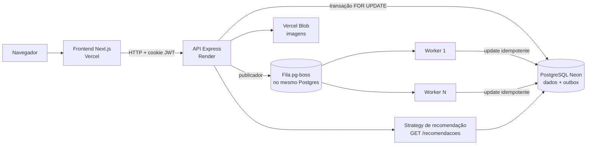
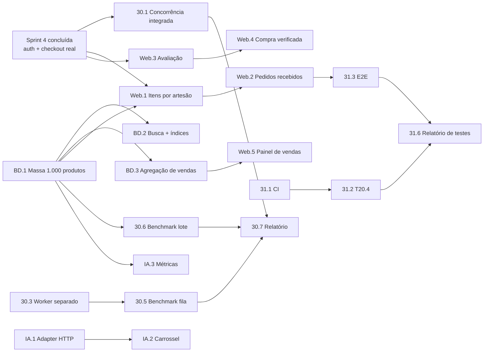

# Origem — Tickets-pai e Subtarefas no Jira (Sprint "Week 12e13", 19/10–30/10/2026)
**Sprint:** Semanas 12–13 (Sprint 5 do backlog SMART) · **Unidade:** 02 · **Checkpoint oficial:** semana 13
**Uso:** definição dos tickets-pai da sprint no Jira, das disciplinas ligadas a cada um, das subtarefas com descrição/evidência e do planejamento dia a dia. Base para a lista de prompts de execução da sprint.
**Status:** ✅ **Sprint concluída** (encerrada em 30/10/2026, confirmado pelo Pedro em 02/11/2026). Resultado por subtarefa e pendências herdadas pela Sprint 6 na **§7 — Fechamento da sprint**. Planejamento original gerado em 18/10/2026 a partir de `sprints/semana-02-03/02-Historias-de-Usuario.md` §4 (Sprint 5), `CLAUDE.md` §3 (critérios de U2) e §4 (entregáveis oficiais das Semanas 12–13), `docs/docs auxiliares/CONCURRENCY.md`, `docs/docs auxiliares/RECOMMENDATION.md` e do quadro "Week 12e13" do Jira (PI4-30, PI4-31).

> **Por que 5 tickets-pai e não 2.** O quadro tem hoje só PI4-30 (FCCPD) e
> PI4-31 (REQ), que cobrem os entregáveis oficiais do cronograma do PI
> (diagrama distribuído, benchmark, testes e refatorações). As 13 tarefas
> SMART da Sprint 5 são majoritariamente de **Web**, **BD** e **IA** e não
> cabem nesses dois tickets sem distorcer o que cada disciplina avalia. Por
> isso a proposta cria **3 tickets-pai novos**, mantendo a convenção
> "W12-<entrega> (<disciplina>)", tipo História, versão corrigida
> "Unidade 02", vinculados ao épico de U2 de cada disciplina.

> **Pré-condição da sprint — atendida.** A Sprint 4 (Semanas 10–11, backend
> real) foi **concluída**, confirmado pelo Pedro em 18/10/2026. Esta sprint
> parte, portanto, de autenticação JWT (T02.3/T02.4), autorização por papel e
> propriedade (T04.4, T05.3, T17.3), `POST /pedidos` integrado ao checkout
> real com revalidação de estoque (T12.2) e pagamento na mesma transação
> (T20.2) já disponíveis.

> **Decisão de 18/10/2026 — paralelismo do PI4-30:** os **dois benchmarks**
> entram na sprint (30.5 fila com consumidores concorrentes e 30.6 cálculo de
> recomendações em lote), ambos reaproveitando o que já existe no backend
> (fila `pg-boss` e `scripts/metricas-recomendacao.ts`). O 30.6 deixa de ser
> corte possível.

---

## Visão geral

| Ticket-pai | Status no Jira | Disciplina avaliadora | Também alimenta | Subtarefas | Esforço | Prioridade |
|---|---|---|---|---|---|---|
| **PI4-30** W12-Arquitetura distribuída e paralelismo (FCCPD) | Já existe | FCCPD | Web (checkout), REQ (evidências) | 7 | 37h | Must |
| **PI4-31** W12-Testes executados (REQ) | Já existe | Requisitos/Projeto de Software e Validação | Web, BD, FCCPD | 6 | 22h | Must |
| **NOVO** W12-Índices e consultas otimizadas (BD) | Criar | Modelagem e Projeto de BD | Web (busca, painel), IA | 4 | 18h | Must |
| **NOVO** W12-Fluxos do artesão e avaliações (WEB) | Criar | Desenvolvimento Web | BD, IA (avaliações são insumo da recomendação) | 6 | 29h | Must/Should |
| **NOVO** W12-Recomendação integrada via API (IA) | Criar | Eng. de Software e IA | Web | 3 | 11h | Should |
| **Total** | | | | **26** | **117h** | |

**Rastreabilidade com o backlog SMART:** as 13 tarefas da Sprint 5 (71h) estão todas distribuídas abaixo. As 46h restantes são subtarefas novas, sem T-número, que cobrem critérios de U2 que o backlog SMART não previa: diagrama distribuído, benchmark de paralelismo, separação do worker, E2E, CI, refatorações e métricas de IA.

**Capacidade.** 117h em 2 semanas equivalem a ~7h por pessoa por semana com os 8 integrantes. Se a carga continuar concentrada no Pedro, **o corte recomendado está marcado como "Corte possível"** em cada tabela (soma ~7h: parte do E2E e a foto de perfil), sem perder nenhum critério Must das rubricas. Os dois benchmarks do PI4-30 não entram no corte.

---

## 1. PI4-30 — W12-Arquitetura distribuída e paralelismo (FCCPD) *(já existe)*

**Disciplina:** FCCPD (U2: "separação coerente de módulos/serviços; paralelismo com ganho comprovado; desempenho avaliado").
**Épico:** FCCPD - Arquitetura distribuída (já vinculado, PI4-9).

**Descrição do ticket-pai (colar no Jira):**

> Evoluir o backend mínimo de concorrência entregue na U1 para a arquitetura
> distribuída da U2. O controle de concorrência do checkout (`SELECT ... FOR
> UPDATE`) passa a operar sobre o fluxo real autenticado; o worker da fila
> `pg-boss` vira um processo separado da API, permitindo escalar
> consumidores de forma independente; e o ganho de paralelismo é comprovado
> por benchmark com números (tempo total, throughput, speedup), sem perda de
> consistência (zero estoque negativo, zero job duplicado).
>
> **Definição de pronto:** diagrama de arquitetura distribuída e diagrama de
> sequência do checkout publicados em `docs/`; script de concorrência
> rodando contra o checkout integrado em 3 rodadas; 2 benchmarks de
> paralelismo com relatório e logs anexados; `docs/uso-de-ia.md` atualizado.

| # | Subtarefa | Descrição | Evidência | h | Origem | Semana |
|---|---|---|---|---|---|---|
| 30.1 | T12.3 — Concorrência no checkout integrado | Adaptar `backend/scripts/concorrencia-checkout.ts` para o fluxo real: 50 compradores sintéticos autenticados (JWT de cada um gerado no setup) disparando `POST /pedidos` em `Promise.all` contra 1 produto com estoque 1. Reiniciar a massa a cada rodada. Validar: exatamente 1 × 201, 49 × 409, estoque final 0, 1 pedido e 1 pagamento criados. | Log das 3 rodadas + consulta SQL final (estoque, contagem de pedidos e pagamentos) | 12 | SMART | 12 |
| 30.2 | T12.4 — Diagrama de sequência e justificativa da concorrência | Diagrama de sequência (Mermaid → PNG) do checkout: comprador → API → transação (locks em ordem de ID, validação, decremento, pedido, pagamento, intenção de notificação) → commit → publicador → fila → worker. Duas páginas justificando `FOR UPDATE` vs. update condicional e a ordenação de locks contra deadlock. | `docs/concorrencia-checkout-u2.md` + PNG do diagrama | 4 | SMART | 13 |
| 30.3 | Worker da fila como processo separado | Criar entrypoint `backend/src/worker.ts` que sobe só o `pg-boss` e registra os handlers; `server.ts` passa a subir só API + publicador. Flag de ambiente `RUN_WORKER_IN_API=true` mantém o modo in-process para o deploy, caso o plano gratuito do Render não ofereça processo de background (confirmar no painel antes de decidir). Scripts `npm run start:api` e `npm run start:worker`. | Print dos dois processos rodando em terminais separados + log de um pedido criado na API e processado no worker | 4 | Novo | 12 |
| 30.4 | Diagrama de arquitetura distribuída | Diagrama de componentes/implantação: Frontend (Vercel) → API Express (Render) → PostgreSQL Neon (dados + fila `pg-boss` + outbox `IntencaoNotificacao`) ← Worker(s); módulo de recomendação como Strategy atrás de `GET /recomendacoes`; Vercel Blob para imagens. Justificar por que **não** há microsserviços adicionais (escopo controlado, risco já mapeado no `CLAUDE.md` §5). Rascunho inicial abaixo. | `docs/arquitetura-distribuida.md` + PNG | 3 | Novo | 12 |
| 30.5 | Benchmark B1 — consumidores concorrentes da fila | Enfileirar 1.000 jobs `notificar-artesao` e medir o tempo até todos ficarem `processada` com 1, 2 e 4 processos worker (subtarefa 30.3). O handler simula a latência de um canal externo via `NOTIFICACAO_LATENCIA_MS=200`, documentado explicitamente como simulação. 5 rodadas por configuração, reportar mediana, throughput (jobs/s), speedup e eficiência. Conferir que nenhuma intenção foi processada duas vezes. | `evidencias/PI4-30/benchmark-fila/` com CSV bruto, tabela/gráfico e consulta de unicidade | 6 | Novo | 13 |
| 30.6 | Benchmark B2 — cálculo de recomendações em lote | O script `backend/scripts/metricas-recomendacao.ts` roda a Strategy para cada produto elegível em sequência. Criar versão com pool de concorrência limitada (1, 4 e 8 consultas simultâneas, limitada pelo pool de conexões do Prisma) sobre a massa de 1.000 produtos (subtarefa BD.1). Mesmas métricas do B1 e verificação de que o resultado é idêntico ao sequencial. | CSV + tabela/gráfico + diff do resultado sequencial × paralelo | 5 | Novo | 13 |
| 30.7 | Relatório de desempenho + declaração de uso de IA | Consolidar 30.1, 30.5 e 30.6 em `docs/relatorio-desempenho-u2.md` (ambiente, metodologia, números, limitações). Atualizar `docs/uso-de-ia.md` com o uso de IA desta sprint. | Os dois documentos commitados | 3 | Novo | 13 |

*Total: 7 subtarefas · 37h (os dois benchmarks são obrigatórios — decisão de 18/10/2026).*

**Rascunho para 30.4 (refinar durante a subtarefa):**

---

## 2. PI4-31 — W12-Testes executados (REQ) *(já existe)*

**Disciplina:** Requisitos, Projeto de Software e Validação (U2: "testes executados, não só descritos; refatorações justificadas; aderência aos critérios de aceitação").
**Épico:** REQ - Validação, testes e refatoração (já vinculado).

**Descrição do ticket-pai (colar no Jira):**

> Comprovar, com execução real e registros, que a aplicação atende aos
> critérios de aceitação das histórias Must/Should. Cobre os quatro níveis da
> estratégia de testes oficializada em 31/08/2026: unitário, integração
> (Postgres real), E2E (Playwright) e concorrência. Todos rodam
> automaticamente no CI a cada push. Inclui refatorações feitas no período,
> cada uma com motivo, antes/depois e testes verdes como garantia.
>
> **Definição de pronto:** pipeline de CI verde no `main`; teste de
> integração do checkout → pagamento; ao menos 2 fluxos E2E; matriz critério
> de aceite × teste × resultado; relatório de execução com logs; registro de
> refatorações.

| # | Subtarefa | Descrição | Evidência | h | Origem | Semana |
|---|---|---|---|---|---|---|
| 31.1 | Pipeline de CI (GitHub Actions) | Workflow rodando `lint`, `typecheck` e `test` do `frontend/` e do `backend/` a cada push/PR. O backend usa uma branch de teste do Neon (secret do repositório, nunca commitado). Badge no README. Pré-requisito do critério "executado a cada push" da T20.4. | Print de uma execução verde + link do workflow | 3 | Novo | 12 |
| 31.2 | T20.4 — Integração checkout → pedido → pagamento | Teste de integração em `backend/tests/integration/` cobrindo os 2 cenários da US20: pedido confirmado gera exatamente 1 `Pagamento` (`pix_simulado`, `aprovado`, valor = total) e o status aparece em `GET /pedidos/:id`. Inclui o caso de estoque insuficiente (nenhum pagamento criado). | Teste verde no CI | 4 | SMART | 12 |
| 31.3 | E2E Playwright — fluxos críticos | Dois fluxos contra o app rodando localmente com backend real: (a) cadastro/login → busca com filtro → produto → carrinho → checkout → "Meus pedidos"; (b) artesão faz login → vê pedido recebido → marca item como enviado → comprador vê o status. Rodar em viewport 360px e 1280px. | Relatório HTML do Playwright + vídeo/trace de 1 execução | 6 | Novo · **Corte possível: só o fluxo (a)** | 13 |
| 31.4 | Matriz de aceitação | Tabela US × cenário Dado/Quando/Então × teste que o cobre (arquivo:nome) × resultado da última execução, para todas as histórias Must e as Should já implementadas. Cenários sem teste automatizado ficam com roteiro manual executado e print. | `docs/matriz-aceitacao-u2.md` | 3 | Novo | 13 |
| 31.5 | Refatorações justificadas | Registrar 2 a 3 refatorações reais do período (candidatas: troca `FakeRecommendationAdapter` → `HttpRecommendationAdapter` só na composição; separação `server.ts`/`worker.ts` de 30.3; extração de consultas agregadas para o Repository em BD.3). Para cada uma: problema, princípio aplicado (SRP, DIP, Strategy…), diff resumido, testes verdes antes e depois. | `docs/refatoracoes-u2.md` + links dos commits | 4 | Novo | 13 |
| 31.6 | Relatório de execução de testes | Consolidar a saída de `vitest --coverage` (front e back), Playwright e o script de concorrência (30.1) em `evidencias/PI4-31/`. Uma página-resumo com totais (passou/falhou/pulado) e data/commit da execução. | Pasta de evidências + resumo | 2 | Novo | 13 |

*Total: 6 subtarefas · 22h (19h com o corte).*

---

## 3. NOVO — W12-Índices e consultas otimizadas (BD)

**Disciplina:** Modelagem e Projeto de Banco de Dados (U2: "modelo físico otimizado; índices pertinentes; integridade garantida; consultas eficientes — busca por técnica/região").
**Épico:** vincular ao épico de U2 de BD (se não existir: "BD - Modelo físico otimizado").

**Descrição do ticket-pai (colar no Jira):**

> Levar o modelo de dados ao nível físico otimizado da U2: busca de produtos
> por palavra-chave, técnica, região e categoria executada no backend com
> índices justificados por `EXPLAIN ANALYZE`; consultas agregadas de vendas
> por artesão corretas e eficientes; massa sintética ampliada (1.000
> produtos) para que os números de desempenho signifiquem algo.
>
> **Definição de pronto:** migration com os índices aplicada no Neon; plano
> de execução antes/depois de cada índice; p95 da busca < 500 ms em 30
> execuções; consulta agregada conferida contra a massa sem divergência.

| # | Subtarefa | Descrição | Evidência | h | Origem | Semana |
|---|---|---|---|---|---|---|
| BD.1 | Massa sintética ampliada | Estender o seed para 1.000 produtos distribuídos nas 6 categorias, regiões e técnicas existentes, e pelo menos 50 pedidos confirmados com itens de vários artesãos (usados por BD.3, Web.1 e 30.6). Seed determinístico (semente fixa) e idempotente. | Contagens por tabela após o seed | 3 | Novo | 12 (início) |
| BD.2 | T08.4 — Busca no backend com índices | `GET /produtos` com filtros combináveis (q, técnica, região, categoria) no Repository. Medir com `EXPLAIN (ANALYZE, BUFFERS)` antes; criar índices justificados (candidatos: B-tree em `categoriaId` e no `ativo`/estoque usado pelo filtro de visibilidade; índice nas colunas de técnica/região do perfil; `pg_trgm` GIN em `nome`/`descricao` se o `ILIKE` dominar o plano). Medir de novo. Script de p95 com 30 execuções. | Planos antes/depois + saída do script de p95 | 8 | SMART | 12 |
| BD.3 | T07.1 — Consulta agregada de vendas por artesão | Quantidade vendida e receita total por artesão sobre pedidos `confirmado`, no Repository. Usar subqueries agregadas antes do `JOIN` (mesmo cuidado de fanout já documentado em `RECOMMENDATION.md`). Conferir contra cálculo manual na massa de BD.1. Expor em `GET /artesao/indicadores`. | Teste de integração + tabela conferida (divergência zero) | 5 | SMART | 12 |
| BD.4 | Índices de suporte às consultas novas | `EXPLAIN` das consultas de Web.1 (itens por artesão), BD.3 e das agregações da recomendação. Criar só os índices que o plano justificar (candidatos: `ItemPedido.produtoId`, `Produto.artesaoId`, `Avaliacao.produtoId`, `Pedido.status`). Documentar também os índices descartados e o motivo. | Planos + `docs/indices-u2.md` | 2 | Novo | 13 |

*Total: 4 subtarefas · 18h.*

---

## 4. NOVO — W12-Fluxos do artesão e avaliações (WEB)

**Disciplina:** Desenvolvimento Web (U2: "fluxo end-to-end funcional; autenticação; recomendação integrada; assíncrono operando").
**Épico:** vincular ao épico de U2 de Web (se não existir: "WEB - Aplicação full stack integrada").

**Descrição do ticket-pai (colar no Jira):**

> Completar o lado do artesão e o pós-venda do comprador sobre o backend
> real: pedidos recebidos com isolamento entre artesãos, painel de vendas,
> avaliação de produto com compra verificada e foto de perfil. Todas as telas
> consomem a API via services HTTP (não mais a Fake API), seguindo a troca de
> implementação prevista nos contratos da AV1.
>
> **Definição de pronto:** os cenários Dado/Quando/Então de US14, US15, US07 e
> US03 (foto) aprovados contra o backend real; responsivo em 360/768/1280px;
> testes de autorização (401/403) verdes.

| # | Subtarefa | Descrição | Evidência | h | Origem | Semana |
|---|---|---|---|---|---|---|
| Web.1 | T14.1 — Itens de pedido filtrados por artesão | Endpoint (ex.: `GET /pedidos?escopo=artesao`, conforme o contrato de `GET /pedidos` por papel) que retorna só os `ItemPedido` de produtos do artesão do token. Depende de BD.1 para ter pedidos multi-artesão. | Teste de integração inspecionando o payload de um pedido com 2 artesãos | 6 | SMART | 12 |
| Web.2 | T14.2 — Tela "Pedidos recebidos" | Tela no painel do artesão com itens, dados de entrega e ação "marcar como enviado"; o status reflete no histórico do comprador (US13). Requer o campo de status por item, se ainda não existir no schema (alinhar com BD antes de criar a migration). | Gif: artesão marca 5 itens, comprador vê a mudança | 5 | SMART | 13 |
| Web.3 | T15.1 — Formulário de avaliação | Nota 1–5 obrigatória e comentário opcional ≤ 500 caracteres, disponível a partir do detalhe do pedido confirmado. `POST /avaliacoes` real. **Nota média calculada na leitura** (não `AVG` dentro de transação concorrente; ver `CONCURRENCY.md`, "Limites documentados"). | Prints dos cenários + teste do validador | 5 | SMART | 12 |
| Web.4 | T15.2 — Compra verificada | `POST /avaliacoes` retorna 403 se o comprador não tem pedido `confirmado` com o produto. O botão de avaliar nem aparece nesse caso. | Teste de integração com 3 contas (comprou / não comprou / artesão) | 4 | SMART | 13 |
| Web.5 | T07.2 — Painel de vendas do artesão | Card com quantidade vendida, receita total e data da última atualização, consumindo `GET /artesao/indicadores` (BD.3). Estados de loading, erro e vazio. | Print + medição de carga < 2 s em 10 execuções | 5 | SMART | 13 |
| Web.6 | T03.3 — Upload da foto de perfil | Upload para Vercel Blob a partir do backend, validando JPG/PNG e ≤ 2 MB no cliente **e** no servidor. | Prints dos 3 casos rejeitados + 1 aceito | 4 | SMART · **Corte possível** (foto é opcional na US03) | 13 |

*Total: 6 subtarefas · 29h (25h com o corte).*

---

## 5. NOVO — W12-Recomendação integrada via API (IA)

**Disciplina:** Engenharia de Software e IA (U2: "módulo consumido via API pela Web, não em notebook isolado; métricas reportadas").
**Épico:** vincular ao épico de U2 de IA (se não existir: "IA - Módulo de IA integrado").

**Descrição do ticket-pai (colar no Jira):**

> Substituir, no frontend, o `FakeRecommendationAdapter` da AV1 pelo
> `HttpRecommendationAdapter` consumindo `GET /recomendacoes` (Strategy real
> com PostgreSQL, já implementada nas subtarefas PI4-20.1 a 20.5). A troca
> acontece só na composição da aplicação, sem alterar hooks e componentes.
> Adicionar o carrossel de relacionados na página de produto e reportar as
> métricas v0 sobre a massa ampliada.
>
> **Definição de pronto:** vitrine e página de produto exibindo
> recomendações vindas do backend; carrossel com no máximo 8 itens e sem o
> produto atual; métricas de cobertura e acerto por categoria (com e sem
> reforço regional) registradas.

| # | Subtarefa | Descrição | Evidência | h | Origem | Semana |
|---|---|---|---|---|---|---|
| IA.1 | T10.1 — Contrato formal + adapter HTTP | O endpoint e o contrato já existem (PI4-20.3). Falta: documentar `GET /recomendacoes` no OpenAPI/Swagger, implementar `HttpRecommendationAdapter` no frontend e trocá-lo na composição (`container.ts`). Reaproveitar a fixture contratual `fixtures/recomendacao-produto.fixture.json` no teste do adapter. Estimativa reduzida de 4h para 3h, porque o contrato já está pronto. | Teste do adapter verde + print da vitrine com a rede mostrando a chamada real | 3 | SMART | 12 |
| IA.2 | T10.2 — Carrossel de relacionados | Carrossel na página de produto com `produtoId` de contexto, no máximo 8 itens, nunca repete o produto atual. Estados de loading, erro e vazio. O fallback com o serviço desligado (T10.3) continua na Sprint 6. | Prints em 3 produtos de categorias diferentes + teste do componente | 5 | SMART | 13 |
| IA.3 | Métricas v0 reexecutadas | Rodar `backend/scripts/metricas-recomendacao.ts` sobre a massa de BD.1, com reforço regional ligado e desligado. Registrar quantidade de produtos, de recomendações e os percentuais. | `docs/metricas-recomendacao-u2.md` + saída JSON | 3 | Novo | 13 |

*Total: 3 subtarefas · 11h.*

---

## 6. Planejamento da sprint

### Ordem de dependências

### Semana 12 (19–23/10): fundação e itens com dependentes

| Dia | Foco | Subtarefas |
|---|---|---|
| Seg 19/10 | Iniciar a sprint no Jira, criar os 3 tickets-pai novos e as 26 subtarefas, atribuir responsáveis. | BD.1, 31.1 |
| Ter 20/10 | Destravar dados e infraestrutura | BD.2 (medição "antes"), 30.3, IA.1 |
| Qua 21/10 | Backend dos fluxos novos | BD.2 (índices), BD.3, Web.1, Web.3 |
| Qui 22/10 | Concorrência e diagramas | 30.1, 30.4, 31.2 |
| Sex 23/10 | Fechar a semana 12 | 30.1 (3 rodadas), conferir p95 de BD.2. **Revisão interna:** tudo da semana 12 com evidência anexada |

### Semana 13 (26–30/10): telas, benchmarks e evidências

| Dia | Foco | Subtarefas |
|---|---|---|
| Seg 26/10 | Telas | Web.2, Web.4, Web.5, IA.2 |
| Ter 27/10 | Benchmarks | 30.5, 30.6, BD.4 |
| Qua 28/10 | Testes ponta a ponta | 31.3, Web.6, IA.3 |
| Qui 29/10 | Documentação e **congelamento de código** | 30.2, 30.7, 31.4, 31.5, 31.6 |
| Sex 30/10 | **Checkpoint da semana 13.** Reacordar o Render alguns minutos antes da demo. Atualizar `CLAUDE.md` §9 e mover tickets para concluído | — |

### Critérios para considerar a sprint fechada

- Todas as subtarefas Must com evidência anexada ao próprio ticket no Jira.
- CI verde no `main` no commit da demo.
- Deploy (Vercel + Render) com os fluxos novos acessíveis em janela anônima.
- Commits distribuídos entre os integrantes. Concentrar tudo em uma pessoa continua sendo um risco registrado em `docs/07` §4.

### Riscos da sprint

| Risco | Mitigação |
|---|---|
| Benchmark "forçado" (paralelismo sem necessidade real) | B1 usa a fila que já existe e B2 usa o script de métricas que já existe; nenhum serviço novo é criado só para o benchmark. A latência simulada em B1 fica declarada como simulação no relatório |
| Free tier do Render sem processo de background | Flag `RUN_WORKER_IN_API` (30.3): separação demonstrada localmente, deploy em modo in-process |
| Neon free tier e pool de conexões limitando B2 | Calibrar o tamanho do pool; reportar o limite como achado do benchmark, não esconder |
| Capacidade (117h) | Aplicar os cortes marcados (~7h) e, se ainda faltar, reduzir o E2E para 1 viewport antes de cortar qualquer item Must ou benchmark |

---

## 7. Fechamento da sprint (registrado em 02/11/2026)

Sprint encerrada em 30/10/2026. Os números abaixo vêm de
`docs/Relatorio-Testes-Origem-Sprint12-13.pdf` (27/10), de
`docs/relatorio-desempenho-u2.md` e das evidências em `evidencias/`.
Último commit da sprint no `main`: `docs(testing): consolidate unit 2 test
execution report` (26/10). Execução congelada da 31.6 no commit `58996b9`.

**Legenda:** ✅ concluída · ⚠️ concluída com ressalva (pendência herdada pela Sprint 6)

### Resultado por ticket-pai

| Ticket-pai | Subtarefas | Resultado |
|---|---|---|
| **PI4-30** FCCPD | 6 ✅ · 1 ⚠️ | 30.1 ✅ 3 rodadas, 50 compradores autenticados, 1×201/49×409, estoque 0, 1 pedido e 1 pagamento · 30.2 ✅ `docs/concorrencia-checkout-u2.md` · 30.3 ✅ `worker.ts` separado; deploy mantém `RUN_WORKER_IN_API=true` (plano Free do Render não tem Background Worker) · 30.4 ✅ `docs/arquitetura-distribuida.md` · 30.5 ⚠️ B1 interrompido: só 2 medições válidas com 1 worker (≈1.006 s), zero duplicatas, **sem speedup** · 30.6 ✅ B2: 13,5 → 53,4 → 107,2 produtos/s (speedup 3,96× com C=4 e 7,95× com C=8), `diff.json = []` · 30.7 ✅ `docs/relatorio-desempenho-u2.md` e `docs/uso-de-ia.md` |
| **PI4-31** REQ | 5 ✅ · 1 ⚠️ | 31.1 ⚠️ CI verde no run `40232946842` (`376c5f9`, 25/10), vermelho depois (issue #1) · 31.2 ✅ `pagamento.us20.integration.test.ts`, 3 casos, 2 mutações detectadas · 31.3 ✅ fluxos (a) e (b) em 360 e 1280px, 3 rodadas 4/4, 0 flaky (corte **não** aplicado) · 31.4 ✅ `docs/matriz-aceitacao-u2.md`, 37 cenários, 35 aprovados · 31.5 ✅ `docs/refatoracoes-u2.md`, 2 refatorações (bootstrap API/worker e composição Fake→HTTP) · 31.6 ✅ 1.723 testes, 0 falhas, cobertura de linhas 81,8% back / 84,3% front |
| **W12 BD** | 4 ✅ | BD.1 ✅ massa de 1.000 produtos · BD.2 ✅ p95 HTTP máx. 49,1 ms em 6 cenários × 30 (meta < 500 ms) · BD.3 ✅ HTTP × SQL independente com divergência zero · BD.4 ✅ 19 consultas com `EXPLAIN`, 3 candidatos testados e revertidos, **0 índices retidos** (justificado em `docs/indices-u2.md`) |
| **W12 WEB** | 6 ✅ | Web.1 ✅ itens por artesão · Web.2 ✅ pedidos recebidos com envio por item refletido ao comprador · Web.3 ✅ avaliação 1–5 + comentário ≤ 500 · Web.4 ✅ compra verificada (403 `COMPRA_NAO_VERIFICADA`) · Web.5 ✅ painel de vendas, card máx. 259,9 ms em 10 recargas · Web.6 ✅ foto de perfil em Vercel Blob (corte **não** aplicado) |
| **W12 IA** | 3 ✅ | IA.1 ✅ `HttpRecommendationAdapter` + `GET /recomendacoes` no OpenAPI · IA.2 ✅ carrossel ≤ 8 itens, sem o produto atual · IA.3 ✅ `docs/metricas-recomendacao-u2.md`, com e sem reforço regional sobre 1.000 produtos |

**Total:** 24 ✅ · 2 ⚠️ de 26 subtarefas. Nenhum corte de escopo aplicado.

### Critérios de fechamento (§6)

| Critério | Situação |
|---|---|
| Subtarefas Must com evidência anexada | ✅ em `evidencias/`. ⚠️ A pasta é ignorada pelo Git: anexar os artefatos principais aos tickets do Jira ou abrir exceção no `.gitignore` |
| CI verde no `main` no commit da demo | ⚠️ Não atendido na data do relatório (issue #1) |
| Deploy com os fluxos novos em janela anônima | ⚠️ Smoke em produção (roteiro WEB-16) não executado |
| Commits distribuídos entre os integrantes | ⚠️ Segue como risco registrado em `docs/07` §4 |

### Pendências herdadas pela Sprint 6 (Semanas 14–15)

| # | Pendência | Por que importa | Ação sugerida |
|---|---|---|---|
| P1 | Correção local em 02/11/2026: script manual Web.6 excluído da compilação backend | Build e typecheck passam sem instalar dependências frontend; suíte com configuração CI: 743/743; regressão adicionada | [Evidências](../evidencias/P1-build-backend/README.md). CI/Render aguardam publicação e nova execução; issue #1 permanece aberta |
| P2 | B1 incompleto (1/2/4 workers) | DoD do PI4-30 exige os dois benchmarks; é a prova de paralelismo na fila para a U2 de FCCPD | Reduzir o custo por rodada (menos jobs ou polling menor, declarado no relatório) e completar as medições |
| P3 | Smoke em produção não executado | Critério "fluxo end-to-end no ambiente publicado" (35%) da AV2 de Web | Executar os passos 0–10 do roteiro WEB-16 com vídeo e aba Network |
| P4 | Resolvida em 02/11/2026: US01.C1 aprovado, cadastro inicia sessão e navega por papel | Cenário Must; E2E 4/4 em 360/1280px | [Evidências](../evidencias/US01.C1/README.md). Hash do commit: preencher pelo responsável após o commit único, sem commit adicional |
| P5 | US08.C3 parcial (falta tempo de renderização da vitrine) | Cenário Must | Medir com Playwright, como no Web.5 |
| P6 | E2E fora do CI | DoD previa todos os níveis a cada push | Job E2E com a branch Neon de CI, ou registrar a limitação |
| P7 | Revisões humanas não registradas | Evidências citam "revisor indicado" sem aprovação confirmada | Revisar os PRs e registrar no Jira |
| P8 | Fallback da recomendação com serviço desligado (T10.3) | Já planejado para a Sprint 6 | — |
