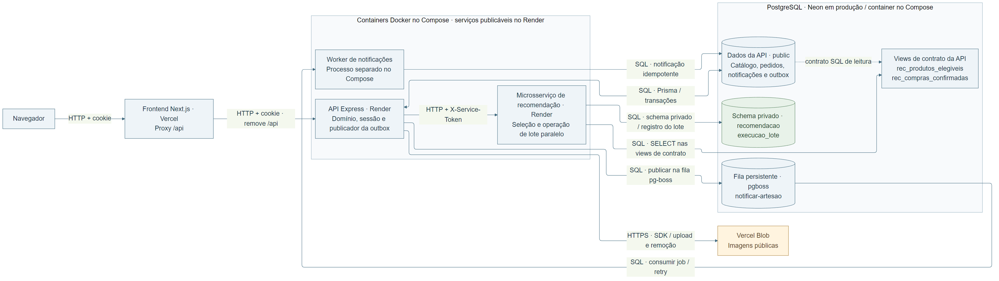

# Arquitetura distribuída do Origem

Entrega da subtarefa 35.7, com base em `f3b199e`.
O desenho representa a composição implementada e seus limites.
As medições estão no [relatório de desempenho](relatorio-desempenho-u2.md).

## Diagrama da arquitetura distribuída



[Fonte Mermaid](arquitetura-distribuida.mmd).
HTTP nas setas representa o protocolo de aplicação.
Os domínios publicados usam HTTPS.
SQL representa as conexões PostgreSQL dos serviços.
O Compose local oferece containers separados para cada processo.
O PostgreSQL utiliza Neon na implantação registrada.

O desenho diferencia imagem disponível e implantação comprovada.
A evidência remota registra recomendação Docker e API Node.
Portanto, a caixa Docker descreve principalmente a execução Compose.
O worker separado foi comprovado nessa execução local.
O consumidor também pode ser integrado à API no Render.
`RUN_WORKER_IN_API` controla essa composição em `backend/src/server.ts`.
Não foi consultado o painel remoto nesta entrega documental.

Fontes: [Docker funcionando](../evidencias/PI4-35-W14-Microsservico-Docker/35.3-docker/README.md),
[implantação registrada](../evidencias/PI4-35/35.4-deploy-render/README.md)
e [comunicação capturada](../evidencias/PI4-35/35.5-comunicacao/fluxos.json).

## Responsabilidade e justificativa de cada serviço

### Navegador e frontend Next.js

O navegador apresenta vitrine, carrossel, carrinho e painéis.
O frontend Vercel entrega interface e proxy `/api`.
Essa separação permite publicar a interface independentemente da API.
O proxy encaminha HTTP e cookie para rotas sem `/api`.
A identidade continua sendo validada pela API.

Uma falha do frontend impede interface e encaminhamento pelo proxy.
Os pedidos confirmados permanecem persistidos no PostgreSQL.
Erros de leitura aparecem na interface com recuperação.
O frontend HTTP não troca silenciosamente para dados locais.

Código: [rewrites](../frontend/next.config.ts)
e [cliente HTTP](../frontend/src/services/http/api-client.ts).
Prova: [fluxo real pela vitrine](../evidencias/PI4-35/35.5-comunicacao/README.md).

### API Express

A API concentra autenticação, catálogo, checkout, avaliações e administração.
Ela valida entradas e aplica regras transacionais do domínio.
O checkout mantém pedido, estoque e intenção na mesma transação.
O publicador envia intenções persistidas para o pg-boss.

Manter esse núcleo junto evita transações distribuídas no checkout.
A API comunica-se por HTTP, SQL e SDK do Blob.
Para recomendações, envia somente contexto ao serviço interno.
O cookie e o JWT do comprador não são encaminhados.

Se a API cai, suas rotas e publicador param.
As intenções persistidas permitem retomar publicação após reinício.
No modo integrado, o consumidor também para com a API.
No Compose, seu worker pertence a outro processo.
O cache público é local a cada instância da API.
Multiplicar instâncias exige coordenar invalidação e publicação.

Código: [composição](../backend/src/app.ts),
[checkout](../backend/src/repositories/pedido.repository.ts)
e [publicador](../backend/src/queues/notificacao.publisher.ts).
Provas: [checkout concorrente](../evidencias/PI4-30-W12-Arquitetura-Distribuida/30.1-concorrencia-checkout/README.md)
e [intenção publicada antes do consumo](../evidencias/PI4-35/35.5-comunicacao/fluxos.json).

### Microsserviço de recomendação

O serviço seleciona produtos por categoria, histórico e popularidade.
Também executa o lote usado pela coleta de métricas.
Seu processo, dependências, configuração, migrations e deploy são próprios.
Isso permite evoluir e escalar o lote independentemente da API.
O contrato HTTP separa seleção e apresentação dos produtos.

A API usa HTTP autenticado com `X-Service-Token`.
O cliente valida o retorno e aplica timeout sem retry.
As leituras utilizam exclusivamente as views de contrato.
A operação de lote grava somente seu schema privado.

Se o serviço falha, a API usa popularidade local.
Esse caminho identifica `fallback-local` e evita guardar a degradação.
Respostas incompletas podem ser complementadas e identificadas como `misto`.
A recuperação depende de o banco da API continuar disponível.
Uma queda do PostgreSQL compartilhado compromete também esse fallback.
Uma falha do lote preserva seu registro incompleto para diagnóstico.

Código: [cliente interno](../backend/src/integrations/recommendation/http-recomendacao.client.ts),
[fallback](../backend/src/services/recomendacao.service.ts),
[serviço](../services/recomendacao/src/app.ts)
e [operação do lote](../services/recomendacao/src/lote/index.ts).
Provas: [contrato e autenticação](../evidencias/PI4-35-W14-Microsservico-Docker/35.2-cliente-http/README.md),
[fallback](../evidencias/PI4-36/36.1-fallback-local/README.md)
e [lote real](../evidencias/PI4-35/35.6-lote/README.md).

### Worker de notificações

O worker consome `notificar-artesao` e grava notificações idempotentes.
Ele existe separado para retirar efeitos assíncronos do checkout.
Compartilha código e domínio com a API.
Portanto, representa separação de processo, sem autonomia de dados própria.

A comunicação usa pg-boss sobre PostgreSQL, com retry e backoff.
A restrição de unicidade impede repetir o efeito da notificação.
O pedido permanece confirmado enquanto o consumidor está parado.
Após retorno, o processamento depende da reserva e dos retries.
Esgotar tentativas exige acompanhamento e intervenção operacional.
Persistência não garante entrega imediata nem execução única absoluta.

Código: [entrypoint](../backend/src/worker.ts),
[registro do consumidor](../backend/src/jobs/notificar-artesao.worker.ts)
e [handler](../backend/src/jobs/notificar-artesao.handler.ts).
Provas: [worker parado e retomado](../evidencias/PI4-35/35.5-comunicacao/fluxos.json)
e [sequência transacional](concorrencia-checkout-u2.md).
Não há medição comparativa de escala dos consumidores nesta entrega.

### PostgreSQL e fila persistente

O PostgreSQL armazena domínio, outbox, notificações e fila pg-boss.
Também hospeda as views e o schema privado da recomendação.
Neon atende a implantação; o Compose oferece um banco local.
Usar o mesmo servidor reduz infraestrutura e operação no semestre.

As conexões usam papéis separados e permissões específicas.
Os serviços comunicam-se com o banco pelo protocolo PostgreSQL.
O servidor compartilhado continua sendo um ponto de falha comum.
Sua indisponibilidade afeta checkout, seleção, lote e notificações.
Os limites de conexões também são compartilhados.

Provas: [permissões reais](../evidencias/PI4-35/35.1/permissoes-runtime-local.json)
e [saúde e isolamento no Compose](../evidencias/PI4-35-W14-Microsservico-Docker/35.3-docker/01-compose-up.txt).

### Vercel Blob

O Blob armazena imagens fora do processo da API.
Essa separação evita depender do filesystem efêmero dos containers.
A API realiza upload e remoção pelo SDK sobre HTTPS.
O domínio persiste a URL retornada pelo armazenamento.

Uma falha impede a operação correspondente de imagem.
Sem token, a API responde indisponibilidade na borda.
Isso não transforma pedidos já confirmados em pedidos inválidos.
A integração existe; não se trata de componente apenas previsto.

Código: [storage Blob](../backend/src/integrations/storage/vercel-foto-storage.ts).
Prova: [upload público exercitado](../evidencias/PI4-32/32.5-headers/README.md).

## Dados por serviço e contrato SQL

Adota-se **database per service**, na forma **schema per service**.
O padrão admite schemas privados no mesmo servidor físico.
Ele requer fronteiras de acesso entre os proprietários.
[Referência: Database per service, Chris Richardson](https://microservices.io/patterns/data/database-per-service.html).

A implementação adapta a leitura cruzada por views publicadas.
Esse contrato SQL é uma decisão explícita da equipe.
Não oferece isolamento físico nem independência da disponibilidade do servidor.

| Proprietário                           | Dados e contrato                                      | Acesso permitido                                        |
| -------------------------------------- | ----------------------------------------------------- | ------------------------------------------------------- |
| API, papel `origem_api_app`            | Tabelas do domínio em `public`                        | Leitura e escrita do domínio                            |
| API                                    | `rec_produtos_elegiveis` e `rec_compras_confirmadas`  | API mantém as views; recomendação recebe SELECT         |
| Recomendação, papel `recomendacao_app` | Schema privado `recomendacao`, tabela `execucao_lote` | Serviço mantém migrations, lê e registra execuções      |
| API e worker                           | Fila em `pgboss`, outbox e notificações               | Publicar, consumir e registrar efeitos do mesmo domínio |

O microsserviço não recebe acesso às tabelas da API.
A API não recebe acesso ao schema privado da recomendação.
As migrations privadas pertencem a `services/recomendacao/migrations/`.
O bootstrap aplica os grants entre os papéis de runtime.
As conexões administrativas ficam restritas à preparação e às migrations.

`rec_produtos_elegiveis` publica categoria, região, vendas, nota e elegibilidade.
Seus indicadores `elegivel` e `visivel` preservam contratos distintos.
A coluna `vendas` mantém a soma histórica de itens.
Ela não foi redefinida como apenas vendas de pedidos confirmados.
`rec_compras_confirmadas` filtra explicitamente compras com status confirmado.
O serviço não consulta diretamente as tabelas de origem.

Código: [migration das views](../backend/prisma/migrations/20261104160116_views_contrato_recomendacao/migration.sql)
e [bootstrap das permissões](../services/recomendacao/scripts/bootstrap-permissoes.ts).
Prova: [semântica preservada na extração](../evidencias/PI4-35/35.1/README.md).

### Permissões comprovadas por teste

| Verificação real                                     | Resultado             | Evidência                                                                                                     |
| ---------------------------------------------------- | --------------------- | ------------------------------------------------------------------------------------------------------------- |
| Serviço lê as views                                  | Permitido             | [conexões locais](../evidencias/PI4-35/35.1/permissoes-runtime-local.json)                                    |
| Serviço lê ou altera `Produto`, `Pedido`, `Usuario`  | Negado                | [conexões locais](../evidencias/PI4-35/35.1/permissoes-runtime-local.json)                                    |
| API lê o schema privado ou assume o papel do serviço | Negado                | [conexões locais](../evidencias/PI4-35/35.1/permissoes-runtime-local.json)                                    |
| Serviço registra o lote no schema privado            | Permitido             | [registros consultados](../evidencias/PI4-35/35.6-lote/execucao-2026-11-07T19-45-53-648Z/execucoes-lote.json) |
| Isolamento verificado com conexões publicadas        | Confirmado na captura | [permissões de produção](../evidencias/PI4-35/35.4-deploy-render/permissoes-producao.json)                    |

Os testes contratuais também verificam nomes e colunas das views.
Mudanças no contrato precisam preservar esses consumidores e verificações.
Essas evidências são capturas anteriores, sem nova auditoria remota.

### Por que manter o mesmo servidor físico

Um banco físico separado exigiria copiar catálogo e compras.
Essa cópia precisaria de eventos, sincronização e tratamento de atrasos.
Também introduziria consistência eventual e recuperação de projeções.
Essa complexidade excede o escopo controlado do semestre.
As views preservam um contrato limitado sem duplicar o catálogo.
A separação de schemas protege a propriedade dos dados privados.

## Limites da separação e justificativa revogada

> Justificativa antiga de "sem microsserviços": **revogado em 02/11/2026**.

A recomendação passou a ter processo e deploy próprios.
A antiga conclusão não representa mais a arquitetura entregue.
O worker continua compartilhando código e dados com a API.

Os demais módulos permanecem organizados dentro do backend.
Catálogo, estoque, pedidos e pagamentos simulados compartilham transações.
Separá-los exigiria novos contratos e coordenação distribuída de gravações.
Não foi demonstrado gargalo que justifique essa complexidade adicional.
O risco registrado em `CLAUDE.md`, §5, permanece aplicável:
distribuição forçada aumenta operação e dificulta validar o produto.

As decisões da sprint orientam limites concretos da implementação:

- D1: recomendação é o microsserviço escolhido.
- D2: views da API e schema privado separado.
- D3: HTTP autenticado e fila PostgreSQL persistente.
- D4: Compose local; implantação continua em Neon e Render.
- D5: média de avaliações continua calculada na leitura.
- D6: cache adicional de indicadores permanece opcional.
- D7: B2 é a referência de paralelismo.

As capacidades medidas e seus limites estão no relatório vinculado.
Não se afirma ganho universal por acrescentar serviços.

## Código de comunicação e evidência funcional

| Fluxo                  | Implementação exata                                                                                                                                                                                                                 | Evidência                                                                                            |
| ---------------------- | ----------------------------------------------------------------------------------------------------------------------------------------------------------------------------------------------------------------------------------- | ---------------------------------------------------------------------------------------------------- |
| API para recomendação  | [HttpRecomendacaoClient.obter](../backend/src/integrations/recommendation/http-recomendacao.client.ts)                                                                                                                              | [cliente HTTP, commit 04](../evidencias/PI4-35-W14-Microsservico-Docker/35.2-cliente-http/README.md) |
| Correlação REST        | [requestContext](../backend/src/utils/request-context.ts), [middleware API](../backend/src/middlewares/request-logging.middleware.ts), [middleware serviço](../services/recomendacao/src/middlewares/request-logging.middleware.ts) | [logs REST, commit 16](../evidencias/PI4-35/35.5-comunicacao/03-logs-rest.png)                       |
| Publicação persistente | [publicarIntencoesPendentes](../backend/src/queues/notificacao.publisher.ts)                                                                                                                                                        | [estados capturados](../evidencias/PI4-35/35.5-comunicacao/fluxos.json)                              |
| Consumo e confirmação  | [registerNotificarArtesaoWorker](../backend/src/jobs/notificar-artesao.worker.ts)                                                                                                                                                   | [logs da fila, commit 16](../evidencias/PI4-35/35.5-comunicacao/04-logs-mensageria.png)              |

## Reprodução do diagrama e revisão

A fonte `.mmd` acompanha o PNG versionado.
O ambiente de exportação está registrado nas evidências desta entrega.
Com Mermaid CLI e Chrome instalados, execute na raiz:

```powershell
$env:PUPPETEER_EXECUTABLE_PATH = 'C:\Program Files\Google\Chrome\Application\chrome.exe'
$env:PUPPETEER_SKIP_DOWNLOAD = 'true'
mmdc --input docs/arquitetura-distribuida.mmd --output docs/arquitetura-distribuida.png --width 1800 --scale 2 --backgroundColor white
```

Confira rótulos, setas e proporção antes de imprimir.
Esta entrega reaproveita evidências históricas e confere os fontes atuais.
Não executa deploy, migrations ou novas medições de desempenho.
Validações: [registro da entrega](../evidencias/PI4-35/35.7-relatorio/README.md).
