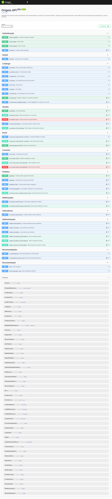

# Cache e documentação da API na U2

Subtarefa 32.6. Conferência e coleta em 08/11/2026.
Fontes: [OpenAPI implementado][openapi] e [evidências desta entrega][evidencias].

## 1. Pontos com cache e justificativa

O cache guarda dados no processo da API Express.
`CachePublico` utiliza `MemoryCacheStore` na composição padrão.
`CacheHttp` expõe headers e registra cada resposta cacheada.
Fontes: [composição][app], [armazenamento e política][cache] e [instrumentação][cache-http].

| Rota                 | Por que aplicar aqui                                                                                                                                           | Chave e abrangência                                                                                                         |
| -------------------- | -------------------------------------------------------------------------------------------------------------------------------------------------------------- | --------------------------------------------------------------------------------------------------------------------------- |
| `GET /produtos`      | Vitrine e filtros repetem leituras públicas. A consulta reúne fotos, vendas confirmadas e médias. Reutilizar filtros equivalentes evita repetir essa consulta. | `chaveCache("produtos:lista", queryValidada)`; inclui termo, categoria, técnica, região, artesão, limit e offset presentes. |
| `GET /produtos/:id`  | O detalhe reúne classificação, fotos, estoque e métricas. Reabrir o produto reutiliza esses dados até invalidar ou expirar.                                    | `chaveCache("produtos:detalhe", { id })`; uma entrada por UUID normalizado.                                                 |
| `GET /recomendacoes` | A faixa e o carrossel repetem leituras públicas. O caminho normal inclui HTTP interno e hidratação PostgreSQL. O HIT evita repetir ambos durante a validade.   | `chaveCache("recomendacoes:produto", { produtoId })`; contexto vazio possui entrada própria.                                |

Fontes das rotas e chaves: [catálogo][controller-catalogo] e [recomendações][controller-rec].
Custos observáveis: [SQL do catálogo][repository-catalogo],
[cliente do microsserviço](../backend/src/integrations/recommendation/http-recomendacao.client.ts) e
[hidratação pública][service-rec].
A justificativa de frequência considera a atualização das telas públicas.
O hook repete consultas enquanto a aba permanece visível.
Fonte: [useConsultaPublica](../frontend/src/hooks/use-consulta-publica.ts).

### Formação das chaves

`chaveCache` remove valores ausentes e strings vazias antes da normalização.
Aplica trim e minúsculas nas strings; ordena os campos.
Serializa os pares, mantendo o prefixo do recurso.
Os validators aplicam tipos, limites e defaults antes disso.
Fontes: [função de chave][cache] e [validator público][validator-catalogo].

Exemplos derivados desses arquivos:

```text
produtos:lista:[["limit",24],["offset",0]]
produtos:detalhe:[["id","<uuid-normalizado>"]]
recomendacoes:produto:[["produtoId","<uuid-normalizado>"]]
recomendacoes:produto:[]
```

### TTL e limite de armazenamento

Todos esses pontos recebem `CACHE_TTL_SECONDS` na composição.
O padrão é 60 segundos, convertido para milissegundos.
A configuração aceita somente inteiros positivos.
Fontes: [environment](../backend/src/config/environment.ts) e [app][app].

O armazenamento padrão comporta até 500 entradas por instância.
O TTL é absoluto; leituras não renovam a expiração.
Entradas vencidas são descartadas nas operações do armazenamento.
Ao atingir o limite, remove a entrada menos recentemente utilizada.
Valores são copiados para preservar o conteúdo armazenado.
Fonte: [MemoryCacheStore][cache].

## 2. Invalidação

Após escrita bem-sucedida, `invalidarCatalogo` remove ambos os prefixos:
`produtos:` e `recomendacoes:`.
Também impede cargas anteriores de repovoarem o cache invalidado.
Não cancela respostas que já estavam sendo processadas.
Fonte: [revisão e fila de mutações][cache].

| Operação concluída                     | Rotas relacionadas                                                            | Fonte da invalidação                                                                                                                                 |
| -------------------------------------- | ----------------------------------------------------------------------------- | ---------------------------------------------------------------------------------------------------------------------------------------------------- |
| Criação, edição, soft delete e estoque | `POST /produtos`, `PATCH/DELETE /produtos/:id`, `PATCH /produtos/:id/estoque` | [GestaoProdutosService](../backend/src/services/gestao-produtos.service.ts) e [controller](../backend/src/controllers/gestao-produtos.controller.ts) |
| Moderação de produto ou artesão        | `PATCH /admin/produtos/:id/moderar`, `PATCH /admin/artesaos/:id/moderar`      | [GestaoProdutosService](../backend/src/services/gestao-produtos.service.ts)                                                                          |
| Alteração do papel                     | `PATCH /admin/usuarios/:id/papel`                                             | [UsuarioService](../backend/src/services/usuario.service.ts)                                                                                         |
| Edição do perfil artesanal             | `PATCH /usuarios/:id/perfil-artesao`                                          | [PerfilArtesaoService](../backend/src/services/perfil-artesao.service.ts)                                                                            |
| Foto do perfil persistida              | `POST /artesao/perfil/foto`                                                   | [FotoPerfilService](../backend/src/services/foto-perfil.service.ts)                                                                                  |
| Checkout confirmado                    | `POST /pedidos`                                                               | [PedidoService](../backend/src/services/pedido.service.ts)                                                                                           |
| Avaliação registrada                   | `POST /avaliacoes`                                                            | [AvaliacaoService](../backend/src/services/avaliacao.service.ts)                                                                                     |

A coleta realizou uma edição autenticada de estoque.
As quatro leituras previamente aquecidas voltaram a MISS.
Na chamada seguinte, todas voltaram a HIT.
Fonte: cenários `invalida-estoque` e `apos-invalidacao` do [HTTP real][http].
As quatro leituras abrangem lista, detalhe e recomendações com/sem contexto.
O [teste de integração existente][teste-cache] cobre outras escritas e expiração.

## 3. O que não é cacheado

| Rota ou situação                                         | Motivo e comportamento                                                                                                                               | Fonte                                                                                                             |
| -------------------------------------------------------- | ---------------------------------------------------------------------------------------------------------------------------------------------------- | ----------------------------------------------------------------------------------------------------------------- |
| `/recomendacoes/para-mim`                                | Seleção depende da identidade autenticada e das compras confirmadas. Evita compartilhar preferências entre compradores; `no-store`, sem `CacheHttp`. | [Controller pessoal][controller-rec]                                                                              |
| `/artesao/indicadores`                                   | Vendas e receita pertencem ao artesão autenticado. A implementação consulta dados atuais; `no-store`, sem cache compartilhado.                       | [Controller artesanal](../backend/src/controllers/indicadores.controller.ts)                                      |
| `/admin/indicadores`                                     | Contagens e receita refletem dados administrativos atuais. Query vazia, autorização administrativa e `no-store`.                                     | [Controller administrativo](../backend/src/controllers/indicadores-admin.controller.ts)                           |
| Recomendações `fallback-local` e `misto`                 | São respostas de degradação ou complementação. Armazená-las atrasaria a recuperação do caminho normal. Continuam MISS nas chamadas seguintes.        | [Política do controller][controller-rec] e [service][service-rec]                                                 |
| `/avaliacoes` e `/avaliacoes/elegibilidade`              | Paginação e resumo permanecem atuais; elegibilidade depende do comprador. As leituras não usam cache compartilhado.                                  | [Catálogo][controller-catalogo] e [controller de avaliação](../backend/src/controllers/avaliacao.controller.ts)   |
| Sessão, carrinho, pedidos e gestão privada               | Autorização e estado pertencem ao usuário atual. Essas rotas não utilizam o cache público.                                                           | [Composição][app] e [middleware de autenticação](../backend/src/middlewares/auth.middleware.ts)                   |
| Categorias, técnicas, regiões, artesãos e perfil público | Não possuem `CacheHttp` na implementação entregue. Esta subtarefa documenta o comportamento existente, sem adicionar pontos.                         | [Catálogo][controller-catalogo] e [controller de perfil](../backend/src/controllers/perfil-artesao.controller.ts) |
| Falhas de validação ou carregamento                      | Falhas não produzem valor armazenável em `CachePublico`. A borda conserva os erros HTTP aplicáveis.                                                  | [CachePublico][cache] e [tratamento de erros](../backend/src/middlewares/error.middleware.ts)                     |

O fallback geral do microsserviço tem tratamento diferente.
Pode ser cacheado quando mantém oito produtos públicos visíveis.
Uma seleção menor passa a `misto` e não persiste.
Isso também vale quando faltam candidatos para completar.
Fontes: [service][service-rec] e [controller][controller-rec].

O cache opcional dos indicadores artesanais ainda não existe.
Não há seção de implementação atribuída ao commit 22.
O inventário desta entrega contém somente os pontos existentes.
Fontes: [composição][app], [controller artesanal](../backend/src/controllers/indicadores.controller.ts) e
[busca registrada](../evidencias/PI4-32/32.6-cache-swagger/inventario-cache.txt).

## 4. Evidência real de MISS e HIT

Coleta em 08/11/2026, com dados sintéticos isolados.
A API chamou o microsserviço real por HTTP local.
Ambos consultaram PostgreSQL; não houve mocks de banco ou repositories.
O TTL configurado nessa coleta foi de 60 segundos.
Fontes: [roteiro executável][roteiro], [HTTP completo][http] e [log da coleta][coleta].

Cada linha abaixo reúne duas chamadas consecutivas da mesma URL.
Todos os pares retornaram 200 e corpos iguais.
Os UUIDs sintéticos completos permanecem no arquivo HTTP.
Fonte de todos os valores: cenário `cache-publico` do [HTTP real][http].

| Consulta                       | Primeira chamada: X-Cache / Server-Timing | Segunda chamada: X-Cache / Server-Timing |
| ------------------------------ | ----------------------------------------- | ---------------------------------------- |
| `/produtos`                    | `MISS` / `cache;dur=58.349`               | `HIT` / `cache;dur=0.193`                |
| `/produtos/:id`                | `MISS` / `cache;dur=52.194`               | `HIT` / `cache;dur=0.116`                |
| `/recomendacoes?produtoId=:id` | `MISS` / `cache;dur=165.294`              | `HIT` / `cache;dur=0.171`                |
| `/recomendacoes`               | `MISS` / `cache;dur=106.530`              | `HIT` / `cache;dur=0.131`                |

Todos esses headers incluem `Cache-Control: no-store`.
Esse header impede armazenamento pelo navegador e intermediários HTTP.
O HIT pertence ao cache interno de dados da API.
Fonte: [CacheHttp][cache-http].

### Log JSON do CacheHttp

As mesmas chamadas de `/produtos` registraram os eventos abaixo.
Transcrição literal do [log JSON completo][log-cache]:

```json
{"rota":"/produtos","cache":"MISS","duracaoMs":60.132}
{"rota":"/produtos","cache":"HIT","duracaoMs":0.771}
```

`Server-Timing` é calculado antes de enviar o JSON.
`duracaoMs` do log termina no evento `finish` da resposta.
Por isso, esses tempos não precisam ser iguais.
Eles não representam o tempo completo percebido pelo navegador.
O log contém somente rota parametrizada, estado e duração.
Fonte: [instrumentação real][cache-http].

### Controles sem armazenamento

A coleta também confirmou os comportamentos abaixo.
Fonte: [HTTP real][http], cenários indicados na tabela.

| Cenário                                          | Resultado das duas chamadas                                |
| ------------------------------------------------ | ---------------------------------------------------------- |
| `sem-cache`, rota pessoal e ambos os indicadores | 200, `no-store`, sem `X-Cache` ou `Server-Timing` de cache |
| `sem-cache`, avaliações paginadas                | 200, `no-store`, sem `X-Cache`                             |
| `selecao-parcial`                                | 200, estratégia `misto`, MISS nas duas chamadas            |
| `microsservico-desligado`                        | 200, estratégia `fallback-local`, MISS nas duas chamadas   |

São observações locais, sem conclusão de capacidade ou desempenho produtivo.
O roteiro verifica comportamento, sem aplicar carga concorrente.
Fonte: [roteiro de coleta][roteiro].

## 5. Swagger e coerência dos contratos

O inventário compara 44 operações registradas e documentadas.
Não encontrou operações faltantes ou adicionais no OpenAPI.
Fonte: [inventário Express × Swagger][rotas].

O [OpenAPI][openapi] documenta parâmetros, exemplos, segurança e erros aplicáveis.
Inclui indicadores administrativos, paginação das avaliações e estratégias da recomendação.
Descreve também os headers e a política dos pontos cacheados.
O [teste OpenAPI][teste-openapi] valida esses contratos e a paridade.



A captura final inclui exemplos corrigidos de seleções completas.
Os exemplos normais contêm oito produtos distintos, conforme o service.
Fontes: [OpenAPI final servido](../evidencias/PI4-32/32.6-cache-swagger/9d7a3a85-9452-4ec8-a087-ac2e4842cded/openapi.json) e
[regra pública de complementação][service-rec].

O contrato histórico marca explicitamente rotas fora do semestre.
Perfil genérico, status global e pagamento isolado continuam indisponíveis.
O pagamento vigente integra a consulta do próprio pedido.
Fonte: [contratos atualizados](../sprints/semana-02-03/04-Contratos-de-API.md#fora-do-escopo-do-semestre).
A tabela de [CLAUDE.md §8](../CLAUDE.md#8-contratos-de-api-vivo--manter-atualizado)
concentra o inventário documental vigente, com data de atualização.

## 6. Reprodução e limites

Dentro de `backend/`, execute com as dependências instaladas:

```powershell
node --import tsx scripts/cache-swagger.evidence.mjs
npm.cmd test -- tests/unit/openapi.test.ts
```

O roteiro utiliza `DIRECT_URL` exclusivamente na preparação dos testes.
Cria schema sintético, papéis temporários e microsserviço HTTP real.
Não altera dados de demonstração ou produção existentes.
As conexões e credenciais temporárias permanecem em memória.
Escreve artefatos em diretório novo, sem substituir coletas anteriores.
Fecha os processos e remove apenas os objetos temporários criados.
Fontes: [roteiro][roteiro] e [helper isolado](../backend/tests/helpers/recomendacao-database.ts).
O [registro de limpeza][limpeza] confirma o encerramento desta execução.

O print requer Chrome e Playwright já usados pelo frontend.
`E2E_CHROMIUM_EXECUTABLE_PATH` permite escolher outro executável instalado.
Fonte: [roteiro][roteiro].

O cache é local a cada instância da aplicação.
Invalidação não é propagada entre processos ou réplicas.
Escritas externas podem permanecer refletidas somente após o TTL.
Reiniciar o processo elimina o armazenamento padrão em memória.
Não existe garantia de resposta durante falha do PostgreSQL.
Fontes: [composição][app], [armazenamento][cache] e [service][service-rec].

[app]: ../backend/src/app.ts
[cache]: ../backend/src/utils/cache.ts
[cache-http]: ../backend/src/utils/cache-http.ts
[controller-catalogo]: ../backend/src/controllers/catalogo.controller.ts
[controller-rec]: ../backend/src/controllers/recomendacao.controller.ts
[service-rec]: ../backend/src/services/recomendacao.service.ts
[repository-catalogo]: ../backend/src/repositories/catalogo.repository.ts
[validator-catalogo]: ../backend/src/validators/catalogo.validator.ts
[teste-cache]: ../backend/tests/integration/cache.web13.integration.test.ts
[teste-openapi]: ../backend/tests/unit/openapi.test.ts
[openapi]: ../backend/src/docs/openapi.ts
[roteiro]: ../backend/scripts/cache-swagger.evidence.mjs
[evidencias]: ../evidencias/PI4-32/32.6-cache-swagger/README.md
[http]: ../evidencias/PI4-32/32.6-cache-swagger/09a6dd10-8235-4b7c-97b5-e60f2c32e8ff/http.json
[coleta]: ../evidencias/PI4-32/32.6-cache-swagger/coleta.txt
[log-cache]: ../evidencias/PI4-32/32.6-cache-swagger/09a6dd10-8235-4b7c-97b5-e60f2c32e8ff/cache-http.txt
[rotas]: ../evidencias/PI4-32/32.6-cache-swagger/09a6dd10-8235-4b7c-97b5-e60f2c32e8ff/rotas.json
[limpeza]: ../evidencias/PI4-32/32.6-cache-swagger/09a6dd10-8235-4b7c-97b5-e60f2c32e8ff/limpeza.json
