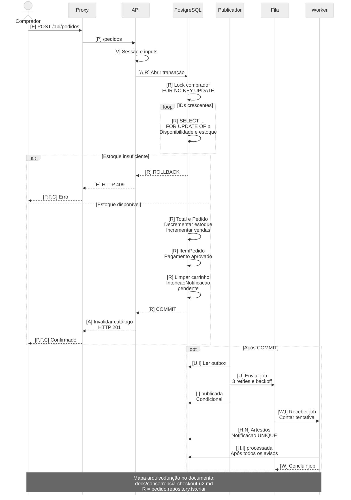

# Checkout concorrente: sequência e justificativa

Subtarefa 30.2 · 26/10/2026 · Responsável: Sergio · Revisor indicado: Pedro.
Código consultado: `8e78cdc`, antes desta alteração documental.

## Sequência fiel ao código

O diagrama representa o adapter HTTP e seu proxy.
`next.config.ts:rewrites` encaminha `/api/pedidos` para `/pedidos`.
Esse encaminhamento depende de `BACKEND_URL` configurada.
Cada mensagem usa códigos vinculados ao mapa arquivo:função abaixo.
Esses códigos preservam a legibilidade durante impressão em A4.
O PostgreSQL representa também a transação do repository.
As mensagens internas representam operações nesse callback transacional.
O código cria `Pedido` antes de decrementar estoque.
A limpeza do carrinho precede a intenção de notificação.
O ramo 409 preserva estoque e carrinho pelo rollback.
Produtos indisponíveis seguem outro ramo: 404 e rollback.



[PNG para impressão](concorrencia-checkout-u2.png) · [Fonte Mermaid](concorrencia-checkout-u2.mmd).

### Localização das funções

Os códigos no diagrama apontam para estas implementações.
Métodos `criar` pertencem às classes indicadas abaixo.

| Código | Arquivo vinculado                                                                                    | Função ou método                                                                                                                  |
| ------ | ---------------------------------------------------------------------------------------------------- | --------------------------------------------------------------------------------------------------------------------------------- |
| C      | [checkout/page.tsx](../frontend/src/app/checkout/page.tsx)                                           | `Checkout.confirmarPedido`, função interna                                                                                        |
| F      | [pedidos.service.ts](../frontend/src/services/http/pedidos.service.ts)                               | `HttpPedidosService.confirmar`                                                                                                    |
| F      | [api-client.ts](../frontend/src/services/http/api-client.ts)                                         | `ApiClient.request`                                                                                                               |
| P      | [next.config.ts](../frontend/next.config.ts)                                                         | `nextConfig.rewrites`                                                                                                             |
| V      | [pedido.routes.ts](../backend/src/routes/pedido.routes.ts)                                           | `createPedidoRouter`                                                                                                              |
| V      | [pedido.validator.ts](../backend/src/validators/pedido.validator.ts)                                 | `validateCriarPedido`                                                                                                             |
| A      | [pedido.controller.ts](../backend/src/controllers/pedido.controller.ts)                              | `PedidoController.criar`                                                                                                          |
| A      | [pedido.service.ts](../backend/src/services/pedido.service.ts)                                       | `PedidoService.criar`                                                                                                             |
| R      | [pedido.repository.ts](../backend/src/repositories/pedido.repository.ts)                             | `PrismaPedidoRepository.criar`                                                                                                    |
| E      | [error.middleware.ts](../backend/src/middlewares/error.middleware.ts)                                | `errorMiddleware`                                                                                                                 |
| U      | [notificacao.publisher.ts](../backend/src/queues/notificacao.publisher.ts)                           | `publicarIntencoesPendentes`, `publicarIntencao`                                                                                  |
| I      | [intencao-notificacao.repository.ts](../backend/src/repositories/intencao-notificacao.repository.ts) | `PrismaIntencaoNotificacaoRepository.listarPendentesOuFalha`, `marcarComoPublicada`, `registrarTentativa`, `marcarComoProcessada` |
| W      | [notificar-artesao.worker.ts](../backend/src/jobs/notificar-artesao.worker.ts)                       | `registerNotificarArtesaoWorker`                                                                                                  |
| H      | [notificar-artesao.handler.ts](../backend/src/jobs/notificar-artesao.handler.ts)                     | `notificarArtesao`                                                                                                                |
| N      | [notificacao.repository.ts](../backend/src/repositories/notificacao.repository.ts)                   | `PrismaNotificacaoRepository.listarArtesaosDoPedido`, `registrarSeAusente`                                                        |

O publicador nasce em [bootstrap.ts:iniciarPublicador](../backend/src/queues/bootstrap.ts).
[server.ts:startServer](../backend/src/server.ts) inicia esse publicador.
[worker.ts:startWorker](../backend/src/worker.ts) inicia `iniciarConsumidor`.
Este registra `registerNotificarArtesaoWorker`, sem iniciar Express.
`RUN_WORKER_IN_API=true` também permite consumidor na própria API.
Os participantes representam responsabilidades, independentemente dessa configuração.
A atualização `publicada` pode ocorrer depois do consumo.
Sua condição preserva `processada` quando isso acontece.

## Justificativa técnica

### FOR UPDATE e atualização condicional

O checkout precisa ler preço, nome, disponibilidade e estoque.
`FOR UPDATE OF p` protege cada produto durante essas operações.
Outra compra aguarda a liberação da mesma linha.
Depois, verifica o estoque atualizado antes de comprar.
Os parâmetros SQL não são concatenados às consultas.
O lock permanece até commit ou rollback da transação.

Uma atualização condicional também pode impedir estoque negativo:
`UPDATE ... WHERE quantidadeEstoque >= quantidade`.
Ela exige verificar quantas linhas foram efetivamente alteradas.
Essa alternativa também adquire locks durante a escrita.
Portanto, não representa uma solução sem bloqueios.
Compras com vários produtos ainda exigem transação e ordenação.
O projeto escolheu explicitar leitura protegida e seção crítica.
Isso também facilita demonstrar concorrência na avaliação FCCPD.
Não significa superioridade universal sobre a atualização condicional.

O §1.2 histórico descreve edição manual disputando o mesmo produto.
Esse cenário exige controle compatível sobre aquela linha.
As três rodadas abaixo comprovam somente compras concorrentes.
Elas não comprovam uma corrida entre edição e checkout.

### Ordem dos locks e rollback

Primeiro, `criar` bloqueia o comprador com `FOR NO KEY UPDATE`.
Isso coordena operações do mesmo comprador com seu carrinho.
Depois, agrega quantidades e ordena IDs distintos com `sort()`.
Os UUIDs chegam normalizados pelo validador da API.
Cada produto recebe `SELECT ... FOR UPDATE OF p`.
A validação ocorre antes das gravações do pedido.

Sem ordenação, uma compra poderia bloquear A e aguardar B.
Outra poderia bloquear B e aguardar A simultaneamente.
Essa espera circular caracteriza um deadlock.
Com ordem compartilhada, ambas começam pelo menor ID.
A segunda aguarda sem bloquear primeiro o maior produto.
Isso evita aquele ciclo entre os locks dos produtos.
Não elimina todos os deadlocks possíveis envolvendo outros recursos.

Estoque insuficiente lança `AppError` com status 409.
O callback rejeitado provoca rollback e libera os locks.
Falhas posteriores também revertem todas as gravações transacionais.
Incluem pedido, vendas, estoque, itens, pagamento, carrinho e intenção.
A numeração por sequence pode manter lacunas após abortos.

### Outbox após commit

`IntencaoNotificacao` nasce pendente na mesma transação do pedido.
Seu `pedidoId` possui unicidade no [schema.prisma](../backend/prisma/schema.prisma).
O commit torna pedido e intenção visíveis conjuntamente.
O publicador consulta intenções pendentes ou em falha periodicamente.
Ele publica `notificar-artesao` e tenta marcar `publicada` condicionalmente.
O envio não faz parte da transação do checkout.
Essa publicação pode concorrer com a resposta HTTP 201.

Publicar antes do commit permitiria consumir um pedido inexistente.
Um rollback posterior deixaria um job sem compra confirmada.
Publicar apenas depois, sem outbox, abriria outra janela.
Uma queda após commit poderia perder a publicação definitivamente.
A intenção persistida permite retomar essa publicação após reinício.
Também evita segurar locks enquanto a fila recebe jobs.
Uma queda entre envio e marcação pode duplicar jobs.
Por isso, o efeito do consumidor precisa ser idempotente.

### Queda do worker, retry e UNIQUE

[pg-boss.client.ts:ensureNotificarArtesaoQueue](../backend/src/queues/pg-boss.client.ts)
configura três novas tentativas e `retryBackoff=true`.
`publicarIntencao` aplica essa configuração também ao envio.
Uma exceção rejeita o handler e permite retry pelo pg-boss.
Uma queda abrupta exige expiração da reserva do job.
Depois, outro consumidor pode recebê-lo, respeitando os limites configurados.
Isso requer infraestrutura ativa e não garante recuperação imediata.
O pedido permanece confirmado enquanto a notificação aguarda processamento.

O worker incrementa tentativas e identifica artesãos distintos.
Para cada um, `registrarSeAusente` executa `createMany` com `skipDuplicates`.
O banco impõe `UNIQUE(usuarioId, pedidoId, tipo)` em `Notificacao`.
Uma reentrega preserva ID, leitura e data do aviso existente.
Uma queda intermediária permite completar os artesãos restantes depois.
Somente após gravar os avisos, o handler marca `processada`.
A atualização condicional preserva também o primeiro `processadaEm`.
Assim, reentregas permitem efeito idempotente, sem garantir execução única.
Esgotar retries pode deixar a intenção `publicada` sem processamento.
O código inspecionado não a converte automaticamente em `falha`.
O publicador não repesca `publicada`; esse caso exige intervenção.

## Evidência do commit 10: três rodadas

Commit 10 corresponde à subtarefa 30.1, commit `1dfce1b`.
A execução histórica ocorreu em 22/10/2026, com PostgreSQL real.
Cada rodada disputou um produto diferente, com estoque inicial um.
Foram 50 compradores distintos, autenticados por cadastro e login reais.
As chamadas `POST /pedidos` foram disparadas por `Promise.all`.

| Rodada | Compradores | HTTP 201 | HTTP 409 | Estoque final | Pedidos | Pagamentos | Respostas inesperadas |
| ------ | ----------: | -------: | -------: | ------------: | ------: | ---------: | --------------------: |
| 1      |          50 |        1 |       49 |             0 |       1 |          1 |                     0 |
| 2      |          50 |        1 |       49 |             0 |       1 |          1 |                     0 |
| 3      |          50 |        1 |       49 |             0 |       1 |          1 |                     0 |

Fontes locais: [JSON das rodadas](../evidencias/PI4-30-W12-Arquitetura-Distribuida/30.1-concorrencia-checkout/rodadas-50-clientes.json),
[log com SQL parametrizado](../evidencias/PI4-30-W12-Arquitetura-Distribuida/30.1-concorrencia-checkout/execucao-50-clientes.log)
e [conferência independente](../evidencias/PI4-30-W12-Arquitetura-Distribuida/30.1-concorrencia-checkout/conferencia-independente.log).
O SQL contou pedidos e pagamentos somente daquele produto.
A conferência ocorreu antes da remoção do schema temporário.
O log registra `exitCode=0` e `schemaRemovido=true`.
A consulta independente confirmou zero schemas residuais daquela execução.
Esses arquivos locais permanecem ignorados pelo Git existente.
Os números ficam preservados nesta tabela documental.

Esta entrega reaproveita evidências históricas, sem repetir o benchmark.
Elas não medem proxy, processamento da fila ou recuperação do worker.
O diagrama deriva do código atual consultado, separadamente dessas evidências.
Nenhum código, contrato ou configuração operacional foi alterado.
O guia conceitual foi removido, conforme confirmação do responsável.

## Exportação e conferência A4

Execute pela raiz, com Mermaid CLI 11.17.0 disponível.
O comando requer Chrome ou Chromium previamente instalado.
Use um destino novo para preservar exportações anteriores.

```powershell
$env:PUPPETEER_EXECUTABLE_PATH = 'C:\Program Files\Google\Chrome\Application\chrome.exe'
$env:PUPPETEER_SKIP_DOWNLOAD = 'true'
npm.cmd exec --yes --package=@mermaid-js/mermaid-cli@11.17.0 -- mmdc `
  --input docs/concorrencia-checkout-u2.mmd `
  --output docs/concorrencia-checkout-u2.png `
  --scale 3 --width 1800 --backgroundColor white
```

A fonte Mermaid acima corresponde integralmente ao arquivo `.mmd`.
Imprima o PNG em A4 retrato, com margens mínimas de 5 mm.
Preserve a proporção ao ajustar à área útil.
A conferência A4 fica nas [evidências da 30.2](../evidencias/PI4-30-W12-Arquitetura-Distribuida/30.2-sequencia-checkout/00-validacao.md).
A revisão documental verifica rastreabilidade, números, legibilidade e segredos.
A revisão humana indicada para Pedro permanece separada.
