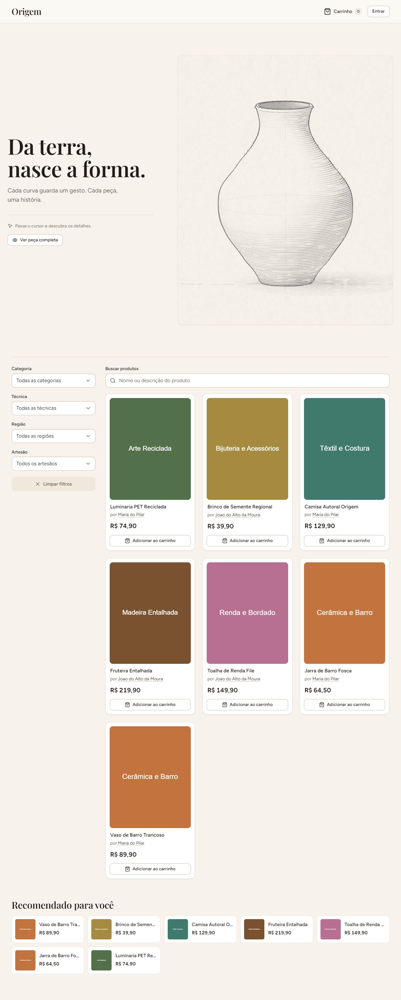
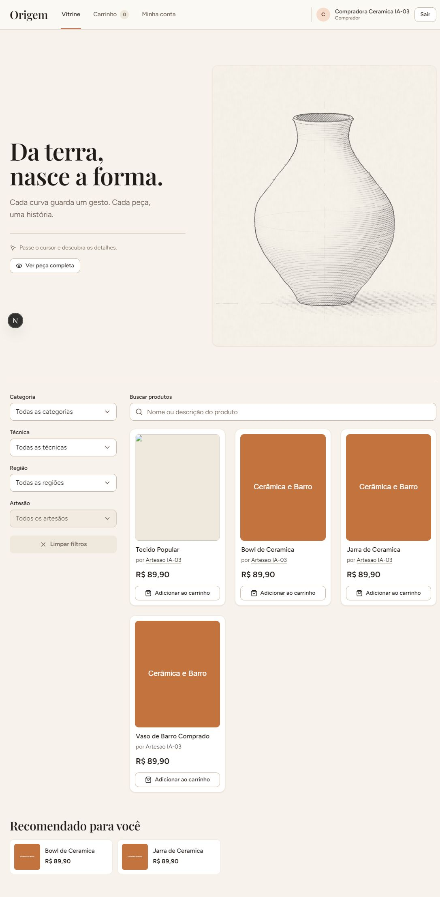
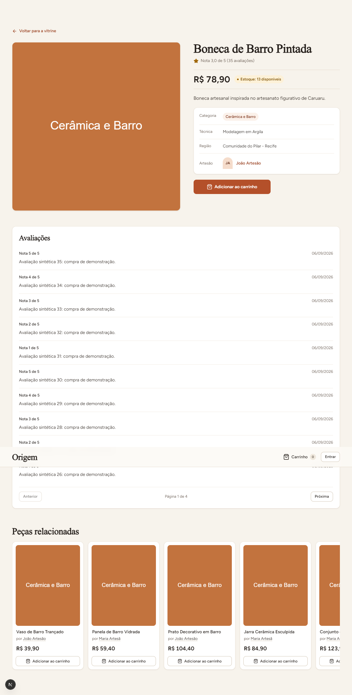
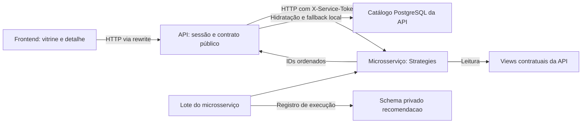

# Módulo de recomendação da U2

Subtarefa 36.3. Consolidação documental em 07/11/2026.

Esta consolidação utiliza código e evidências já existentes.
As coletas abaixo não foram reexecutadas nesta entrega.
Os commits identificam as implementações consultadas no histórico local.

| Referência da sprint | Subtarefa                    | Commit Git | Evidência utilizada                                                                      |
| -------------------- | ---------------------------- | ---------- | ---------------------------------------------------------------------------------------- |
| Commit 11            | 36.1, fallback local         | `b4b718d`  | [Fallback, cache e validação visual](../evidencias/PI4-36/36.1-fallback-local/README.md) |
| Commit 15            | 36.2, métricas após extração | `05ec40e`  | [Coleta regional pelo microsserviço](../evidencias/PI4-36/36.2-metricas/README.md)       |

## 1. Problema resolvido no Origem

O módulo oferece caminhos de descoberta dentro do catálogo.
Na vitrine, sugere produtos para visitantes e compradores autenticados.
No detalhe, apresenta peças relacionadas ao produto consultado.
Fontes: [vitrine](../frontend/src/app/page.tsx) e
[detalhe do produto](../frontend/src/components/produto/DetalheProduto.tsx).

A seleção considera categoria, região opcional e compras confirmadas.
A API conserva sugestões quando o microsserviço fica indisponível.
Fontes: [categoria][categoria], [histórico][historico] e
[degradação na API][service-api].

## 2. Estratégias de seleção

### Categoria e reforço regional opcional

`CategoriaRecomendacaoStrategy` procura candidatos da categoria do contexto.
Exclui o próprio produto e retorna até oito IDs.
Ordena por vendas, nota média e UUID crescente.
O reforço regional antecede vendas nessa ordenação lexicográfica.
Compara a região do artesão com aquela do contexto.
Fontes: [Strategy por categoria][categoria] e [consultas do repository][repo].

O reforço fica desligado na composição HTTP atual.
Sua ativação ocorre internamente no lote e nas métricas.
Não existe parâmetro regional na API pública.
Fontes: [composição do microsserviço][app-micro],
[opções do lote][lote] e [validação pública][validator].

### Histórico de compras do comprador

`HistoricoCompraRecomendacaoStrategy` seleciona categorias de compras confirmadas.
Exclui produtos já comprados nesses pedidos pelo próprio comprador.
Pedidos pendentes, cancelados e alheios não compõem esse histórico.
Ordena candidatos por vendas, nota média e UUID crescente.
Sem candidatos pessoais, executa o fallback geral do módulo.
A exclusão das compras confirmadas permanece nesse fallback.
Fontes: [Strategy pessoal][historico], [repository][repo] e
[view de compras confirmadas][views].

### Fallback geral do módulo

`fallback-geral` seleciona produtos visíveis entre todas as categorias.
Ordena por vendas, nota média e UUID crescente.
Não aplica o reforço regional nessa seleção geral.
É usado sem contexto, contexto inexistente ou categoria esgotada.
Também atende histórico ausente ou sem candidatos pessoais disponíveis.
Fontes: [categoria][categoria], [histórico][historico] e [repository][repo].

### Elegibilidade e significado de vendas

O contrato distingue `elegivel` de `visivel` no PostgreSQL.
`elegivel` exige produto ativo e estoque positivo na categoria.
`visivel` também considera moderação e atividade do artesão.
A API revalida visibilidade e exige o papel artesanal.
Fontes: [views contratuais][views] e [catálogo público][catalogo].

O ranking remoto utiliza `vendas` da view contratual.
Essa soma inclui itens de pedidos sem filtrar status.
O histórico pessoal utiliza exclusivamente a view de compras confirmadas.
O fallback local da API conta somente vendas confirmadas.
São definições diferentes, preservadas por esta entrega documental.
Fontes: [SQL das views][views] e [consulta local][catalogo].

## 3. Contratos interno e público

### Contrato interno de seleção

O microsserviço devolve IDs ordenados, sem produtos hidratados.
O contrato interno possui o seguinte formato TypeScript:

```typescript
interface RecomendacaoSelecao {
  estrategia: string;
  produtoIds: string[];
}
```

Fonte: [interface Strategy do microsserviço][contrato-interno].
O [cliente HTTP da API][cliente] restringe estratégias e UUIDs.
Aceita `categoria`, `historico-compra` e `fallback-geral`, até oito IDs.

| Rota interna                   | Entrada                                    | Resultado                    |
| ------------------------------ | ------------------------------------------ | ---------------------------- |
| `GET /recomendacoes`           | `produtoId` opcional; `limite` opcional    | Seleção contextual ou geral  |
| `GET /recomendacoes/historico` | `usuarioId` obrigatório; `limite` opcional | Seleção pessoal ou geral     |
| `GET /health`                  | Sem contexto                               | Estado da conexão PostgreSQL |

As rotas de seleção exigem `X-Service-Token` próprio.
`/health` permanece público, sem exigir esse token.
`limite` aceita inteiros de um a oito, padrão oito.
Queries são estritas; campos desconhecidos são recusados com 400.
Fontes: [router interno][router-micro] e [controller interno][controller-micro].

### Contrato público de produtos

A API transforma a seleção em produtos do catálogo.
Remove IDs repetidos, contexto e produtos atualmente invisíveis.
Reconstrói a ordem recebida antes de aplicar complementação local.
Retorna o formato abaixo, com até oito itens:

```typescript
interface RecomendacaoResultado {
  estrategia: RecomendacaoEstrategia;
  itens: ProdutoDTO[];
}
```

Fontes: [service público][service-api] e [tipos aceitos][contrato-api].
`ProdutoDTO` contém identificação, descrição, preço, classificação e fotos.
Também contém estoque, vendas, nota, visibilidade e criação.
O mapper converte preço numérico e data ISO.
Não inclui credenciais ou identidade do comprador nesse DTO.
Fonte: [ProdutoDTO e mapper público][dto].

| Rota pública da API           | Contexto e autorização                              | Cache                                            |
| ----------------------------- | --------------------------------------------------- | ------------------------------------------------ |
| `GET /recomendacoes`          | Visitante; query vazia ou `produtoId` UUID          | Compartilhado, exceto `misto` e `fallback-local` |
| `GET /recomendacoes/para-mim` | Sessão autenticada com papel comprador; query vazia | `Cache-Control: no-store`                        |

A identidade pessoal vem exclusivamente da sessão na API.
Enviar `usuarioId` na query pública é recusado com 400.
Fontes: [rotas públicas][router-api], [validators][validator] e
[controller público][controller-api].

O navegador utiliza o prefixo `/api` no frontend.
O rewrite encaminha essas chamadas para rotas da API.
O identificador frontal apenas escolhe a rota pessoal.
O adapter não transmite esse identificador ao servidor.
Fontes: [ApiClient](../frontend/src/services/http/api-client.ts),
[rewrite Next.js](../frontend/next.config.ts) e [adapter HTTP][adapter].

## 4. Consumo na aplicação e prints

| Consumo                 | Contexto e apresentação                                    | Código                                           |
| ----------------------- | ---------------------------------------------------------- | ------------------------------------------------ |
| Vitrine sem comprador   | Contexto vazio; faixa “Recomendado para você”              | [Página inicial][vitrine]                        |
| “Para mim” do comprador | Mesma faixa; utiliza a sessão do comprador                 | [Página inicial][vitrine] e [adapter][adapter]   |
| Carrossel no detalhe    | `produtoId`; título “Peças relacionadas”; cards navegáveis | [Detalhe][detalhe] e [FaixaRecomendacoes][faixa] |

“Para mim” é a rota pessoal consumida pela vitrine.
Não existe uma página separada para esse consumo.
Fontes: [página inicial][vitrine] e [seleção da rota][adapter].

A composição HTTP registra `HttpRecommendationAdapter` no frontend.
O hook preserva carregamento, sucesso, vazio e erro recuperável.
O componente oferece o botão “Tentar novamente” nas falhas.
Não aplica ranking próprio sobre os produtos recebidos.
Fontes: [container](../frontend/src/services/fake/container.ts),
[hook](../frontend/src/hooks/use-recomendacoes.ts) e [componente][faixa].

### Vitrine com seleção geral



Captura histórica da publicação registrada na subtarefa 35.4.
A faixa aparece depois da listagem principal de produtos.
As respostas dessa captura identificam `fallback-geral` no microsserviço.
Fontes: [relato do deploy](../evidencias/PI4-35/35.4-deploy-render/README.md) e
[respostas HTTP](../evidencias/PI4-35/35.4-deploy-render/http-producao.json).
Essa captura não comprova o estado atual do deploy.

### Vitrine pessoal pelo histórico



Captura histórica da integração IA-03, anterior ao fallback local.
Mostra recomendações cerâmicas sem repetir o vaso já comprado.
Na versão atual, seleções curtas recebem complementação como `misto`.
Fontes: [relato IA-03](../evidencias/PI4-29-W10-Recomendacao/IA-03/README.md),
[respostas pessoais](../evidencias/PI4-29-W10-Recomendacao/IA-03/respostas-http.json) e
[complementação atual][service-api].

### Carrossel com microsserviço desligado



Captura do commit 11, com a degradação local ativa.
O registro HTTP identifica microsserviço desligado e `fallback-local`.
Fontes: [respostas e verificações visuais](../evidencias/PI4-36/36.1-fallback-local/tela-network.json) e
[print mobile](../evidencias/PI4-36/36.1-fallback-local/produto-360-5.png).

## 5. Microsserviço e fallback local da API

O fluxo HTTP separa seleção, hidratação e apresentação:



Fontes: [composição da API](../backend/src/app.ts),
[cliente HTTP][cliente], [composição do microsserviço][app-micro],
[repository][repo] e [operação de lote][lote].

O microsserviço possui processo, configuração e migrations próprios.
Lê `rec_produtos_elegiveis` e `rec_compras_confirmadas`, usando `recomendacao_app`.
Possui o schema privado `recomendacao`, com `execucao_lote`.
A API não recebe acesso a esse schema privado.
O microsserviço não recebe acesso às tabelas da API.
Fontes: [inicialização](../services/recomendacao/src/server.ts),
[bootstrap de permissões](../services/recomendacao/sql/bootstrap-permissoes.sql),
[migration privada](../services/recomendacao/migrations/001_execucao_lote.sql) e
[verificação dos papéis](../evidencias/PI4-35/35.4-deploy-render/permissoes-producao.json).

O cliente aplica timeout configurável, com padrão de 800 ms.
Não executa retry em cascata nessa chamada HTTP.
Falha de rede, status inesperado ou resposta inválida acionam degradação.
Timeout também produz `RecomendacaoIndisponivelError` tratado pelo service.
Outros erros continuam seguindo o tratamento normal da borda.
Fontes: [cliente HTTP][cliente] e [service da API][service-api].

O fallback local prioriza a categoria do produto contextual.
Depois considera vendas confirmadas gerais, nota média e UUID.
Exclui contexto, itens existentes e compras confirmadas do comprador.
Completa apenas as vagas restantes até oito produtos visíveis.
Pode retornar menos, conforme a disponibilidade real do catálogo.
Fontes: [fallback local](../backend/src/services/recomendacao-fallback-local.ts),
[consulta do catálogo][catalogo] e [service público][service-api].

| Valor de `estrategia` | Origem        | Quando chega à resposta pública                                | Fonte                                           |
| --------------------- | ------------- | -------------------------------------------------------------- | ----------------------------------------------- |
| `categoria`           | Microsserviço | Seleção contextual mantém oito produtos visíveis               | [Categoria][categoria] e [service][service-api] |
| `historico-compra`    | Microsserviço | Seleção pessoal mantém oito produtos visíveis                  | [Histórico][historico] e [service][service-api] |
| `fallback-geral`      | Microsserviço | Seleção geral mantém oito produtos visíveis                    | [Strategies][repo] e [service][service-api]     |
| `fallback-local`      | API           | Falha do microsserviço, inclusive timeout ou resposta inválida | [Cliente][cliente] e [service][service-api]     |
| `misto`               | API           | Seleção válida conserva menos de oito produtos após hidratação | [Service público][service-api]                  |

`misto` também cobre seleção vazia e complemento insuficiente.
Esse nome não garante itens provenientes das duas origens.
Respostas `misto` e `fallback-local` não persistem no cache compartilhado.
A rota pessoal permanece sem esse cache em qualquer estratégia.
Fontes: [service][service-api], [controller][controller-api] e
[evidência do commit 11](../evidencias/PI4-36/36.1-fallback-local/README.md).

## 6. Métricas do commit 15 e reprodução

### Método e resultados preservados

A coleta de 07/11/2026 usa o lote do microsserviço.
Avalia todos os contextos públicos da base sintética de volume.
Executa on e off com concorrência oito e pool dez.
Ambos compartilham catálogo e snapshot `REPEATABLE READ READ ONLY`.
Somente registros privados de execução recebem escritas nessa operação.
Fontes: [JSON da coleta][resultado], [implementação da medição][metricas] e
[lote][lote].

Todos os valores desta tabela vêm do [JSON original][resultado].
Os percentuais preservam a precisão registrada no arquivo.

| Indicador                               |         Reforço on |            Reforço off |
| --------------------------------------- | -----------------: | ---------------------: |
| Produtos totais / elegíveis / contextos | 1000 / 1000 / 1000 |     1000 / 1000 / 1000 |
| Recomendações retornadas                |               8000 |                   8000 |
| Cobertura do catálogo                   | 162 / 1000 = 16.2% |       54 / 1000 = 5.4% |
| Cobertura v0, contextos com itens       | 1000 / 1000 = 100% |     1000 / 1000 = 100% |
| Fallback geral                          |      0 / 1000 = 0% |          0 / 1000 = 0% |
| Acerto por categoria                    | 8000 / 8000 = 100% |     8000 / 8000 = 100% |
| Coincidência regional                   | 8000 / 8000 = 100% | 2695 / 8000 = 33.6875% |
| Categorias distintas / elegíveis        |              6 / 6 |                  6 / 6 |
| Categorias por resposta, média          |                  1 |                      1 |
| Contextos sem região                    |                  0 |                      0 |

Cobertura do catálogo mede a circulação de produtos distintos.
Cobertura v0 mede contextos que recebem alguma recomendação.
Fallback conta respostas identificadas como `fallback-geral` pelo lote.
Não mede acionamentos de `fallback-local` ou `misto` na API.
Fontes: [fórmulas de qualidade](../services/recomendacao/src/strategies/recomendacao-volume.metricas.ts) e
[coleta regional][metricas].

Acerto compara a categoria do item com aquela do contexto.
Coincidência regional exige regiões presentes e iguais entre ambos.
Ambos usam o total de recomendações como denominador.
Percentuais multiplicam a razão por cem; denominadores vazios retornam zero.
Fonte: [cálculo regional][metricas].

O reforço aumenta exposição regional e circulação nesse snapshot sintético.
A exposição continua concentrada, conforme a cobertura do catálogo.
O [diff integral][diff] contém `[]` contra a referência histórica.
Comprova igualdade dos indicadores agregados, sem comparação histórica por ID.
Não reavalia latência HTTP, cache ou histórico pessoal.
Fontes: [resultado][resultado], [comparador][metricas] e
[relatório da coleta](../evidencias/PI4-36/36.2-metricas/README.md).

### Como reproduzir

Execute dentro de `services/recomendacao/`, com dependências instaladas.
Configure `DATABASE_URL_VOLUME` para a base sintética existente.
Utilize `recomendacao_app`, com views, permissões e migration privada preparadas.
Configure `API_SCHEMA` e `RECOMENDACAO_SCHEMA` conforme essa base.
O ambiente deve diferir das bases padrão e deploy.
O comando recusa `NODE_ENV=production` antes de conectar.
Fontes: [README operacional](../services/recomendacao/README.md#métricas-regionais-362),
[CLI de métricas][cli-metricas] e
[validação ambiental](../services/recomendacao/scripts/lib/bench-lote.ts).

```powershell
npm.cmd run metricas:recomendacao -- --reforco-regional ambos --output metricas/execucao-nova/resultado.json
```

O destino e `diff.json` precisam ser arquivos novos.
`--reforco-regional` aceita `on`, `off` ou `ambos`.
`--referencia` permite substituir o JSON histórico da comparação.
O padrão utiliza `backend/metricas/recomendacao-u2.json` como referência.
O comando não aplica seeds, migrations ou alterações no catálogo.
Fontes: [script registrado](../services/recomendacao/package.json),
[CLI][cli-metricas] e [medição][metricas].

Confira resultados, diff e IDs dos registros privados gerados.
A consulta de conferência deve usar os IDs recém-gerados.
Preservar a massa permite comparar os indicadores novamente.
Fontes: [procedimento 36.2](../evidencias/PI4-36/36.2-metricas/README.md),
[consulta histórica](../evidencias/PI4-36/36.2-metricas/execucao-2026-11-07T20-14-08-695Z/consulta-execucoes.sql) e
[relatório completo de métricas](metricas-recomendacao-u2.md#após-a-extração-para-o-microsserviço-07112026).

## 7. Limitações

- A recomendação é didática, determinística e baseada em regras.
  Não existe treinamento de modelo nas Strategies implementadas.
  Fontes: [categoria][categoria], [histórico][historico] e [repository][repo].
- Os resultados publicados utilizam dados sintéticos de demonstração.
  Não comprovam satisfação, conversão ou preferências de compradores reais.
  Fontes: [gerador de volume](../backend/prisma/seeds/volume.ts) e [coleta][resultado].
- Não existe personalização por navegação, cliques ou sessão de páginas.
  As entradas implementadas são produto, comprador autenticado ou contexto vazio.
  Fontes: [contrato frontal](../frontend/src/types/recomendacao.ts),
  [adapter][adapter] e [consultas pessoais][repo].
- Popularidade e categoria concentram exposição nos mesmos produtos.
  O reforço amplia circulação somente no cenário sintético medido.
  Fonte: [cobertura e diversidade registradas][resultado].
- A ordenação regional considera regiões nulas iguais entre si.
  A métrica regional não contabiliza essas ausências como coincidência.
  Fontes: [SQL regional][repo] e [cálculo da coincidência][metricas].
- O fallback local ainda depende da disponibilidade do PostgreSQL.
  Não garante oito itens sem candidatos visíveis suficientes.
  Fontes: [service público][service-api] e [consulta local][catalogo].
- As capturas preservam estados históricos identificados nas respectivas legendas.
  As métricas regionais não avaliam a composição final da API.
  Fontes: [evidência visual 36.1](../evidencias/PI4-36/36.1-fallback-local/README.md) e
  [método da coleta 36.2][resultado].

[categoria]: ../services/recomendacao/src/strategies/categoria-recomendacao.strategy.ts
[historico]: ../services/recomendacao/src/strategies/historico-compra-recomendacao.strategy.ts
[repo]: ../services/recomendacao/src/repositories/recomendacao.repository.ts
[views]: ../backend/prisma/migrations/20261104160116_views_contrato_recomendacao/migration.sql
[catalogo]: ../backend/src/repositories/catalogo.repository.ts
[contrato-interno]: ../services/recomendacao/src/strategies/recomendacao.strategy.ts
[contrato-api]: ../backend/src/integrations/recommendation/recomendacao.strategy.ts
[app-micro]: ../services/recomendacao/src/app.ts
[router-micro]: ../services/recomendacao/src/routes/recomendacao.routes.ts
[controller-micro]: ../services/recomendacao/src/controllers/recomendacao.controller.ts
[cliente]: ../backend/src/integrations/recommendation/http-recomendacao.client.ts
[service-api]: ../backend/src/services/recomendacao.service.ts
[router-api]: ../backend/src/routes/recomendacao.routes.ts
[controller-api]: ../backend/src/controllers/recomendacao.controller.ts
[validator]: ../backend/src/validators/recomendacao.validator.ts
[dto]: ../backend/src/utils/produto-dto.ts
[vitrine]: ../frontend/src/app/page.tsx
[detalhe]: ../frontend/src/components/produto/DetalheProduto.tsx
[faixa]: ../frontend/src/components/vitrine/FaixaRecomendacoes.tsx
[adapter]: ../frontend/src/services/http/recomendacoes.adapter.ts
[lote]: ../services/recomendacao/src/lote/index.ts
[metricas]: ../services/recomendacao/scripts/lib/metricas.ts
[cli-metricas]: ../services/recomendacao/scripts/metricas.ts
[resultado]: ../evidencias/PI4-36/36.2-metricas/execucao-2026-11-07T20-14-08-695Z/resultado.json
[diff]: ../evidencias/PI4-36/36.2-metricas/execucao-2026-11-07T20-14-08-695Z/diff.json
