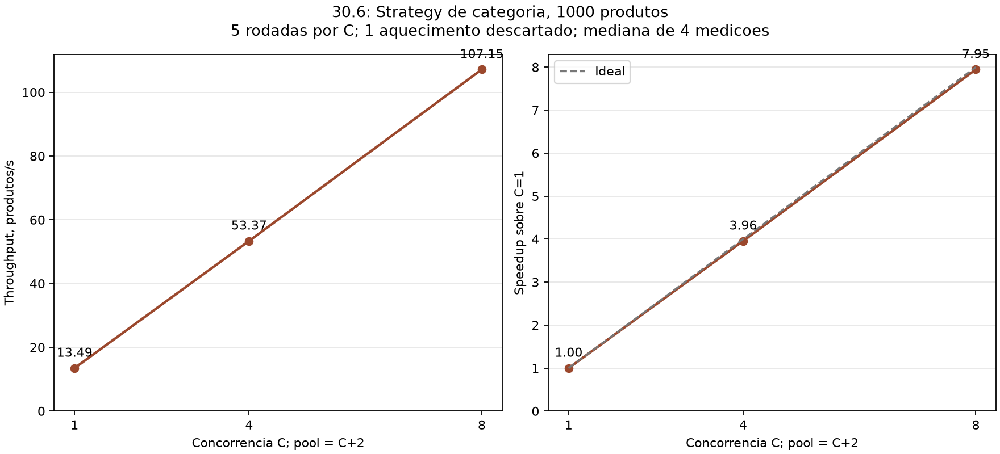
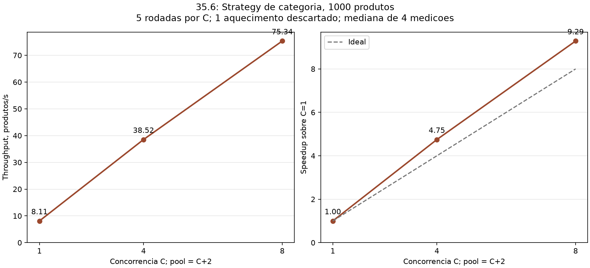

# Relatório de desempenho da Unidade 2

Subtarefa 35.7. Este relatório consolida coletas já preservadas.
O B2 é a referência de paralelismo da entrega.
A arquitetura está no [documento distribuído](arquitetura-distribuida.md).
As medições abaixo não foram repetidas nesta tarefa documental.

## Cobertura do relatório exigido pela rubrica

| Item do relatório                   | Seção correspondente                                                                                      |
| ----------------------------------- | --------------------------------------------------------------------------------------------------------- |
| Diagrama da arquitetura distribuída | [Diagrama e protocolos](arquitetura-distribuida.md#diagrama-da-arquitetura-distribuída)                   |
| Justificativa de cada separação     | [Responsabilidades e falhas](arquitetura-distribuida.md#responsabilidade-e-justificativa-de-cada-serviço) |
| Localização do trecho paralelo      | [Código e tarefa real](#trecho-paralelo-e-comunicação-implementada)                                       |
| Metodologia dos benchmarks          | [Metodologia e ambiente](#metodologia-e-ambiente-por-medição)                                             |
| Resultados sequenciais e paralelos  | [Resultados B2](#b2-recomendações-em-lote)                                                                |
| Interpretação dos resultados        | [Ganhos, custos e limites](#interpretação-ligada-às-decisões)                                             |

## Trecho paralelo e comunicação implementada

O trecho paralelo está em [executarPool](../services/recomendacao/src/lote/pool.ts).
Ele limita tarefas assíncronas e aguarda sua conclusão com `Promise.all`.
A operação [gerarRecomendacoesEmLote](../services/recomendacao/src/lote/index.ts) chama esse pool.
Ela utiliza a Strategy real e registra cada execução privada.
A [coleta de métricas](../services/recomendacao/scripts/metricas.ts) consome essa operação.
Assim, o processamento pertence a uma tarefa real do produto.

| Entrega              | Código e função                                                                                                                            | Evidência preservada                                                                           |
| -------------------- | ------------------------------------------------------------------------------------------------------------------------------------------ | ---------------------------------------------------------------------------------------------- |
| Commit 01, `5771ac3` | [serviço independente](../services/recomendacao/src/app.ts)                                                                                | [extração e permissões](../evidencias/PI4-35/35.1/README.md)                                   |
| Commit 04, `8e17cab` | [HttpRecomendacaoClient.obter](../backend/src/integrations/recommendation/http-recomendacao.client.ts)                                     | [HTTP real](../evidencias/PI4-35-W14-Microsservico-Docker/35.2-cliente-http/README.md)         |
| Commit 06, `280bd87` | [Docker Compose](../docker-compose.yml)                                                                                                    | [containers e isolamento](../evidencias/PI4-35-W14-Microsservico-Docker/35.3-docker/README.md) |
| Commit 14, `62991ad` | [executarPool](../services/recomendacao/src/lote/pool.ts), [operação](../services/recomendacao/src/lote/index.ts)                          | [lote após extração](../evidencias/PI4-35/35.6-lote/README.md)                                 |
| Commit 16, `001c6e7` | [middleware HTTP](../backend/src/middlewares/request-logging.middleware.ts), [consumidor](../backend/src/jobs/notificar-artesao.worker.ts) | [logs REST e mensageria](../evidencias/PI4-35/35.5-comunicacao/README.md)                      |
| Commit 18, `f3b199e` | [benchmark HTTP](../backend/scripts/custo-salto-http.ts)                                                                                   | [comparação local](../evidencias/PI4-35/35.8-custo-http/README.md)                             |

Os logs correlacionam API e recomendação pelo mesmo `requestId`.
O fluxo assíncrono registra intenção publicada, consumo e notificação.
Isso comprova comunicação funcional, sem medir escalabilidade da fila.
[Captura estruturada](../evidencias/PI4-35/35.5-comunicacao/fluxos.json).

## Metodologia e ambiente por medição

### Checkout concorrente

**O que:** integridade do estoque, pedidos e pagamentos simulados.
**Como:** compradores autenticados disputam o mesmo produto simultaneamente.
**Ferramenta:** [script HTTP](../backend/scripts/concorrencia-checkout.ts), usando `Promise.all`.
**Volume:** cinquenta compradores e estoque unitário em cada rodada.
**Repetições:** três rodadas, cada uma com produto distinto.
**Ambiente:** API local, autenticação real e schema PostgreSQL temporário.
Não houve aquecimento separado nem medição de latência.
Hardware e versão do banco não foram inventariados nessa evidência.
[Protocolo](../evidencias/PI4-30-W12-Arquitetura-Distribuida/30.1-concorrencia-checkout/README.md),
[log](../evidencias/PI4-30-W12-Arquitetura-Distribuida/30.1-concorrencia-checkout/execucao-50-clientes.txt).

### Busca HTTP

**O que:** duração completa das respostas de listagem pública.
**Como:** requisições sequenciais, com `X-Cache: MISS` obrigatório.
**Ferramenta:** [busca-p95.ts](../backend/scripts/busca-p95.ts), `fetch` e `performance.now`.
**Volume:** mil produtos; seis cenários de busca e filtros.
**Repetições:** cinco aquecimentos e trinta medições por cenário.
**Ambiente:** API local, PostgreSQL Neon e pool unitário.
O resultado registra versões de Node e PostgreSQL.
O hardware local não foi inventariado nessa coleta.
[Metadados e protocolo](../evidencias/PI4-BD-W12-Indices-Consultas/BD.2-busca-p95/04-benchmark-volume-final/resultado.json).

O tempo inclui receber e decodificar o JSON completo.
Invalidação e validação ficam fora da cronometragem.
P50 e p95 usam nearest-rank, sem remover outliers.
Os aquecimentos são identificados no CSV, fora dos percentis.
O snapshot usa `REPEATABLE READ READ ONLY`.
Caches do banco e sistema operacional permanecem ativos.
[Auditoria](../evidencias/PI4-BD-W12-Indices-Consultas/BD.2-busca-p95/07-auditoria-amostras.json).

### B2: referência histórica e lote no microsserviço

**O que:** tempo para recomendar produtos em lote.
**Como:** mesma Strategy, sem HTTP ou cache aplicativo.
**Ferramenta:** `performance.now`, Strategy e pool assíncrono limitado.
**Volume:** mil contextos ordenados por UUID em cada rodada.
**Repetições:** concorrências um, quatro e oito; cinco rodadas por configuração.
A primeira rodada é aquecimento, identificado e excluído da mediana.
Restam quatro medições para calcular cada mediana.
**Ambiente:** Windows local, Node e PostgreSQL Neon remoto.
As duas coletas registram CPU Intel Core Ultra 7 265KF.
Os metadados preservam versões e origem de volume.
[Referência histórica](../evidencias/PI4-30/benchmark-recomendacao/execucao-2026-10-25T20-35-37-389Z/resultado.json),
[coleta após extração](../evidencias/PI4-35/35.6-lote/execucao-2026-11-07T19-45-53-648Z/resultado.json).

O pool total possui C+2 conexões previamente abertas.
O lote atual reserva exportador de snapshot e escritor privado.
As demais conexões atendem as C tarefas da Strategy.
A referência histórica reservava somente o exportador.
Cada concorrência utiliza seu próprio snapshot consistente.
IDs e ordem são comparados à referência sequencial.
O reforço regional permanece desligado nessas coletas comparáveis.

O tempo inclui todas as seleções até sua última conclusão.
Exclui conexões, catálogo, persistência privada, hashes e artefatos.
Throughput usa produtos divididos pela mediana em segundos.
Speedup divide a mediana sequencial pela mediana concorrente.
Eficiência divide o speedup pela concorrência.
A mediana usa a média dos dois valores centrais.
Não foi consolidado p95 para esse protocolo de lote.
[Protocolo atual e limites](../evidencias/PI4-35/35.6-lote/README.md).

### Custo do salto HTTP

**O que:** latência pública com seleção interna ou serviço separado.
**Como:** `GET /recomendacoes?produtoId=`, primeiro A e depois B.
**Ferramenta:** [custo-salto-http.ts](../backend/scripts/custo-salto-http.ts), `fetch` e `performance.now`.
**Volume:** mesmos dez produtos, repetidos em três ciclos.
**Repetições:** cinco aquecimentos e trinta medições válidas por configuração.
**Ambiente:** mesma máquina, processos locais separados e Neon de volume.
Todos importam o mesmo snapshot somente leitura, com pool unitário.
[Ambiente completo](../evidencias/PI4-35/35.8-custo-http/execucao-02/resultado.json).

A usa `df92c70`, pai da troca para HTTP, em worktree.
B usa API e serviço de `1fd856b`, versões medidas.
O cache usa TTL mínimo e invalidação antes de cada chamada.
Toda resposta exige `X-Cache: MISS` e `no-store`.
O tempo inclui preparo do URL, HTTP e decodificação JSON.
Invalidação, validação e escrita ficam fora do intervalo.
Percentis usam nearest-rank e nenhuma medição é substituída.
A tentativa inicial encerrou antes da primeira requisição.
Todas as tentativas e aquecimentos permanecem preservados.
[Metodologia e tentativas](../evidencias/PI4-35/35.8-custo-http/README.md).

## Resultados

Os valores foram arredondados somente para apresentação.
Cada tabela aponta para medições e metadados originais.

### Checkout: integridade sob disputa

Fonte: [rodadas consultadas no PostgreSQL](../evidencias/PI4-30-W12-Arquitetura-Distribuida/30.1-concorrencia-checkout/rodadas-50-clientes.json).

| Rodada | Compradores | HTTP 201 | HTTP 409 | Estoque final | Pedidos | Pagamentos | Inesperadas |
| ------ | ----------: | -------: | -------: | ------------: | ------: | ---------: | ----------: |
| 1      |          50 |        1 |       49 |             0 |       1 |          1 |           0 |
| 2      |          50 |        1 |       49 |             0 |       1 |          1 |           0 |
| 3      |          50 |        1 |       49 |             0 |       1 |          1 |           0 |

Locks ordenados e transação preservaram um vencedor por disputa.
Não se extrai speedup ou latência dessa verificação de integridade.
[Sequência e justificativa](concorrencia-checkout-u2.md).

### Busca HTTP: percentis por cenário

Fontes: [resultado](../evidencias/PI4-BD-W12-Indices-Consultas/BD.2-busca-p95/04-benchmark-volume-final/resultado.json)
e [CSV bruto](../evidencias/PI4-BD-W12-Indices-Consultas/BD.2-busca-p95/04-benchmark-volume-final/bruto.csv).

| Cenário    | Medições | p50 ms | p95 ms | Máximo ms |
| ---------- | -------: | -----: | -----: | --------: |
| sem-filtro |       30 | 41,600 | 45,370 |    46,162 |
| termo      |       30 | 41,384 | 44,601 |    44,951 |
| categoria  |       30 | 40,731 | 49,102 |    49,894 |
| tecnica    |       30 | 40,723 | 41,883 |    42,327 |
| regiao     |       30 | 40,724 | 42,661 |    46,236 |
| combinado  |       30 | 40,566 | 42,377 |    42,871 |

Todos os cenários atenderam ao limite documentado do ensaio.
A coleta não introduziu índices entre suas medições.
Portanto, diferenças temporais não demonstram ganho de novos índices.
[Interpretação e planos](../evidencias/PI4-BD-W12-Indices-Consultas/BD.2-busca-p95/00-resumo.md).

### B2: recomendações em lote

Referência: [CSV histórico](../evidencias/PI4-30/benchmark-recomendacao/execucao-2026-10-25T20-35-37-389Z/rodadas.csv)
e [resumo histórico](../evidencias/PI4-30/benchmark-recomendacao/execucao-2026-10-25T20-35-37-389Z/resultado.json).
Após extração: [CSV do serviço](../evidencias/PI4-35/35.6-lote/execucao-2026-11-07T19-45-53-648Z/rodadas.csv)
e [resumo do serviço](../evidencias/PI4-35/35.6-lote/execucao-2026-11-07T19-45-53-648Z/resultado.json).

| Coleta        |   C | Pool máximo | Medições | Mediana s | Produtos/s | Speedup | Eficiência % |
| ------------- | --: | ----------: | -------: | --------: | ---------: | ------: | -----------: |
| Histórica     |   1 |           3 |        4 |    74,155 |     13,485 |   1,000 |       100,00 |
| Histórica     |   4 |           6 |        4 |    18,738 |     53,368 |   3,957 |        98,94 |
| Histórica     |   8 |          10 |        4 |     9,333 |    107,152 |   7,946 |        99,32 |
| Microsserviço |   1 |           3 |        4 |   123,248 |      8,114 |   1,000 |       100,00 |
| Microsserviço |   4 |           6 |        4 |    25,960 |     38,521 |   4,748 |       118,69 |
| Microsserviço |   8 |          10 |        4 |    13,273 |     75,339 |   9,285 |       116,07 |

O gráfico histórico permanece idêntico à [imagem original](../evidencias/PI4-30/benchmark-recomendacao/execucao-2026-10-25T20-35-37-389Z/throughput.png).

Ambas as coletas preservam paridade entre sequencial e paralelo.
O lote atual também confere seus registros privados persistidos.
[Diff histórico](../evidencias/PI4-30/benchmark-recomendacao/execucao-2026-10-25T20-35-37-389Z/diff.json),
[diff após extração](../evidencias/PI4-35/35.6-lote/execucao-2026-11-07T19-45-53-648Z/diff.json)
e [conferência independente atual](../evidencias/PI4-35/35.6-lote/execucao-2026-11-07T19-45-53-648Z/conferencia-independente.json).

### Salto HTTP: custo da separação

Fontes: [CSV integral](../evidencias/PI4-35/35.8-custo-http/execucao-02/bruto.csv),
[resultado](../evidencias/PI4-35/35.8-custo-http/execucao-02/resultado.json)
e [conferência independente](../evidencias/PI4-35/35.8-custo-http/conferencia-independente.json).

| Configuração           | Medições |  p50 ms |   p95 ms | Máximo ms |
| ---------------------- | -------: | ------: | -------: | --------: |
| A: in-process          |       30 | 171,942 |  499,963 |   784,693 |
| B: API + microsserviço |       30 | 223,078 |  787,686 | 1.012,345 |
| Diferença B − A        |        — | +51,136 | +287,723 |  +227,652 |

As respostas de A e B foram idênticas por contexto.
O serviço recebeu todas as chamadas internas esperadas.
Os aquecimentos permanecem no CSV, fora dos percentis.
[Confirmações do protocolo](../evidencias/PI4-35/35.8-custo-http/execucao-02/resultado.json).

## Interpretação ligada às decisões

### Onde houve ganho: sobreposição de I/O no B2

O pool assíncrono sobrepõe esperas de consultas ao banco remoto.
Ele mantém tarefas independentes sem alterar o ranking dos resultados.
Isso reduz o tempo total frente à execução sequencial.
O ganho sustenta manter o lote dentro da recomendação.
Não demonstra aceleração equivalente em processamento intensivo de CPU.
[Resultados e diagnóstico do lote](../evidencias/PI4-35/35.6-lote/README.md).

A eficiência atual supera o ideal calculado pela concorrência.
Isso reflete uma referência sequencial proporcionalmente mais lenta.
Variações de I/O remoto influenciam a razão entre medianas.
As sondagens não determinaram uma causa física única.
Não se interpreta o excedente como eficiência superior de CPU.
Também não demonstra que extrair o serviço acelerou a Strategy.
As durações absolutas são maiores que na coleta histórica.
[Discussão e sondagens](../evidencias/PI4-35/35.6-lote/README.md),
[diagnóstico SQL](../evidencias/PI4-35/35.6-lote/diagnostico-sql.json).

### Onde não houve ganho: latência do salto HTTP

O salto HTTP adiciona latência de rede e serialização.
Nesta comparação, os percentis com serviço foram maiores.
O ganho da separação está em isolamento de falha.
Também permite deploy independente e escala do lote.
A latência individual não é a justificativa dessa extração.
[Tabela e interpretação](../evidencias/PI4-35/35.8-custo-http/execucao-02/tabela.md).

A diferença compara implementações completas em versões distintas.
Inclui consultas Prisma versus views SQL e observabilidade adicional.
Portanto, não isola exclusivamente o custo do transporte HTTP.
A ordem fixa e a variabilidade remota também afetam resultados.
O ensaio não mede indisponibilidade nem capacidade de escala.
[Metodologia e limites](../evidencias/PI4-35/35.8-custo-http/README.md).

### Limites: conexões, máquina local e massa

- O pooler Neon introduz limites externos compartilhados.
  `max_connections` não informa a cota comercial efetiva.
  `waitingCount` local não mede espera no pooler remoto.
  Não se identificou um teto do provedor nessas configurações.
  [Metadados do lote](../evidencias/PI4-35/35.6-lote/execucao-2026-11-07T19-45-53-648Z/resultado.json).
- CPU, rede, pooler e banco não foram isolados fisicamente.
  Coletas diferentes não formam ensaio ambiental controlado.
  A coleta histórica registra testes sobrepostos em outra branch.
  [Limitações históricas](../evidencias/PI4-30/benchmark-recomendacao/README.md).
- HTTP local não representa latência completa Vercel para Render.
  Não mede suspensão, retomada ou réplicas em produção.
  O ensaio usa papel administrativo e snapshot somente leitura.
  Essa configuração não audita permissões produtivas do microsserviço.
  [Contexto HTTP](../evidencias/PI4-35/35.8-custo-http/execucao-02/resultado.json).
- A massa HTTP não contém fotos nem avaliações.
  Agregações vazias limitam a representatividade desse custo.
  [Contexto da busca](../evidencias/PI4-BD-W12-Indices-Consultas/BD.2-busca-p95/06-contexto-volume.json),
  [contexto do salto](../evidencias/PI4-35/35.8-custo-http/execucao-02/resultado.json).
- A fila comprova publicação, retomada e efeito idempotente.
  Nenhuma conclusão de ganho entre consumidores é apresentada.
  [Evidência funcional](../evidencias/PI4-35/35.5-comunicacao/fluxos.json).

As decisões combinam integridade transacional e paralelismo com fronteiras limitadas.
O lote oferece ganho; a separação HTTP tem custo mensurável.
As conclusões permanecem restritas aos ambientes e recortes citados.
