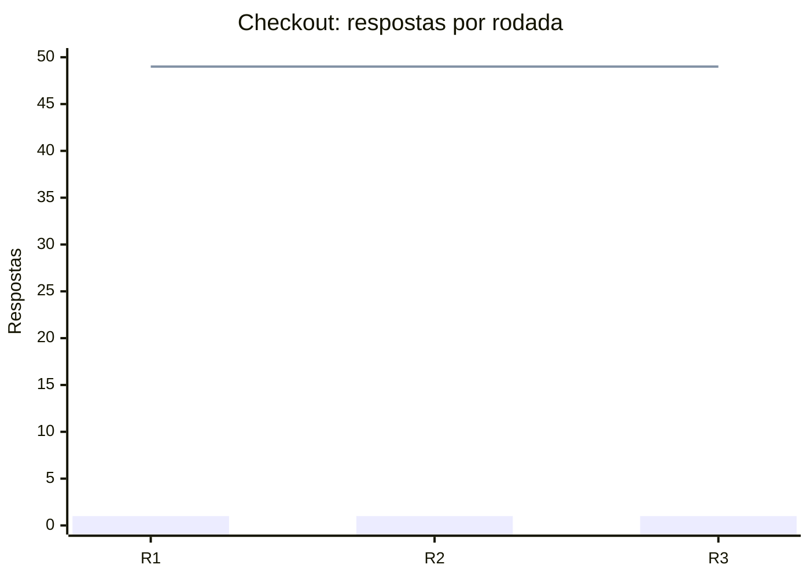
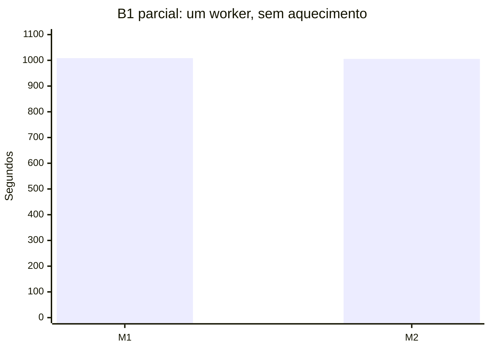
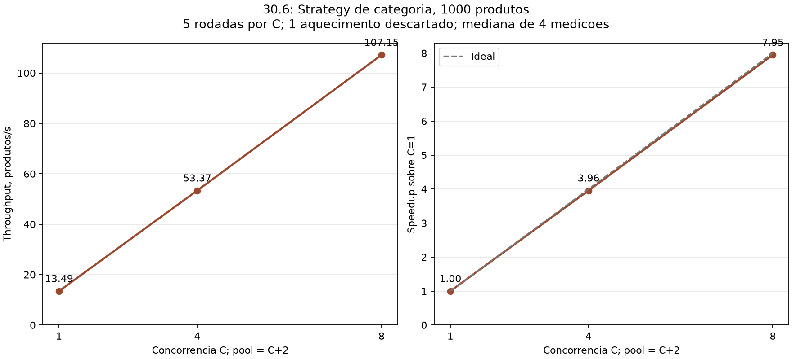
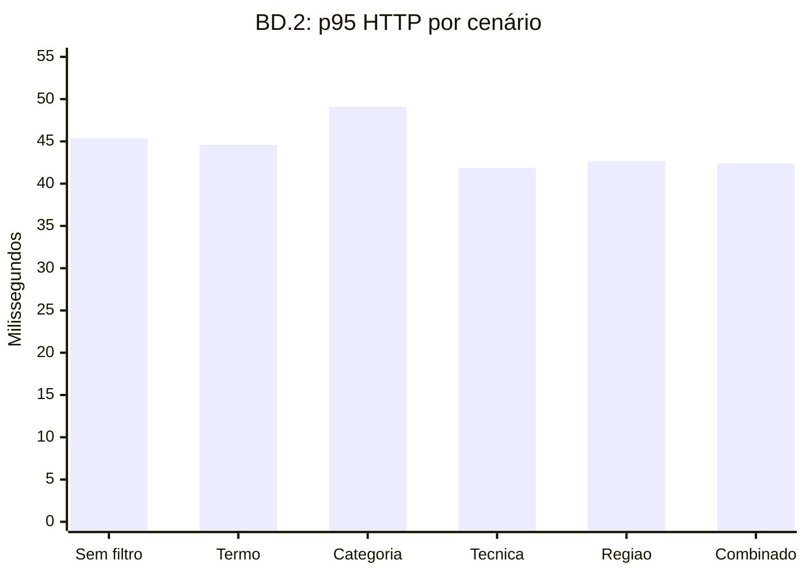

# Relatório de desempenho da U2

Subtarefa 30.7. Consolidação documental em 26/10/2026.
Foram utilizados exclusivamente os arquivos já salvos.
Nenhum benchmark foi executado nesta consolidação.

O checkout preservou as invariantes nas rodadas registradas.
O B2 manteve paridade e apresentou ganho com concorrência.
A busca cumpriu seu limite na coleta HTTP local.
O B1 foi interrompido; sua comparação permanece incompleta.

## 1. Ambiente e rastreabilidade

Os números de commit identificam a sequência da sprint.
Os hashes abaixo identificam as implementações correspondentes.
As coletas precederam seus respectivos commits de código.

| Commit da sprint | Subtarefa | Commit Git | Data da coleta | Branch Git registrada               | Fonte                                                                                                                                                                            |
| ---------------- | --------- | ---------- | -------------- | ----------------------------------- | -------------------------------------------------------------------------------------------------------------------------------------------------------------------------------- |
| 04               | BD.2      | `bd8fec3`  | 22/10/2026     | `codex/bd-2-busca-p95`              | [Resumo BD.2](../evidencias/PI4-BD-W12-Indices-Consultas/BD.2-busca-p95/00-resumo.md)                                                                                            |
| 10               | 30.1      | `1dfce1b`  | 22/10/2026     | `codex/30-1-concorrencia-checkout`  | [Resumo checkout](../evidencias/PI4-30-W12-Arquitetura-Distribuida/30.1-concorrencia-checkout/README.md)                                                                         |
| 16               | 30.5      | `60b9b56`  | 25/10/2026     | `codex/30-5-benchmark-fila`         | [Resumo B1](../evidencias/PI4-30/benchmark-fila/README.md)                                                                                                                       |
| 17               | 30.6      | `376c5f9`  | 25/10/2026     | `codex/30-6-benchmark-recomendacao` | [Resumo B2](../evidencias/PI4-30/benchmark-recomendacao/README.md), [referência Git conferida](../evidencias/PI4-30-W12-Arquitetura-Distribuida/30.7-relatorio/00-contexto.json) |

Esta consolidação utiliza `codex/30-7-relatorio-desempenho-u2`.
Sua base de leitura é `a21910b`.
[Registro desta consolidação](../evidencias/PI4-30-W12-Arquitetura-Distribuida/30.7-relatorio/00-contexto.json).

| Item                | Ambiente documentado                                                | Evidência                                                                                                                                                                                                                                                                                                  |
| ------------------- | ------------------------------------------------------------------- | ---------------------------------------------------------------------------------------------------------------------------------------------------------------------------------------------------------------------------------------------------------------------------------------------------------- |
| Máquina B1/B2       | Windows `win32`, arquitetura `x64`, Intel Core Ultra 7 265KF        | [Ambiente B1](../evidencias/PI4-30/benchmark-fila/execucao-2026-10-25T19-34-45.068Z/resultado.json), [ambiente B2](../evidencias/PI4-30/benchmark-recomendacao/execucao-2026-10-25T20-35-37-389Z/resultado.json)                                                                                           |
| Processamento B2    | 20 processadores lógicos reportados pelo Node                       | [B2, campo `contexto`](../evidencias/PI4-30/benchmark-recomendacao/execucao-2026-10-25T20-35-37-389Z/resultado.json)                                                                                                                                                                                       |
| Node                | `v22.12.0` registrado em B1, B2 e BD.2                              | [B1](../evidencias/PI4-30/benchmark-fila/execucao-2026-10-25T19-34-45.068Z/resultado.json), [B2](../evidencias/PI4-30/benchmark-recomendacao/execucao-2026-10-25T20-35-37-389Z/resultado.json), [BD.2](../evidencias/PI4-BD-W12-Indices-Consultas/BD.2-busca-p95/04-benchmark-volume-final/resultado.json) |
| PostgreSQL          | Neon, versão 18.6 em B2 e BD.2                                      | [B2](../evidencias/PI4-30/benchmark-recomendacao/execucao-2026-10-25T20-35-37-389Z/resultado.json), [BD.2](../evidencias/PI4-BD-W12-Indices-Consultas/BD.2-busca-p95/04-benchmark-volume-final/resultado.json)                                                                                             |
| Região e plano Neon | Ausentes dos metadados salvos; não inferidos do endpoint            | Mesmos campos de ambiente das fontes acima                                                                                                                                                                                                                                                                 |
| Branch de dados     | Volume sintético por `DATABASE_URL_VOLUME`, separado de demo/deploy | [B1](../evidencias/PI4-30/benchmark-fila/README.md), [B2](../evidencias/PI4-30/benchmark-recomendacao/README.md), [BD.2](../evidencias/PI4-BD-W12-Indices-Consultas/BD.2-busca-p95/00-resumo.md)                                                                                                           |
| Checkout            | API local autenticada; PostgreSQL em schema temporário isolado      | [Execução checkout](../evidencias/PI4-30-W12-Arquitetura-Distribuida/30.1-concorrencia-checkout/execucao-50-clientes.log)                                                                                                                                                                                  |
| Pool                | B1/B2 usaram pooler Neon; BD.2 utilizou uma conexão                 | [B1](../evidencias/PI4-30/benchmark-fila/execucao-2026-10-25T19-34-45.068Z/resultado.json), [B2](../evidencias/PI4-30/benchmark-recomendacao/execucao-2026-10-25T20-35-37-389Z/resultado.json), [BD.2](../evidencias/PI4-BD-W12-Indices-Consultas/BD.2-busca-p95/04-benchmark-volume-final/resultado.json) |

O hardware não foi inventariado nas evidências de checkout/BD.2.
Não se atribui automaticamente o hardware B2 às demais coletas.
As versões PostgreSQL registram arquiteturas diferentes entre coletas.
Portanto, elas não representam um ambiente remoto rigorosamente idêntico.

## 2. Metodologia

### Checkout integrado, 30.1

Cada rodada reiniciou o produto com estoque unitário.
Foram autenticados 50 compradores sintéticos distintos.
Os pedidos partiram simultaneamente com `Promise.all`.
Três rodadas conferiram respostas HTTP e estado persistido.
O PostgreSQL confirmou estoque, pedidos e pagamentos por produto.
Não houve aquecimento separado nem coleta de latências.
Consequentemente, não há mediana ou p95 de checkout.
[Protocolo e execução](../evidencias/PI4-30-W12-Arquitetura-Distribuida/30.1-concorrencia-checkout/README.md).

### Consumidores da fila, B1, 30.5

O protocolo previa 1.000 jobs por rodada.
As configurações previstas tinham 1, 2 e 4 workers.
Cada configuração previa um aquecimento e cinco medições.
Cada worker tinha concorrência interna unitária.
`NOTIFICACAO_LATENCIA_MS=200` simulava um canal externo.
O polling existente permaneceu em 1.000 ms.
A observação ocorreu a cada 250 ms, acrescida da consulta.
[Protocolo B1](../evidencias/PI4-30/benchmark-fila/README.md).

O relógio monotônico incluía publicação e processamento completo.
A inicialização dos workers ficava fora da cronometragem.
Throughput previsto: jobs divididos pela mediana em segundos.
Speedup previsto: mediana sequencial dividida pela mediana concorrente.
Eficiência prevista: speedup dividido pela quantidade de workers.
O protocolo não consolida p95.
[Definições B1](../evidencias/PI4-30/benchmark-fila/README.md).

A execução terminou com um aquecimento e duas medições.
Todas pertencem à configuração com um worker.
A rodada seguinte foi interrompida e excluída.
Não existe mediana final aprovada entre configurações.
Não foram calculados speedup ou eficiência comparativos.
[Interrupção](../evidencias/PI4-30/benchmark-fila/execucao-2026-10-25T19-34-45.068Z/interrupcao.json).

### Recomendações em lote, B2, 30.6

Cada rodada consultou 1.000 contextos visíveis, ordenados por UUID.
A Strategy existente foi executada sem HTTP ou cache aplicativo.
As concorrências foram 1, 4 e 8.
Os respectivos pools máximos tinham 3, 6 e 10 conexões.
Uma conexão do próprio pool exportava o snapshot.
As demais importavam transações `REPEATABLE READ READ ONLY`.
Cada configuração utilizava seu próprio snapshot consistente.
[Metodologia B2](../evidencias/PI4-30/benchmark-recomendacao/execucao-2026-10-25T20-35-37-389Z/resultado.json).

Houve cinco rodadas totais por configuração.
A primeira era aquecimento, excluído da mediana.
Restaram quatro medições por configuração, doze ao todo.
A mediana corresponde à média dos dois tempos centrais.
Throughput usa contextos divididos pela mediana em segundos.
Speedup compara medianas; eficiência divide speedup pela concorrência.
O protocolo não consolida p95.
[Tabela e definições B2](../evidencias/PI4-30/benchmark-recomendacao/execucao-2026-10-25T20-35-37-389Z/tabela.md).

O tempo abrangia as chamadas `obter` até a última conclusão.
Conexões, catálogo, comparação e arquivos ficavam fora do intervalo.
Todas as respostas foram comparadas à referência sequencial.
A comparação verificou IDs e ordem por contexto.
[Protocolo completo B2](../evidencias/PI4-30/benchmark-recomendacao/README.md).

### Busca HTTP, BD.2

A API local consultou a massa real de volume.
Cada cenário teve cinco aquecimentos e trinta medições.
As chamadas foram sequenciais, com cache aplicativo invalidado.
Todas exigiram HTTP 200 e `X-Cache: MISS`.
O tempo incluiu recebimento e decodificação do JSON.
Invalidação e validação ficaram fora da cronometragem.
[Metodologia BD.2](../evidencias/PI4-BD-W12-Indices-Consultas/BD.2-busca-p95/04-benchmark-volume-final/resultado.json).

P50 e p95 usam nearest-rank, sem descarte de outliers.
O p50 é o percentil registrado, sem interpolação.
Ele não corresponde à média dos dois tempos centrais.
Os aquecimentos são excluídos dos percentis.
Caches PostgreSQL e sistema operacional permaneceram aquecidos.
As consultas utilizaram `REPEATABLE READ READ ONLY`.
[Resumo e auditoria](../evidencias/PI4-BD-W12-Indices-Consultas/BD.2-busca-p95/00-resumo.md), [auditoria das amostras](../evidencias/PI4-BD-W12-Indices-Consultas/BD.2-busca-p95/07-auditoria-amostras.json).

## 3. Resultados

Os valores exibidos foram arredondados somente para apresentação.
As evidências preservam os valores brutos completos.

### Checkout integrado

Fonte da tabela: [rodadas JSON](../evidencias/PI4-30-W12-Arquitetura-Distribuida/30.1-concorrencia-checkout/rodadas-50-clientes.json).

| Rodada | Compradores | HTTP 201 | HTTP 409 | Estoque final | Pedidos | Pagamentos | Inesperadas |
| ------ | ----------- | -------- | -------- | ------------- | ------- | ---------- | ----------- |
| 1      | 50          | 1        | 49       | 0             | 1       | 1          | 0           |
| 2      | 50          | 1        | 49       | 0             | 1       | 1          | 0           |
| 3      | 50          | 1        | 49       | 0             | 1       | 1          | 0           |

O gráfico abaixo transpõe as contagens dessa mesma fonte.
Não representa latência ou throughput de checkout.

Barras: HTTP 201. Linha: HTTP 409.
Foi preservado um único vencedor em cada disputa.

### B1: fila com workers

Fonte: [CSV B1](../evidencias/PI4-30/benchmark-fila/execucao-2026-10-25T19-34-45.068Z/rodadas.csv) e [JSON B1](../evidencias/PI4-30/benchmark-fila/execucao-2026-10-25T19-34-45.068Z/resultado.json).

| Workers | Aquecimentos completos | Medições válidas | Tempos medidos, s    | Mediana final   | Throughput consolidado | Speedup / eficiência |
| ------- | ---------------------- | ---------------- | -------------------- | --------------- | ---------------------- | -------------------- |
| 1       | 1                      | 2                | 1.008,631; 1.005,532 | Não consolidada | Não consolidado        | Sem comparação       |
| 2       | 0                      | 0                | Não coletado         | Não coletada    | Não coletado           | Não coletado         |
| 4       | 0                      | 0                | Não coletado         | Não coletada    | Não coletado           | Não coletado         |

O aquecimento durou 1.004,654 segundos e foi excluído.
Cada rodada completa processou 1.000 intenções e 1.050 notificações.
Pedidos multiartesão explicam a quantidade maior de notificações.
[CSV e verificações](../evidencias/PI4-30/benchmark-fila/execucao-2026-10-25T19-34-45.068Z/rodadas.csv).

Não existe gráfico final salvo do B1.
A interrupção impediu gerar sua tabela e PNG finais.
O gráfico abaixo mostra somente as duas medições existentes.
Não representa a comparação entre configurações.
[Estado da execução](../evidencias/PI4-30/benchmark-fila/README.md).

Fonte dos pontos: [CSV bruto B1](../evidencias/PI4-30/benchmark-fila/execucao-2026-10-25T19-34-45.068Z/rodadas.csv).

### B2: recomendações em lote

Fonte: [resumo JSON](../evidencias/PI4-30/benchmark-recomendacao/execucao-2026-10-25T20-35-37-389Z/resultado.json), [CSV](../evidencias/PI4-30/benchmark-recomendacao/execucao-2026-10-25T20-35-37-389Z/rodadas.csv) e [tabela original](../evidencias/PI4-30/benchmark-recomendacao/execucao-2026-10-25T20-35-37-389Z/tabela.md).

| Concorrência | Pool máximo | Medições | Mediana, s | Produtos/s | Speedup | Eficiência, % |
| ------------ | ----------- | -------- | ---------- | ---------- | ------- | ------------- |
| 1            | 3           | 4        | 74,155     | 13,485     | 1,000   | 100,00        |
| 4            | 6           | 4        | 18,738     | 53,368     | 3,957   | 98,94         |
| 8            | 10          | 4        | 9,333      | 107,152    | 7,946   | 99,32         |

Imagem copiada integralmente do [PNG original B2](../evidencias/PI4-30/benchmark-recomendacao/execucao-2026-10-25T20-35-37-389Z/throughput.png).
Sua igualdade é conferida por hash, sem redesenhar resultados.
O ganho observado vale somente para as configurações medidas.

### Busca HTTP, BD.2

Fonte: [resultado final](../evidencias/PI4-BD-W12-Indices-Consultas/BD.2-busca-p95/04-benchmark-volume-final/resultado.json) e [CSV original](../evidencias/PI4-BD-W12-Indices-Consultas/BD.2-busca-p95/04-benchmark-volume-final/bruto.csv).

| Cenário    | Medições | p50, ms | p95, ms | Máximo, ms |
| ---------- | -------- | ------- | ------- | ---------- |
| sem-filtro | 30       | 41,600  | 45,370  | 46,162     |
| termo      | 30       | 41,384  | 44,601  | 44,951     |
| categoria  | 30       | 40,731  | 49,102  | 49,894     |
| tecnica    | 30       | 40,723  | 41,883  | 42,327     |
| regiao     | 30       | 40,724  | 42,661  | 46,236     |
| combinado  | 30       | 40,566  | 42,377  | 42,871     |

O gráfico transpõe os p95 da tabela original.

Todos ficaram abaixo do limite registrado de 500 ms.
Não houve criação de índices entre as coletas BD.2.
Portanto, não se atribui variação temporal a índices novos.
[Decisão baseada nos planos](../evidencias/PI4-BD-W12-Indices-Consultas/BD.2-busca-p95/00-resumo.md).

## 4. Consistência

| Invariante                                | Resultado observado                                         | Evidência                                                                                                                                                                                                                                             |
| ----------------------------------------- | ----------------------------------------------------------- | ----------------------------------------------------------------------------------------------------------------------------------------------------------------------------------------------------------------------------------------------------- |
| Estoque não negativo                      | Estoque final 0 nas três rodadas; nenhum negativo observado | [Rodadas checkout](../evidencias/PI4-30-W12-Arquitetura-Distribuida/30.1-concorrencia-checkout/rodadas-50-clientes.json), [consulta SQL no log](../evidencias/PI4-30-W12-Arquitetura-Distribuida/30.1-concorrencia-checkout/execucao-50-clientes.log) |
| Atomicidade do checkout                   | Um pedido e um pagamento por rodada                         | [Rodadas checkout](../evidencias/PI4-30-W12-Arquitetura-Distribuida/30.1-concorrencia-checkout/rodadas-50-clientes.json)                                                                                                                              |
| Zero job duplicado no recorte completo B1 | Uma tentativa por intenção; zero notificações duplicadas    | [CSV B1](../evidencias/PI4-30/benchmark-fila/execucao-2026-10-25T19-34-45.068Z/rodadas.csv), [verificações por rodada](../evidencias/PI4-30/benchmark-fila/execucao-2026-10-25T19-34-45.068Z/resultado.json)                                          |
| Unicidade verificável                     | Chave usuário, pedido e tipo; sem chaves excedentes         | [Consulta de unicidade B1](../evidencias/PI4-30/benchmark-fila/consulta-unicidade.sql)                                                                                                                                                                |
| Paralelo idêntico ao sequencial B2        | Quinze rodadas com mesmos IDs ordenados; zero divergências  | [Diff vazio](../evidencias/PI4-30/benchmark-recomendacao/execucao-2026-10-25T20-35-37-389Z/diff.json), [conferência independente](../evidencias/PI4-30/benchmark-recomendacao/execucao-2026-10-25T20-35-37-389Z/conferencia-independente.json)        |

A unicidade B1 vale somente nas rodadas completas registradas.
Não existe comprovação B1 para os workers não medidos.
A referência B2 inclui o aquecimento sequencial na comparação.
Os aquecimentos são descartados somente da análise temporal.

## 5. Limitações

- **Latência simulada B1:** o atraso simula um canal externo.
  O polling também integra o tempo observado.
  [Protocolo B1](../evidencias/PI4-30/benchmark-fila/README.md).
- **B1 interrompido:** faltam medições para comparar configurações de workers.
  Nenhuma estimativa substituiu as rodadas ausentes.
  [Interrupção registrada](../evidencias/PI4-30/benchmark-fila/execucao-2026-10-25T19-34-45.068Z/interrupcao.json).
- **Pool Neon:** espera local não mede espera remota.
  O pico local amostrado B2 foi zero.
  `max_connections=901` não informa a cota comercial do pooler.
  Não foi identificado teto nas configurações B2 medidas.
  [Ambiente e metodologia B2](../evidencias/PI4-30/benchmark-recomendacao/execucao-2026-10-25T20-35-37-389Z/resultado.json).
- **Máquina local:** as coletas não medem latência do deploy.
  CPU, rede e PostgreSQL não foram isolados individualmente.
  Testes específicos sobrepuseram parte do aquecimento sequencial B2.
  Esses testes utilizaram outra branch Neon.
  [Limites B2](../evidencias/PI4-30/benchmark-recomendacao/README.md).
- **Massa BD.2:** havia 1.000 produtos, sem fotos ou avaliações.
  Agregações dessas tabelas percorriam o caminho vazio.
  [Contexto real de volume](../evidencias/PI4-BD-W12-Indices-Consultas/BD.2-busca-p95/06-contexto-volume.json).
- **Free tier Render:** a decisão registrada conserva consumidor integrado.
  A verificação histórica documenta restrições de workers e suspensão.
  O painel autenticado não confirmou a configuração remota.
  Portanto, os benchmarks locais não comprovam escalabilidade no Render.
  [Decisão 30.3](../evidencias/PI4-30-W12-Arquitetura-Distribuida/30.3-worker-separado/04-decisao-render.md), [verificação histórica 30.4](../evidencias/PI4-30-W12-Arquitetura-Distribuida/30.4-diagrama-distribuido/00-validacao.md).

## 6. Conclusão

O checkout preservou estoque, pedido e pagamento nas disputas registradas.
O B2 alcançou speedup 7,946, mantendo os resultados sequenciais.
A busca apresentou p95 máximo de 49,102 ms.
O B1 parcial não permite concluir ganho entre workers.
Essas conclusões limitam-se às evidências locais citadas.

O relatório consolida os dados disponíveis para 30.7.
A definição de pronto do PI4-30 exige ambos benchmarks completos.
O B1 salvo não comprova esse fechamento integral.
[Definição de pronto](10-Subtarefas-Jira-Sprint12-13.md).
