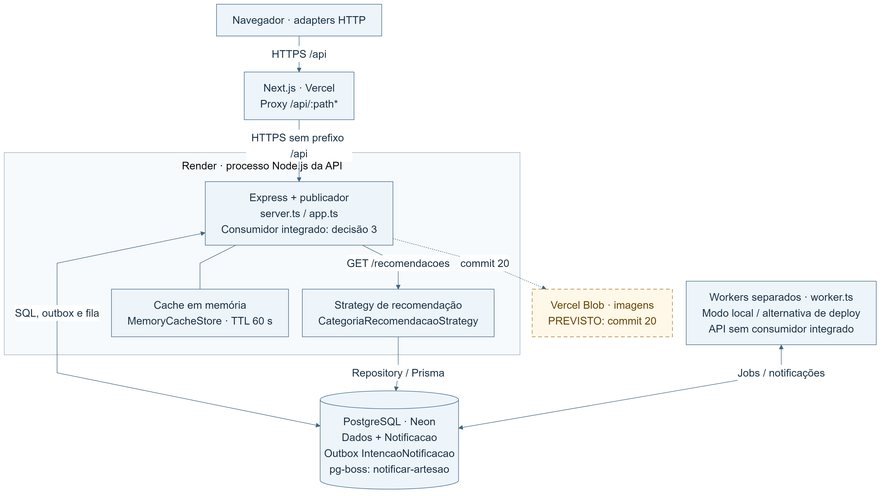
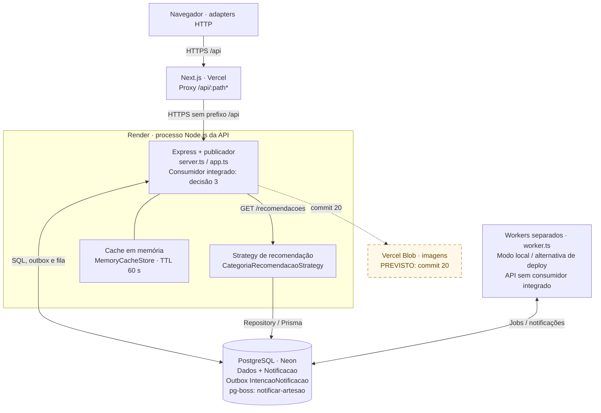

# Arquitetura distribuída do Origem

Subtarefa 30.4 · PI4-30 · FCCPD · 25/10/2026.
Responsável: Sergio. Revisor indicado: Pedro.
Base inspecionada: `1dfce1b`, incluindo a separação da 30.3.

## Componentes e implantação

O desenho representa o modo HTTP do frontend.
`NEXT_PUBLIC_DATA_SOURCE=http` seleciona os adapters HTTP.
No modo fake, os services usam persistência local.
O proxy exige `BACKEND_URL` configurada no Next.js.
Sua ausência deixa a lista de rewrites vazia.





O contorno Render delimita um único processo da API.
Cache e Strategy pertencem a esse mesmo processo.
`server.ts` também inicializa o publicador da outbox.
O consumidor integrado depende de `RUN_WORKER_IN_API=true`.
Esse valor é o padrão definido pela decisão 3.
A caixa externa representa processos separados já implementados.
Sua implantação remota não foi confirmada nesta tarefa.

As setas contínuas representam relações existentes no código.
A ligação tracejada representa somente o futuro commit 20.
Vercel Blob permanece a exceção explicitamente prevista pelo prompt.
Não foram encontrados SDK, token ou integração Blob implementados.
Cada componente existente está vinculado abaixo ao respectivo arquivo.

### Fluxos e limites

O navegador solicita `/api/recomendacoes` pelo domínio do frontend.
O rewrite encaminha essa chamada para `/recomendacoes` no Express.
O backend mantém suas rotas sem o prefixo `/api`.
O cookie de sessão acompanha requisições autenticadas pelo proxy.
`GET /recomendacoes` é público e usa a Strategy de categoria.
`GET /recomendacoes/para-mim` exige comprador e usa histórico.
Ambas as Strategies executam dentro da API.

O checkout persiste pedido, itens, pagamento simulado e intenção.
Essas gravações pertencem à mesma transação PostgreSQL.
Os produtos recebem locks `FOR UPDATE` por IDs ordenados.
O publicador consulta intenções após o commit da transação.
Depois publica jobs na fila persistente do mesmo banco.
O consumidor cria notificações internas para os artesãos distintos.
Somente depois marca a intenção como `processada`.
Não há envio implementado de email, SMS ou mensagens externas.

A fila permite três novas tentativas, com backoff.
Reentregas são possíveis; execução única absoluta não é garantida.
A restrição `(usuarioId, pedidoId, tipo)` evita notificações duplicadas.
Atualizações condicionais preservam `processada` como estado terminal.
Uma falha permanente pode esgotar as tentativas configuradas.
Persistência não elimina a necessidade de acompanhamento operacional.

## Responsabilidade, escala e falhas

Os caminhos abaixo partem da raiz do repositório.
Escala descreve possibilidades, sem afirmar réplicas atualmente implantadas.

| Componente e vínculo real                                                                                                            | Responsabilidade                                               | Processo                                             | Como escala                                                                   | Se cair                                                                             |
| ------------------------------------------------------------------------------------------------------------------------------------ | -------------------------------------------------------------- | ---------------------------------------------------- | ----------------------------------------------------------------------------- | ----------------------------------------------------------------------------------- |
| Navegador: `frontend/src/app/`, `frontend/src/services/http/`                                                                        | Renderiza telas e executa adapters HTTP.                       | Navegador de cada usuário.                           | Novas sessões utilizam clientes independentes.                                | A sessão visual encerra. Dados confirmados permanecem no servidor.                  |
| Next.js: `frontend/next.config.ts`                                                                                                   | Serve o frontend e encaminha `/api/:path*`.                    | Aplicação hospedada na Vercel.                       | A plataforma amplia atendimento conforme configuração e plano.                | Interface e proxy ficam indisponíveis. A API permanece independente.                |
| API: `backend/src/server.ts`, `backend/src/app.ts`                                                                                   | Inicializa HTTP, composição, publicador e consumidor opcional. | Um processo Node.js no modo integrado previsto.      | Mais instâncias exigem plano compatível e revisão do cache.                   | HTTP e publicador param. O consumidor integrado também para.                        |
| Publicador: `backend/src/queues/bootstrap.ts`, `backend/src/queues/notificacao.publisher.ts`                                         | Consulta a outbox e envia jobs após o commit.                  | Intervalo dentro do processo da API.                 | Multiplicar instâncias pode produzir reentregas. Exige coordenação adicional. | Intenções pendentes persistem até retomada. Pedidos confirmados permanecem válidos. |
| Strategy: `backend/src/routes/recomendacao.routes.ts`, `backend/src/integrations/recommendation/categoria-recomendacao.strategy.ts`  | Seleciona recomendações usando Repository e Prisma.            | Módulo no processo Express.                          | Escala junto da API, respeitando conexões e consultas.                        | Falhas viram respostas de erro na borda HTTP.                                       |
| Cache: `backend/src/utils/cache.ts`, `backend/src/utils/cache-http.ts`                                                               | Mantém respostas públicas com TTL e limite LRU.                | Memória da API; padrão de 500 entradas.              | Cada instância possui cache e invalidação próprios.                           | Reinício perde entradas. Leituras voltam a consultar o banco.                       |
| PostgreSQL Neon: `backend/prisma/schema.prisma`, `backend/src/queues/pg-boss.client.ts`                                              | Persiste domínio, outbox, notificações e fila pg-boss.         | Serviço PostgreSQL externo compartilhado.            | Capacidade, índices e conexões limitam API e consumidores.                    | Checkout, publicação e consumo falham. Cache ainda válido pode responder.           |
| Consumidor: `backend/src/jobs/notificar-artesao.worker.ts`, `backend/src/jobs/notificar-artesao.handler.ts`, `backend/src/worker.ts` | Reserva jobs e grava notificações idempotentes.                | Integrado na API ou em processos worker separados.   | Novos processos consomem a mesma fila e banco.                                | Jobs persistem. Reentrega depende dos limites da fila.                              |
| Vercel Blob: previsto no commit 20                                                                                                   | Armazenará imagens conforme decisão de arquitetura existente.  | Serviço externo futuro, sem integração implementada. | Capacidade dependerá do serviço e da integração futura.                       | Não há dependência Blob implementada para interromper hoje.                         |

O cache público usa TTL padrão de 60 segundos.
`CACHE_TTL_SECONDS` permite configurar esse prazo na API.
Respostas pessoais de recomendação utilizam `Cache-Control: no-store`.
As invalidações do catálogo alcançam também recomendações públicas.
Hoje essas invalidações ficam restritas à própria instância.

## Por que não adicionar microsserviços

O risco de distribuição forçada consta em `CLAUDE.md` §5.
O MVP exige separação coerente, com custo operacional controlado.
Controllers, services e repositories já organizam o backend.
A Strategy permite evolução sem criar outro serviço HTTP.
O plano gratuito pressupõe uma única instância da API.
Fila e outbox aproveitam o PostgreSQL já necessário.
Outro broker acrescentaria operação, credenciais e novos pontos de falha.
Microsserviços adicionais também exigiriam deploys, observabilidade e contratos distribuídos.
Não há ganho medido que justifique esses custos agora.

O worker separado atende uma necessidade concreta: processamento assíncrono.
Ele reutiliza o backend, seus repositories e o banco.
Essa separação de processo não cria um domínio independente.
O banco compartilhado mantém acoplamento e concentra a indisponibilidade.

### Com mais carga

1. Medir latência, conexões, profundidade da fila e falhas primeiro.
2. Separar consumidores em serviço pago continuamente ativo.
3. Ampliar processos gradualmente, respeitando o limite do PostgreSQL.
4. Coordenar publicadores antes de multiplicar instâncias da API.
5. Compartilhar cache ou coordenar invalidações entre instâncias.
6. Otimizar índices e consultas antes de separar domínios.
7. Extrair serviços somente mediante gargalos e autonomia comprovados.

`WORKER_CONCURRENCY` é validada, mas não controla paralelismo interno atualmente.
Sua aplicação permanece reservada à subtarefa 30.5.
Os benchmarks 30.5 e 30.6 permanecem fora desta entrega.

## Deploy do worker: decisão 3

A decisão 3 preserva `RUN_WORKER_IN_API=true` por padrão.
Fonte: `docs/PROMPTS_EXECUCAO_SPRINT12-13.md`, decisão 3.
Ela mantém API, publicador e consumidor no mesmo processo.
O worker independente permanece disponível para execução separada.

| Evidência consultada                                                                             | Resultado observado                                                                                                                  | Limite                                                                                  |
| ------------------------------------------------------------------------------------------------ | ------------------------------------------------------------------------------------------------------------------------------------ | --------------------------------------------------------------------------------------- |
| Código e `backend/package.json`, em 25/10/2026                                                   | `start` e `start:api` iniciam `server.js`. `start:worker` inicia `worker.js`. `start:prod` aplica migrations antes de iniciar a API. | Scripts locais não comprovam o comando remoto ativo. Nenhum foi executado nesta tarefa. |
| `evidencias/PI4-30-W12-Arquitetura-Distribuida/30.3-worker-separado/04-decisao-render.md`        | Registra o padrão integrado e testes locais separados.                                                                               | A evidência declara que o painel não foi consultado.                                    |
| Acesso ao painel Render, em 25/10/2026                                                           | `https://dashboard.render.com` redirecionou para `/login`.                                                                           | Sem sessão autenticada, plano e variáveis remotas não foram consultados.                |
| [Documentação oficial do plano gratuito](https://render.com/docs/free), consultada em 25/10/2026 | Background Workers não oferecem instância Free. Web Services Free ficam limitados a uma instância.                                   | Confirma a política pública, sem comprovar a configuração desta conta.                  |

Assim, o documento representa o modo previsto pela decisão.
Não afirma que a configuração remota tenha sido verificada.
Permanece pendente conferir plano, comando e flag no painel autenticado.

Web Services Free suspendem após quinze minutos sem tráfego recebido.
Ao suspender, API, publicador e consumidor integrado deixam de executar.
Jobs e intenções persistem no Neon durante essa pausa.
O próximo acesso pode aguardar aproximadamente um minuto para retomada.
A decisão integrada não garante processamento contínuo durante suspensão.
Esses limites constam na [documentação oficial](https://render.com/docs/free).

Para separação futura, a API usará `RUN_WORKER_IN_API=false`.
O outro processo iniciará pelo script `start:worker`.
Ambos precisarão compartilhar a mesma `DATABASE_URL`.
O worker não inicia Express nem publicador da outbox.
Não houve alteração remota, deploy ou execução de migrations.

## Reprodução do PNG e validação

A fonte exportável está em `docs/arquitetura-distribuida.mmd`.
Ela contém o mesmo diagrama Mermaid apresentado acima.
O arquivo acrescenta somente tema e ajustes de disposição.
Execute os comandos abaixo pela raiz do repositório.
Use o Chromium/Chrome previamente instalado no ambiente.

```powershell
$env:PUPPETEER_EXECUTABLE_PATH = 'C:\Program Files\Google\Chrome\Application\chrome.exe'
$env:PUPPETEER_SKIP_DOWNLOAD = 'true'
npm.cmd exec --yes --package=@mermaid-js/mermaid-cli@11.17.0 -- mmdc `
  --input docs/arquitetura-distribuida.mmd `
  --output docs/arquitetura-distribuida.png `
  --scale 3 --width 1600 --backgroundColor white
```

O PNG deve ser impresso em A4, orientação paisagem.
Use ajuste à área útil, preservando sua proporção.
O tamanho final e a conferência visual constam nas evidências.

Esta tarefa altera somente documentação e seus artefatos.
Não executa benchmarks, testes de banco ou deploy.
A revisão documental confere vínculos, limites operacionais e segredos.
Não substitui a revisão humana indicada para Pedro.
