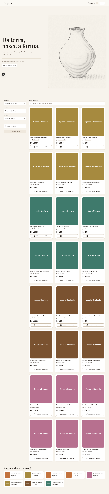

# 34.5: README final e reprodução limpa

Validação local em 09/11/2026, horário de Brasília.
Branch: `codex/34-5-readme-final`.
Base executável: `7995bc207131410775129f4f13de17ec471b7807`.
Somente documentação, imagem documental e exceções de versionamento foram alteradas.
Não houve commit, push ou novo deploy.

## Entrega

- [README da raiz](../../../README.md).
- [Registro de uso de IA](../../../docs/uso-de-ia.md).
- [Conferência documental](validacao-documental.json).
- [Origem dos documentos da 35.7](documentos-35.7.json).

O README descreve frontend, API, recomendação e worker.
Inclui instalação, banco, bootstrap, migrations privadas e runtime.
O caminho Docker mantém o frontend fora dos containers.
Deploy cobre Vercel, API Node e recomendação Docker no Render.
As variáveis de deploy aparecem exclusivamente pelos nomes.

A referência ao commit 19 correspondia a alterações sem commit.
Os documentos existiam em outro worktree, ainda não integrados.
O responsável autorizou sua inclusão nesta entrega.
Foram copiados arquitetura, fonte Mermaid, PNG e relatório de desempenho.
Também foram preservadas suas evidências e entrada de IA.
Três exceções específicas no `.gitignore` disponibilizam o diagrama documental.
Nenhum hash de commit foi inventado para essa entrega.

## Cópia limpa e dependências

A cópia foi exportada por `git archive HEAD`.
Não recebeu `.env`, `node_modules` ou builds do workspace.
Os candidatos documentais foram sobrepostos depois, sem alterar fontes executáveis.
O [registro da cópia](copia-limpa.json) identifica diretório e base.
A conferência final compara os fontes com essa revisão.
Ela normaliza somente finais de linha de arquivos textuais.
O Git exportou CRLF em parte dos arquivos no Windows.
[Conferência do código congelado](codigo-congelado.json).
Os scripts auxiliares de observação ficaram somente no temporário.

| Diretório                | Instalação real                                | Resultado                          |
| ------------------------ | ---------------------------------------------- | ---------------------------------- |
| `backend/`               | `npm ci --prefer-offline --no-audit --no-fund` | 437 pacotes instalados, saída zero |
| `frontend/`              | Mesmo comando, lockfile próprio                | 311 pacotes instalados, saída zero |
| `services/recomendacao/` | Mesmo comando, lockfile próprio                | 247 pacotes instalados, saída zero |

Logs: [backend](backend-npm-ci.txt), [frontend](frontend-npm-ci.txt)
e [microsserviço](services-recomendacao-npm-ci.txt).
Não houve instalação de dependências a partir de outro checkout.
O cache npm forneceu pacotes, preservando as versões dos lockfiles.

Ambiente nativo: Windows, Node `v22.12.0`, npm `10.9.0`.
O npm informou avisos de engine de ferramentas de desenvolvimento.
Esses avisos não impediram instalação nem os fluxos exercitados.
O README recomenda Node 22.13 ou superior na linha 22.
Não se afirma execução nativa nessa versão recomendada.

## Execução sem Docker

Resultado: **aprovado**.
[Resultados estruturados](nativo-resultado.json) e [execução](nativo-execucao.txt).

O teste criou um banco Neon novo e exclusivo.
Não usou containers para banco ou aplicação nesse caminho.
PostgreSQL observado: `18.6`.
O [registro isolado](banco-isolado.json) identifica banco e papéis.
Foram usados nomes exclusivos para evitar alterar papéis existentes.
As conexões de runtime permaneceram restritas às responsabilidades documentadas.

| Etapa do README                       | Resultado                  | Log                                                          |
| ------------------------------------- | -------------------------- | ------------------------------------------------------------ |
| Gerar Prisma Client                   | Saída zero                 | [nativo-prisma.txt](nativo-prisma.txt)                       |
| Aplicar migrations da API e views     | Saída zero                 | [nativo-migrations.txt](nativo-migrations.txt)               |
| Carregar seed demo                    | Saída zero                 | [nativo-seed.txt](nativo-seed.txt)                           |
| Criar papéis, grants e schema privado | Saída zero                 | [nativo-bootstrap.txt](nativo-bootstrap.txt)                 |
| Aplicar migration privada             | Saída zero                 | [nativo-migration-privada.txt](nativo-migration-privada.txt) |
| Iniciar recomendação                  | Health 200                 | [nativo-recomendacao.txt](nativo-recomendacao.txt)           |
| Iniciar API e publicador              | Health 200                 | [nativo-api.txt](nativo-api.txt)                             |
| Iniciar worker separado               | Notificação persistida     | [nativo-worker.txt](nativo-worker.txt)                       |
| Iniciar Next.js                       | Interface e proxy HTTP 200 | [nativo-frontend.txt](nativo-frontend.txt)                   |

O proxy retornou 24 produtos na primeira página.
As recomendações retornaram oito produtos com estratégia `fallback-geral`.
Esse resultado veio do microsserviço ativo, sem fallback local.
A chamada direta ao microsserviço sem token retornou 401.
O login demo retornou 200 e o pedido, 201.
Uma notificação daquele pedido foi confirmada no PostgreSQL.
Cookie e senha de login ficaram somente na memória.

Os quatro processos iniciados pelo teste foram encerrados.
O banco e os papéis exclusivos foram preservados para inspeção.
Nenhum dado de outras bases foi alterado por esse fluxo.

## Execução com Docker

Resultado: **aprovado**.
[Resultados estruturados](docker-resultado.json) e [execução final](docker-execucao-final.txt).

Projeto Compose exclusivo: `origem-34-5-clean`.
O volume PostgreSQL iniciou vazio, independente do Neon.
Docker Engine observado: `29.8.2`; Compose: `v5.6.0`.
As imagens foram construídas diretamente da cópia limpa.
O arquivo `.env.compose` recebeu segredos locais aleatórios.
Esses valores não foram incluídos nas evidências versionáveis.

Comandos principais executados na cópia:

```powershell
docker compose -p origem-34-5-clean --env-file .env.compose build
docker compose -p origem-34-5-clean --env-file .env.compose up -d
```

Logs: [build](docker-build.txt), [primeira subida](docker-up.txt)
e [subida da revalidação](docker-up-revalidacao.txt).
O projeto explícito apenas isola os recursos deste teste.
Não muda a composição ou os comandos de preparação.

| Serviço              | Estado conferido      |
| -------------------- | --------------------- |
| `postgres`           | `running`, `healthy`  |
| `api`                | `running`, `healthy`  |
| `recomendacao`       | `running`, `healthy`  |
| `worker`             | `running`, `healthy`  |
| `migrate`            | `exited`, código zero |
| `recomendacao-setup` | `exited`, código zero |

O frontend executou localmente com suas dependências recém-instaladas.
O proxy retornou catálogo e oito recomendações reais.
Login retornou 200; pedido retornou 201.
A contagem PostgreSQL confirmou uma nova notificação.
O log JSON do worker confirmou o mesmo pedido.
[Logs dos serviços](docker-servicos.txt) e [frontend](docker-frontend.txt).

O navegador Chrome abriu a interface em 1280px.
O teste selecionou “Continuar como visitante” e aguardou produto real.
A captura foi conferida visualmente, incluindo catálogo e faixa de recomendações.



Ao terminar, os processos e containers exclusivos foram parados.
O volume foi preservado, sem remoção de dados.
[Registro de parada](docker-stop.txt).

### Diagnóstico preservado

A primeira conferência Docker esperava `notificacao-processada` no log.
Esse nome antigo estava no README herdado da 35.3.
O código atual registra campos JSON, incluindo `resultado`.
A notificação já havia sido persistida naquela execução.
O erro estava na expectativa documental, não no processamento.

Foram conferidos o fonte atual e o evento emitido.
O README foi corrigido para os campos efetivamente existentes.
A repetição conferiu `servico`, `resultado` e o mesmo `pedidoId`.
O fluxo completo e a interface passaram na execução final.
Não foi alterado código para corrigir a expectativa.

Registros: [resultado inicial](docker-resultado-inicial.json),
[logs iniciais](docker-servicos-inicial.txt) e [execução inicial](docker-execucao.txt).
A repetição reutilizou o volume exclusivo, com o seed idempotente.
O primeiro uso desse volume vazio consta na subida inicial.

## Conferência de documentação e segurança

A [conferência inicial](validacao-inicial.json) identificou lacunas documentais.
Faltavam deploy completo, bootstrap local e seção distribuída final.
A conferência final valida links locais, âncoras e scripts existentes.
Também verifica os três serviços e suas variáveis por nome.

O registro de IA possui uma entrada por subtarefa.
São 26 entradas, sem atribuições humanas novas.
As entradas 34.3 e 34.4 permanecem explicitamente pendentes.
Não foram criados tag, roteiro ou autoria para essas entregas.
As entradas antigas de outras sprints foram preservadas.

Foi realizada revisão documental local, sem delegação de agentes.
Não houve implementação de feature ou mudança de superfície executável.
Foram conferidos segredos, cookies, conexões e limites das conclusões.
Hostnames privados e endereços de rede locais foram sanitizados.
Logs e resultados não incluem os arquivos de ambiente.

Esta validação demonstra reprodução técnica pelo roteiro documentado.
Não representa teste presencial com outro integrante do grupo.
Também não representa novo deploy ou auditoria dos serviços publicados.
