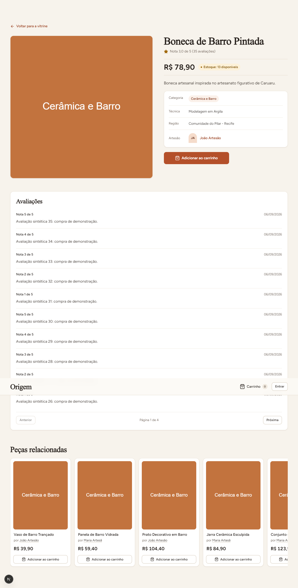
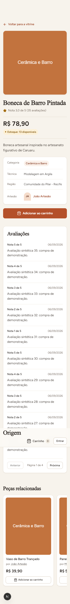

# PI4-36.1: fallback local da recomendação

Validação local em 04/11/2026, com dados sintéticos.
Branch: `codex/36-1-fallback-recomendacao`.
Sem commit ou push nesta entrega.

## Comportamento

Oito produtos visíveis preservam a estratégia do microsserviço.
Seleções menores recebem complemento e estratégia `misto`.
Indisponibilidade, timeout e resposta inválida retornam `fallback-local`.
O fallback prioriza a categoria, depois as vendas gerais.
Conta somente vendas confirmadas, com nota e UUID como desempates.
Exclui contexto, duplicados, produtos indisponíveis e artesãos indisponíveis.
A rota pessoal também preserva a exclusão de compras confirmadas.

`CachePublico` recebe a opção explícita `deveGuardar`.
`CacheHttp` encaminha essa política sem conhecer recomendações.
Respostas `fallback-local` e `misto` permanecem `MISS`.
A rota pessoal mantém `no-store`, sem cache compartilhado.

## Justificativa da consulta nova

`CatalogoRepository.listar` pagina pela criação antes de calcular vendas.
Por isso, não serve para selecionar os mais vendidos.
`listarMaisVendidosVisiveis` seleciona IDs usando SQL parametrizado.
A hidratação reutiliza `carregarVisiveisPorIds` e o DTO existente.
São consultas em lote, sem uma consulta por produto.
Essa regra pertence à degradação da API, fora das Strategies.
Esta justificativa deve acompanhar o futuro commit solicitado.

## Verificação

| Verificação | Resultado |
|---|---|
| Backend completo | 847 aprovados, em 82 arquivos |
| Backend, testes direcionados | 95 aprovados |
| Frontend completo | 1.028 aprovados |
| Microsserviço completo | 58 aprovados |
| Lint e typecheck | Verificados nos três projetos |
| Tela desktop, 1280 px | 5/5 com oito recomendações |
| Tela mobile, 360 px | 5/5 com oito recomendações |
| Microsserviço desligado | Cinco chamadas, `fallback-local`, `MISS` |
| Timeout simulado | 100 ms; limite total de 1.100 ms |
| Recuperação | Próxima chamada retorna `categoria`, depois `HIT` |
| Seleção parcial | `misto`, sem repetição, invisíveis ou cache |

A suíte completa do backend também foi executada.
Seu resultado final consta no arquivo `backend-final.txt`.
Os três projetos somam 1.933 testes aprovados.
As falhas iniciais estão preservadas nos arquivos de diagnóstico.
A conexão restrita não permitia criar schemas da fila.
A execução final usa `DIRECT_URL` somente no processo de testes.
Aplica os prazos do CI: 60 segundos por teste.
Hooks recebem 120 segundos; o arquivo `.env` permanece intacto.

As massas dos testes de cache garantem oito candidatos visíveis.
A moderação de casos anteriores é restaurada antes de cada caso.
O consumidor legado reconhece estratégias novas e contabiliza `MISS` real.
Isso preserva sua compatibilidade, sem reexecutar relatórios oficiais da 36.2.
O roteiro visual fica no frontend, preservando o build backend isolado.

Os testes começaram antes da implementação, com falhas esperadas.
O backend não devolvia fallback nem respeitava a política de cache.
O OpenAPI não enumerava estratégias; o frontend aceitava estratégia desconhecida.

## Evidência visual e HTTP

[Respostas HTTP e dez verificações da tela](tela-network.json).
[Limpeza do schema visual](limpeza.json).
O arquivo HTTP contém somente respostas públicas e dados sintéticos.
Não registra cookies, headers de autenticação ou URLs de conexão.





Para repetir a validação visual:

```powershell
Set-Location backend
node --import tsx ../frontend/e2e/recomendacao-fallback.evidence.ts
```

O script prepara migrations e seed em schema isolado.
Inicia API, frontend e Chrome locais, com microsserviço desligado.
Fecha processos e remove o schema criado ao terminar.

## Revisão equivalente de segurança

Realizada nesta conversa, conforme autorização do responsável.
Nenhum agente foi delegado.

- SQL parametrizado para contexto, exclusões, comprador e limite.
- Visibilidade verifica estoque, moderação, atividade e papel artesanal.
- A identidade pessoal continua vindo exclusivamente da sessão autenticada.
- Logs incluem somente evento constante e motivo classificado.
- Falhas do catálogo continuam seguindo o tratamento da borda.
- Respostas degradadas não persistem no cache compartilhado.
- O frontend valida os cinco nomes públicos de estratégia.

Nenhum problema de segurança identificado no diff da subtarefa.
Não houve alteração de permissões persistentes ou credenciais.
O fallback respeita a disponibilidade real de produtos elegíveis.
