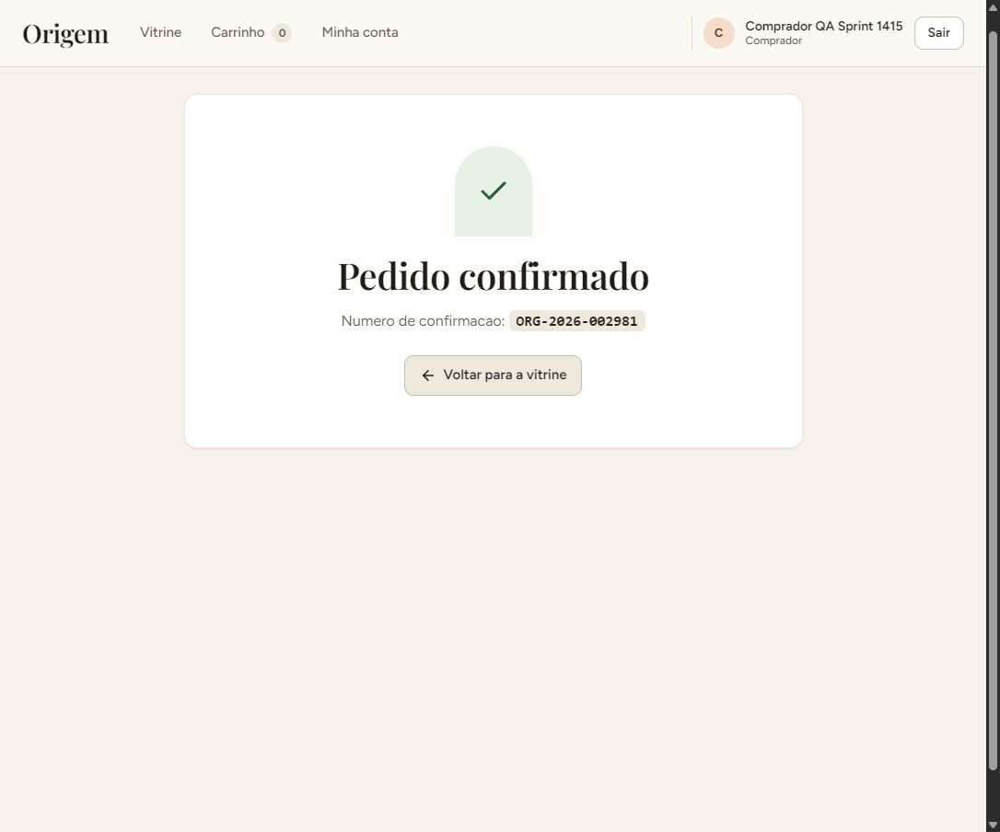

# Validação funcional da Sprint 14–15

Data: 10/11/2026. Horários das telas: Brasília.
Commit local: `f0802685e5276a0d941ebc94e1c298de83437bee`.
Branch: `codex/validacao-sprint-14-15`.

Os fluxos principais funcionaram com persistência PostgreSQL confirmada.
A auditoria encontrou uma falha reproduzível nos filtros rápidos.
Também encontrou uma avaliação legada sem compra confirmada correspondente.
Essas pendências impedem declarar aceite funcional irrestrito.

## Execução automatizada

| Camada | Aprovados | Ignorados | Falhas finais | Evidência |
|---|---:|---:|---:|---|
| Frontend | 1.031 | 0 | 0 | [JSON](frontend-network-tests.json) |
| Backend e integridade | 837 | 1 | 0 | [JSON](backend-tests.json) |
| Microsserviço | 116 | 0 | 0 | [JSON](micro-tests.json) |
| E2E Chromium | 7 | 1 | 0 | [Resultado](e2e/a847b42c7bac4f42aab5b6114e60bcfe/resultado.json) |
| Total | **1.991** | **2** | **0** | Execuções finais, sem somar repetições |

Lint, typecheck e build passaram nos três projetos.
As [migrations do backend](backend-migrations.txt) também passaram.
Resumos: [frontend](frontend-network-summary.json), [backend](backend-summary.json),
[build backend](backend-build-summary.json), [microsserviço](micro-summary.json)
e [E2E](e2e-summary.json).

O teste HTTP de desempenho exige `EVIDENCIA_INDICADORES=1`.
Ele permaneceu ignorado pela configuração existente.
O caso admin de 360px também foi ignorado.
O mesmo caso executou em 1280px, incluindo três larguras.
Os demais fluxos E2E executaram em 360px e 1280px.
As avaliações paginadas percorreram quatro páginas reais.

Na primeira execução, a sandbox bloqueou duas requisições locais.
Também bloqueou o download das fontes pelo build.
As repetições com rede liberada passaram integralmente.
Nenhum código foi alterado entre essas execuções.
Resultados iniciais foram preservados nos arquivos `frontend-tests.*`.

## Ambiente e método

Site: <https://origem-marketplace.vercel.app/>.
API: <https://projeto-integrador-v1vf.onrender.com/health>.
Microsserviço: <https://origem-recomendacao.onrender.com/health>.

A navegação publicada utilizou o navegador interno desta conversa.
Cadastros, publicação, edição e compra ocorreram pela interface.
Consultas independentes confirmaram os registros diretamente no PostgreSQL.
Essas consultas utilizaram transações `READ ONLY`.
Senhas, hashes, cookies e tokens ficaram fora das evidências.

Os testes locais utilizaram três bancos novos exclusivos.
O [registro de isolamento](database-isolation.json) comprova suas criações vazias.
Os papéis temporários receberam autorização explícita do responsável.
Nenhum mock de banco foi introduzido nesta validação.
O [schema E2E foi removido](e2e/a847b42c7bac4f42aab5b6114e60bcfe/cleanup.json).
Os três bancos QA permaneceram disponíveis após a execução.
Nenhum banco preexistente foi removido.

## Cobertura funcional publicada

| Área | Verificações efetivas | Resultado |
|---|---|---|
| Logins | Ana, Bruno, João, Maria e administrador | Aprovado |
| Cadastro | Comprador e artesão novos; sessão automática | Aprovado |
| Entradas inválidas | Login vazio, senha errada, cadastro vazio | Aprovado |
| Sessão | Logout confirmado; recarga; troca entre perfis | Aprovado |
| Autorização | Anônimo nas áreas protegidas; comprador e artesão indevidos | Aprovado |
| Perfil | Campos obrigatórios; história; técnica; região; recarga | Aprovado |
| Foto | Upload PNG real; Vercel Blob; persistência PostgreSQL | Aprovado |
| Perfil público | História, técnica, região e produto publicado | Aprovado |
| Publicação | Campos obrigatórios; categoria; foto; preço; estoque | Aprovado |
| Edição | Rejeição do preço zero; alteração de nome, preço e estoque | Aprovado |
| Remoção | Cancelamento; confirmação; ocultação; histórico preservado | Aprovado |
| Busca | Texto; resultado vazio; limpeza; URL após recarga | Aprovado |
| Filtros | Categoria, técnica, região e artesão, sequencialmente | Aprovado |
| Filtros rápidos | Categoria seguida imediatamente por técnica | **Reprovado** |
| Carrinho | Inclusão; remoção; quantidade; total; recarga | Aprovado |
| Estoque | Quantidade superior ao disponível recusada | Aprovado |
| Compra | Revisão; Pix simulado; confirmação; carrinho esvaziado | Aprovado |
| Histórico | Pedido e pagamento consultáveis pelo comprador | Aprovado |
| Expedição | Cancelar confirmação; confirmar envio; data persistida | Aprovado |
| Acompanhamento | Comprador visualiza item enviado após novo login | Aprovado |
| Avaliações novas | Nota obrigatória; nota quatro; comentário; duplicidade bloqueada | Aprovado |
| Avaliações antigas | Avaliação pública vinculada somente a pedido cancelado | **Dado inconsistente** |
| Notificações | Fila processada; entrega ao artesão; marcar como lida | Aprovado |
| Indicadores artesão | Duas unidades; receita R$ 31,50; um pedido | Aprovado |
| Indicadores admin | Receita e pedidos refletem a compra após carregamento | Aprovado |
| Moderação | Buscar; abas; desativar e reativar produto e artesão | Aprovado |
| Conta desativada | Login recusado; produtos ocultados; reativação funcional | Aprovado |
| Recomendações | Vitrine e detalhe; exclusão do produto contextual | Aprovado |
| Swagger | Interface renderizada; `/api/docs` canonicalizado sem ciclo | Aprovado |

Os [registros do navegador](browser-audit.json) preservam os checkpoints.
As 59 entradas incluem logins repetidos durante as trocas.
Elas não representam 59 cenários automatizados independentes.
Operações de pagamento recusado, concorrência e permissões adicionais
também foram cobertas pelas suítes locais existentes.

## Persistência da compra publicada

Pedido: **ORG-2026-002981**.
Produto QA: `55d2e34f-9d26-4f03-9d9b-aaba65b38ebb`.
Comprador QA: `d3a3f3ca-5c6a-4b50-9504-8a1ddffc5f5b`.
Artesão QA: `9f7f0372-5404-47a5-89a2-f11c76af627d`.

| Registro | Valor confirmado por SELECT |
|---|---|
| Preço editado | R$ 15,75 |
| Quantidade comprada | 2 |
| Total e pagamento aprovado | R$ 31,50 |
| Estoque antes e depois | 6 → 4 |
| Quantidade vendida | 0 → 2 |
| Carrinho após checkout | Vazio |
| Pedido | `confirmado` |
| Item | `enviado`, com data |
| Intenção da fila | `processada`, uma tentativa |
| Notificação | `novo_pedido`, posteriormente lida |
| Avaliação QA | Nota 4; comentário persistido |
| Produto após remoção | `ativo=false`; pedido e avaliação preservados |

[Checkpoints completos](database-checkpoints.json).

## Microsserviço

Os 116 testes próprios passaram com PostgreSQL real.
Incluíram autenticação, isolamento, estratégias, lote e métricas.
Lint, tipos e compilação também passaram.

Os E2E geraram [22 chamadas HTTP reais](e2e/a847b42c7bac4f42aab5b6114e60bcfe/recomendacao.log).
Todas responderam HTTP 200.
Foram chamadas recomendações gerais e histórico de compras.
Os testes backend também cobriram indisponibilidade e fallback local.

Em produção, `/health` respondeu HTTP 200.
Sem token, `/recomendacoes` respondeu HTTP 401 corretamente.
Pela API publicada, recomendações gerais retornaram sete produtos.
O contexto de produto retornou seis, excluindo o próprio produto.
A estratégia observada foi `misto`, sem `fallback-local`.
Esse caminho indica sucesso do serviço antes da complementação local.
Veja [checagens publicadas](production-checks.json).

As credenciais locais merecem atualização separada.
O token de `services/recomendacao/.env` recebeu HTTP 401 remoto.
A conexão local desse papel falhou com `28P01`.
Ela aponta ao mesmo endpoint PostgreSQL da API publicada.
Isso limita a verificação direta autenticada usando esse arquivo.
As credenciais configuradas no Render não foram extraídas.
Os testes isolados usaram credenciais temporárias próprias.

O catálogo PostgreSQL confirmou o isolamento dos papéis:

- Recomendação possui leitura na view de contrato.
- Recomendação não possui leitura em `Usuario`.
- API não possui acesso ao schema privado `recomendacao`.

[Evidência de produção e permissões](micro-production.json).

## Banco publicado

As 14 migrations locais estão aplicadas.
As 19 chaves estrangeiras possuem cobertura por índices.
Nenhuma divergência foi encontrada entre pedido, itens e pagamento.
Nenhum estoque negativo foi encontrado.
Nenhum item enviado estava sem data de envio.
Uma avaliação legada não possui compra confirmada correspondente.

[Resultado SQL e HTTP](production-checks.json).

## Pendências encontradas

### P2: alterações rápidas descartam filtros anteriores

Reproduzido duas vezes no site publicado.

1. Limpar os filtros da vitrine.
2. Selecionar `Ceramica e Barro`.
3. Selecionar `Torno Cerâmico` imediatamente em seguida.
4. Observar a categoria voltar para `Todas as categorias`.

URL final observada: `/?tecnica=tecnica-torno-ceramico`.
A URL deveria preservar também o parâmetro `categoria`.
O comportamento sequencial, aguardando cada navegação, funcionou.

O [hook responsável](../../frontend/src/hooks/use-filtros-url.ts)
mescla alterações com `query`, derivada da URL renderizada.
A segunda alteração ainda pode ler o estado anterior.
Ela então substitui a navegação pendente da primeira alteração.
Essa é a causa indicada pela reprodução e implementação.
Uma correção precisa acumular alterações pendentes entre navegações.
Nenhuma correção foi aplicada nesta auditoria.

[Estado registrado](filtros-rapidos.json) e [captura](producao-filtros-rapidos.jpg).

### P2: avaliação legada sem compra confirmada

Avaliação: `fb000000-0000-4000-8000-000000000004`.
Data: 15/09/2026, anterior à presente auditoria.
Produto: `Fruteira Entalhada`.
Nota: 5; comentário: `Acabamento impecavel.`.
O único pedido correspondente é `PED-0003`.
Ele está cancelado, com pagamento recusado.
A avaliação permanece visível publicamente e influencia a nota.

Essa pendência exige reconciliar os dados antigos da demonstração.
A avaliação QA nova possui compra confirmada e pagamento aprovado.
O fluxo atual bloqueou sua duplicação pela interface.
Nenhum dado legado foi alterado.

[Consulta](legacy-review.json) e [captura pública](producao-avaliacao-legada.jpg).

### Observações operacionais

A primeira abertura exibiu falha ao conferir sessão.
A API mostrou a tela de inicialização do Render.
O acesso normalizou após `Tentar novamente`.
A coincidência é compatível com inicialização lenta.
A relação causal e o tempo não foram medidos.
O cliente HTTP possui timeout padrão de dez segundos.

O painel admin mantém o snapshot dos indicadores carregados.
A moderação atualiza suas listas antes desse snapshot.
Recarregar a página atualizou os números corretamente.
O horário exibido identifica a coleta dos indicadores.

O viewport do navegador interno permaneceu em 1101px.
As tentativas de override não alteraram sua largura real.
As imagens `tentativa-viewport-*` registram somente essa limitação.
A validação responsiva válida está nas capturas E2E.
O painel admin passou em 360px, 768px e 1280px.

## Estado deixado após a auditoria

O produto QA ficou removido logicamente da vitrine.
As duas contas QA e o pedido ficaram preservados.
O artesão QA foi reativado após testar o bloqueio.
Os registros permitem revisar compra, envio e avaliação.
As contas documentadas preexistentes não foram editadas.
A sessão final do navegador foi encerrada.

Nenhum código da aplicação foi alterado.
Nenhum commit, push ou deploy foi realizado.
A revisão de autorização utilizou testes e consultas reais.
Não houve delegação para agentes auxiliares.

## Outras capturas

- [Produto editado](producao-produto-editado.jpg).
- [Envio confirmado](producao-envio.jpg).
- [Moderação do produto](producao-moderacao-produto.jpg).
- [Conta desativada](producao-artesao-bloqueado.jpg).
- [Remoção lógica](producao-remocao-produto.jpg).
- [Filtros sequenciais combinados](producao-filtros-combinados.jpg).
- [Responsividade E2E](e2e/a847b42c7bac4f42aab5b6114e60bcfe/results/admin-indicadores-32-1-ind-02c40-ez-recargas-e-tres-larguras-1280px/indicadores-admin.json).
