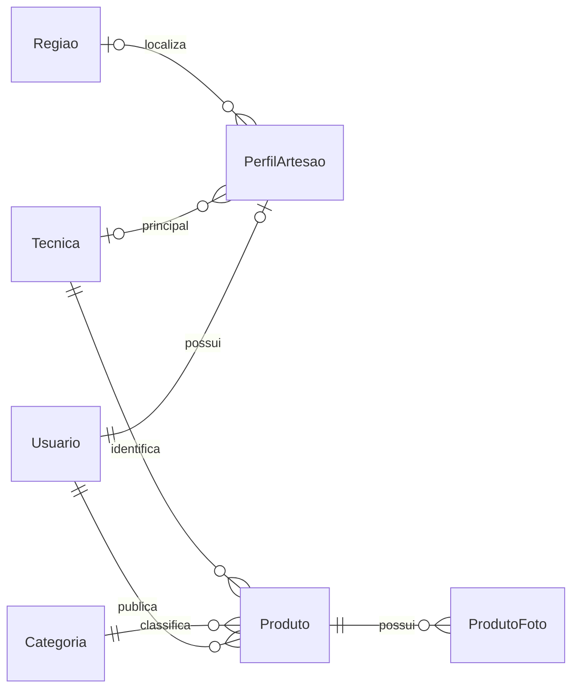
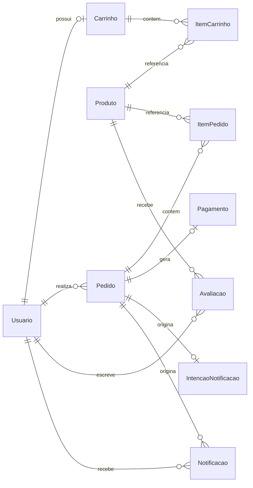

# Origem: Modelo Físico do Banco de Dados

**Sprint:** Semanas 10–11 · **Subtarefa:** BD-01 · **Ticket:** PI4-28
**Referência:** 14/10/2026 · **Banco:** PostgreSQL no Neon

## 1. Objetivo e abrangência

Este documento consolida o modelo físico vigente da Origem.
Sucede o modelo lógico das semanas 6–7.
Contempla as quinze tabelas declaradas no schema Prisma.
São onze entidades originais, duas referências e duas estruturas técnicas.
As referências são Tecnica e Regiao.
As estruturas técnicas são IntencaoNotificacao e Notificacao.
As tabelas internas de pgboss pertencem à biblioteca.
Elas não integram o DDL da aplicação.

## 2. Convenções físicas

Os nomes reais preservam PascalCase e camelCase entre aspas.
Colunas String sem anotação nativa tornam-se TEXT.
Valores monetários usam DECIMAL(10,2), equivalente a NUMERIC(10,2).
Datas usam TIMESTAMPTZ(3), com precisão de milissegundos.
Campos Int tornam-se INTEGER.
UUIDs não possuem DEFAULT gen_random_uuid() neste DDL.
O Prisma gera @default(uuid()) na aplicação.
Tecnica e Regiao usam identificadores TEXT fornecidos externamente.
As especializações compartilham usuarioId como PK e FK.
O comportamento @updatedAt também pertence ao Prisma.
Inserts SQL diretos precisam informar esses timestamps obrigatórios.

CHECK admite NULL quando sua expressão resulta desconhecida.
Por isso CHECK monetário não substitui NOT NULL.
Todas as FKs físicas usam ON UPDATE CASCADE.
ON DELETE RESTRICT preserva referências históricas.
ON DELETE CASCADE remove apenas composições autorizadas.
PK indica chave primária na coluna correspondente.
UNIQUE composto aparece com todas as colunas participantes.
Ausente significa que não existe aquela restrição física.

| Tipo ENUM         | Valores físicos permitidos             |
| ----------------- | -------------------------------------- |
| `PapelUsuario`    | comprador, artesao, admin              |
| `StatusPedido`    | pendente, confirmado, cancelado        |
| `MetodoPagamento` | pix_simulado                           |
| `StatusPagamento` | aprovado, recusado                     |
| `StatusIntencao`  | pendente, publicada, processada, falha |
| `TipoNotificacao` | novo_pedido                            |

## 3. DDL consolidado

O script completo está em [backend/prisma/ddl-fisico.sql](../../backend/prisma/ddl-fisico.sql).
A base foi gerada pelo Prisma instalado, versão 7.10.0.
O comando utiliza a opção vigente --to-schema:

```sh
npx prisma migrate diff --from-empty \
  --to-schema prisma/schema.prisma --script
```

A opção --to-schema-datamodel foi removida nesta versão.
O resultado representa o schema atual sem modificar migrations.
As seções manuais completam objetos omitidos pelo diff.
São doze CHECKs, um índice funcional e um parcial.
Também restauram pg_trgm e a sequence do checkout.
Os dois índices GIN já constam no schema Prisma.
Por isso aparecem uma única vez na seção gerada.
A extensão precisa existir antes da criação desses GIN.
A sequence precisa existir antes do DEFAULT de Pedido.numero.
Seu vínculo OWNED BY aparece após criar a tabela.

O script destina-se exclusivamente a um schema de aplicação vazio.
Não substitui o histórico de migrations nem executa backfills.
Não carrega dados de domínio nem estruturas internas de pgboss.
Na implantação existente, prisma migrate deploy continua sendo utilizado.
A instalação de pg_trgm exige permissão no banco.

Trechos essenciais de integridade e acesso:

```sql
CREATE EXTENSION IF NOT EXISTS pg_trgm WITH SCHEMA public;
CREATE SEQUENCE "Pedido_numero_seq"
  AS bigint MINVALUE 1 MAXVALUE 999999 NO CYCLE;

ALTER TABLE "Produto" ADD CONSTRAINT "Produto_preco_check"
  CHECK ("preco" > 0);
CREATE UNIQUE INDEX "Usuario_email_lower_key"
  ON "Usuario" (lower("email"));

CREATE INDEX "Produto_vitrine_criadoEm_idx"
  ON "Produto" ("criadoEm" DESC)
  WHERE "ativo" AND NOT "desativadoPorAdmin"
    AND "quantidadeEstoque" > 0;

CREATE INDEX "Produto_nome_trgm_idx"
  ON "Produto" USING GIN ("nome" public.gin_trgm_ops);
CREATE INDEX "Produto_descricao_trgm_idx"
  ON "Produto" USING GIN ("descricao" public.gin_trgm_ops);
```

## 4. Relacionamentos físicos

Os diagramas representam FKs existentes no banco.
O vínculo entre Pedido e ItemPedido admite zero itens fisicamente.
O checkout garante pelo menos um item na transação.

### 4.1 Identidade, referências e catálogo



### 4.2 Compra, avaliação e mensageria



## 5. Dicionário físico por entidade

### 5.1 `Usuario`

Raiz de identidade e autenticação. O papel recebe comprador por padrão. O índice funcional impede emails iguais com caixas diferentes. A aplicação normaliza espaços e caixa antes da gravação. O CHECK garante somente hash não vazio; bcrypt e autorização pertencem à aplicação.

| Coluna      | Tipo físico      | NULL | CHECK                 | PK / UNIQUE         | FK e ações |
| ----------- | ---------------- | ---- | --------------------- | ------------------- | ---------- |
| `id`        | `UUID`           | Não  | Ausente               | PK                  | Ausente    |
| `nome`      | `TEXT`           | Não  | Ausente               | Ausente             | Ausente    |
| `email`     | `TEXT`           | Não  | Ausente               | email; lower(email) | Ausente    |
| `senhaHash` | `TEXT`           | Não  | length(senhaHash) > 0 | Ausente             | Ausente    |
| `papel`     | `PapelUsuario`   | Não  | Ausente               | Ausente             | Ausente    |
| `ativo`     | `BOOLEAN`        | Não  | Ausente               | Ausente             | Ausente    |
| `criadoEm`  | `TIMESTAMPTZ(3)` | Não  | Ausente               | Ausente             | Ausente    |

Defaults SQL: `papel`: 'comprador'; `ativo`: true; `criadoEm`: CURRENT_TIMESTAMP.

### 5.2 `PerfilArtesao`

Especialização com PK compartilhada: um perfil por usuário. A existência exige papel artesao na aplicação. Técnica principal e região são opcionais. Ambas referenciam catálogos controlados. A região pertence ao artesão, chegando ao produto por join.

| Coluna               | Tipo físico | NULL | CHECK   | PK / UNIQUE | FK e ações                                    |
| -------------------- | ----------- | ---- | ------- | ----------- | --------------------------------------------- |
| `usuarioId`          | `UUID`      | Não  | Ausente | PK          | `Usuario.id`; DELETE CASCADE; UPDATE CASCADE  |
| `historia`           | `TEXT`      | Sim  | Ausente | Ausente     | Ausente                                       |
| `tecnicaPrincipalId` | `TEXT`      | Sim  | Ausente | Ausente     | `Tecnica.id`; DELETE RESTRICT; UPDATE CASCADE |
| `regiaoId`           | `TEXT`      | Sim  | Ausente | Ausente     | `Regiao.id`; DELETE RESTRICT; UPDATE CASCADE  |
| `foto`               | `TEXT`      | Sim  | Ausente | Ausente     | Ausente                                       |
| `completo`           | `BOOLEAN`   | Não  | Ausente | Ausente     | Ausente                                       |

Defaults SQL: `completo`: false.

### 5.3 `Categoria`

Classificação do produto, com nome único. UUID é informado pelo Prisma ou pela aplicação.

| Coluna | Tipo físico | NULL | CHECK   | PK / UNIQUE | FK e ações |
| ------ | ----------- | ---- | ------- | ----------- | ---------- |
| `id`   | `UUID`      | Não  | Ausente | PK          | Ausente    |
| `nome` | `TEXT`      | Não  | Ausente | nome        | Ausente    |

Nenhuma coluna possui DEFAULT SQL.

### 5.4 `Tecnica`

Referência criada em BD-03. O identificador textual acompanha os IDs sintéticos do frontend. Nome único evita duplicação dentro do catálogo.

| Coluna | Tipo físico | NULL | CHECK   | PK / UNIQUE | FK e ações |
| ------ | ----------- | ---- | ------- | ----------- | ---------- |
| `id`   | `TEXT`      | Não  | Ausente | PK          | Ausente    |
| `nome` | `TEXT`      | Não  | Ausente | nome        | Ausente    |

Nenhuma coluna possui DEFAULT SQL.

### 5.5 `Regiao`

Referência criada em BD-03. O identificador textual acompanha o frontend. A relação regional permanece em PerfilArtesao.

| Coluna | Tipo físico | NULL | CHECK   | PK / UNIQUE | FK e ações |
| ------ | ----------- | ---- | ------- | ----------- | ---------- |
| `id`   | `TEXT`      | Não  | Ausente | PK          | Ausente    |
| `nome` | `TEXT`      | Não  | Ausente | nome        | Ausente    |

Nenhuma coluna possui DEFAULT SQL.

### 5.6 `Produto`

Descrição e preço são obrigatórios desde BD-02. Ativo representa exclusão lógica do artesão. DesativadoPorAdmin representa moderação independente. Estoque exige valor informado; não possui DEFAULT físico. QuantidadeVendida é uma coluna preexistente de WEB-09; a seção 9 registra sua divergência com a decisão de BD-01.

| Coluna               | Tipo físico      | NULL | CHECK                  | PK / UNIQUE | FK e ações                                      |
| -------------------- | ---------------- | ---- | ---------------------- | ----------- | ----------------------------------------------- |
| `id`                 | `UUID`           | Não  | Ausente                | PK          | Ausente                                         |
| `nome`               | `TEXT`           | Não  | Ausente                | Ausente     | Ausente                                         |
| `artesaoId`          | `UUID`           | Não  | Ausente                | Ausente     | `Usuario.id`; DELETE RESTRICT; UPDATE CASCADE   |
| `categoriaId`        | `UUID`           | Não  | Ausente                | Ausente     | `Categoria.id`; DELETE RESTRICT; UPDATE CASCADE |
| `tecnicaId`          | `TEXT`           | Não  | Ausente                | Ausente     | `Tecnica.id`; DELETE RESTRICT; UPDATE CASCADE   |
| `descricao`          | `TEXT`           | Não  | Ausente                | Ausente     | Ausente                                         |
| `preco`              | `DECIMAL(10,2)`  | Não  | preco > 0              | Ausente     | Ausente                                         |
| `quantidadeEstoque`  | `INTEGER`        | Não  | quantidadeEstoque >= 0 | Ausente     | Ausente                                         |
| `quantidadeVendida`  | `INTEGER`        | Não  | quantidadeVendida >= 0 | Ausente     | Ausente                                         |
| `ativo`              | `BOOLEAN`        | Não  | Ausente                | Ausente     | Ausente                                         |
| `desativadoPorAdmin` | `BOOLEAN`        | Não  | Ausente                | Ausente     | Ausente                                         |
| `criadoEm`           | `TIMESTAMPTZ(3)` | Não  | Ausente                | Ausente     | Ausente                                         |

Defaults SQL: `quantidadeVendida`: 0; `ativo`: true; `desativadoPorAdmin`: false; `criadoEm`: CURRENT_TIMESTAMP.

### 5.7 `ProdutoFoto`

Composição sem histórico financeiro. A exclusão do produto elimina suas fotos. A combinação produtoId e ordem garante posições distintas. Ordem usa INTEGER, sem CHECK de não-negatividade nas migrations atuais.

| Coluna      | Tipo físico | NULL | CHECK   | PK / UNIQUE      | FK e ações                                   |
| ----------- | ----------- | ---- | ------- | ---------------- | -------------------------------------------- |
| `id`        | `UUID`      | Não  | Ausente | PK               | Ausente                                      |
| `produtoId` | `UUID`      | Não  | Ausente | produtoId, ordem | `Produto.id`; DELETE CASCADE; UPDATE CASCADE |
| `url`       | `TEXT`      | Não  | Ausente | Ausente          | Ausente                                      |
| `ordem`     | `INTEGER`   | Não  | Ausente | produtoId, ordem | Ausente                                      |

Defaults SQL: `ordem`: 0.

### 5.8 `Carrinho`

Especialização com PK compartilhada: um carrinho por usuário. A aplicação restringe o fluxo ao comprador. AtualizadoEm é obrigatório, sem DEFAULT SQL. O Prisma mantém o valor por @updatedAt.

| Coluna         | Tipo físico      | NULL | CHECK   | PK / UNIQUE | FK e ações                                   |
| -------------- | ---------------- | ---- | ------- | ----------- | -------------------------------------------- |
| `usuarioId`    | `UUID`           | Não  | Ausente | PK          | `Usuario.id`; DELETE CASCADE; UPDATE CASCADE |
| `atualizadoEm` | `TIMESTAMPTZ(3)` | Não  | Ausente | Ausente     | Ausente                                      |

Nenhuma coluna possui DEFAULT SQL.

### 5.9 `ItemCarrinho`

A combinação carrinhoId e produtoId impede produto repetido. A aplicação altera quantidade na mesma linha. O CHECK monetário aceita zero, diferindo do preço estritamente positivo do modelo lógico.

| Coluna          | Tipo físico     | NULL | CHECK              | PK / UNIQUE           | FK e ações                                           |
| --------------- | --------------- | ---- | ------------------ | --------------------- | ---------------------------------------------------- |
| `id`            | `UUID`          | Não  | Ausente            | PK                    | Ausente                                              |
| `carrinhoId`    | `UUID`          | Não  | Ausente            | carrinhoId, produtoId | `Carrinho.usuarioId`; DELETE CASCADE; UPDATE CASCADE |
| `produtoId`     | `UUID`          | Não  | Ausente            | carrinhoId, produtoId | `Produto.id`; DELETE RESTRICT; UPDATE CASCADE        |
| `quantidade`    | `INTEGER`       | Não  | quantidade > 0     | Ausente               | Ausente                                              |
| `precoUnitario` | `DECIMAL(10,2)` | Não  | precoUnitario >= 0 | Ausente               | Ausente                                              |

Nenhuma coluna possui DEFAULT SQL.

### 5.10 `Pedido`

CompradorId é a identidade real e obrigatória. CompradorRef permanece legado opcional de FCCPD, previsto para remoção na Sprint 6. Numero e total aceitam NULL por compatibilidade histórica. Novos pedidos do checkout recebem ambos. A sequence gera ORG-AAAA-NNNNNN e não reinicia a cada ano. Seu limite global é 999999, sem ciclo.

| Coluna         | Tipo físico      | NULL | CHECK      | PK / UNIQUE | FK e ações                                    |
| -------------- | ---------------- | ---- | ---------- | ----------- | --------------------------------------------- |
| `id`           | `UUID`           | Não  | Ausente    | PK          | Ausente                                       |
| `compradorRef` | `TEXT`           | Sim  | Ausente    | Ausente     | Ausente                                       |
| `compradorId`  | `UUID`           | Não  | Ausente    | Ausente     | `Usuario.id`; DELETE RESTRICT; UPDATE CASCADE |
| `numero`       | `TEXT`           | Sim  | Ausente    | numero      | Ausente                                       |
| `status`       | `StatusPedido`   | Não  | Ausente    | Ausente     | Ausente                                       |
| `total`        | `DECIMAL(10,2)`  | Sim  | total >= 0 | Ausente     | Ausente                                       |
| `criadoEm`     | `TIMESTAMPTZ(3)` | Não  | Ausente    | Ausente     | Ausente                                       |

Defaults SQL: `numero`: ORG-AAAA-NNNNNN, por Pedido_numero_seq; `status`: 'pendente'; `criadoEm`: CURRENT_TIMESTAMP.

### 5.11 `ItemPedido`

Preserva a linha histórica da compra. PrecoUnitario e subtotal aceitam NULL em registros legados. Seus CHECKs rejeitam negativos quando preenchidos. A igualdade subtotal = quantidade × precoUnitario é garantida pelo checkout, sem CHECK SQL correspondente.

| Coluna          | Tipo físico     | NULL | CHECK              | PK / UNIQUE | FK e ações                                    |
| --------------- | --------------- | ---- | ------------------ | ----------- | --------------------------------------------- |
| `id`            | `UUID`          | Não  | Ausente            | PK          | Ausente                                       |
| `pedidoId`      | `UUID`          | Não  | Ausente            | Ausente     | `Pedido.id`; DELETE RESTRICT; UPDATE CASCADE  |
| `produtoId`     | `UUID`          | Não  | Ausente            | Ausente     | `Produto.id`; DELETE RESTRICT; UPDATE CASCADE |
| `quantidade`    | `INTEGER`       | Não  | quantidade > 0     | Ausente     | Ausente                                       |
| `precoUnitario` | `DECIMAL(10,2)` | Sim  | precoUnitario >= 0 | Ausente     | Ausente                                       |
| `subtotal`      | `DECIMAL(10,2)` | Sim  | subtotal >= 0      | Ausente     | Ausente                                       |

Nenhuma coluna possui DEFAULT SQL.

### 5.12 `Pagamento`

O índice único em pedidoId limita a um pagamento por pedido. O valor precisa ser positivo. O único método disponível é pix_simulado. Nenhum gateway financeiro integra este modelo.

| Coluna          | Tipo físico       | NULL | CHECK     | PK / UNIQUE | FK e ações                                   |
| --------------- | ----------------- | ---- | --------- | ----------- | -------------------------------------------- |
| `id`            | `UUID`            | Não  | Ausente   | PK          | Ausente                                      |
| `pedidoId`      | `UUID`            | Não  | Ausente   | pedidoId    | `Pedido.id`; DELETE RESTRICT; UPDATE CASCADE |
| `metodo`        | `MetodoPagamento` | Não  | Ausente   | Ausente     | Ausente                                      |
| `valor`         | `DECIMAL(10,2)`   | Não  | valor > 0 | Ausente     | Ausente                                      |
| `status`        | `StatusPagamento` | Não  | Ausente   | Ausente     | Ausente                                      |
| `dataPagamento` | `TIMESTAMPTZ(3)`  | Não  | Ausente   | Ausente     | Ausente                                      |

Defaults SQL: `metodo`: 'pix_simulado'; `dataPagamento`: CURRENT_TIMESTAMP.

### 5.13 `Avaliacao`

A combinação compradorId e produtoId admite uma avaliação por comprador. A nota usa INTEGER com intervalo de 1 a 5. A comprovação da compra permanece uma regra da aplicação.

| Coluna        | Tipo físico      | NULL | CHECK                | PK / UNIQUE            | FK e ações                                    |
| ------------- | ---------------- | ---- | -------------------- | ---------------------- | --------------------------------------------- |
| `id`          | `UUID`           | Não  | Ausente              | PK                     | Ausente                                       |
| `compradorId` | `UUID`           | Não  | Ausente              | compradorId, produtoId | `Usuario.id`; DELETE RESTRICT; UPDATE CASCADE |
| `produtoId`   | `UUID`           | Não  | Ausente              | compradorId, produtoId | `Produto.id`; DELETE RESTRICT; UPDATE CASCADE |
| `nota`        | `INTEGER`        | Não  | nota BETWEEN 1 AND 5 | Ausente                | Ausente                                       |
| `comentario`  | `TEXT`           | Sim  | Ausente              | Ausente                | Ausente                                       |
| `criadoEm`    | `TIMESTAMPTZ(3)` | Não  | Ausente              | Ausente                | Ausente                                       |

Defaults SQL: `criadoEm`: CURRENT_TIMESTAMP.

### 5.14 `IntencaoNotificacao`

Outbox técnica criada na mesma transação do pedido. PedidoId único admite uma intenção por pedido. Status e tentativas representam publicação, processamento e retries. Tentativas possui DEFAULT 0, sem CHECK de não-negatividade. AtualizadoEm usa @updatedAt, sem DEFAULT SQL.

| Coluna         | Tipo físico      | NULL | CHECK   | PK / UNIQUE | FK e ações                                   |
| -------------- | ---------------- | ---- | ------- | ----------- | -------------------------------------------- |
| `id`           | `UUID`           | Não  | Ausente | PK          | Ausente                                      |
| `pedidoId`     | `UUID`           | Não  | Ausente | pedidoId    | `Pedido.id`; DELETE RESTRICT; UPDATE CASCADE |
| `status`       | `StatusIntencao` | Não  | Ausente | Ausente     | Ausente                                      |
| `tentativas`   | `INTEGER`        | Não  | Ausente | Ausente     | Ausente                                      |
| `criadoEm`     | `TIMESTAMPTZ(3)` | Não  | Ausente | Ausente     | Ausente                                      |
| `atualizadoEm` | `TIMESTAMPTZ(3)` | Não  | Ausente | Ausente     | Ausente                                      |
| `processadaEm` | `TIMESTAMPTZ(3)` | Sim  | Ausente | Ausente     | Ausente                                      |

Defaults SQL: `status`: 'pendente'; `tentativas`: 0; `criadoEm`: CURRENT_TIMESTAMP.

### 5.15 `Notificacao`

Estrutura técnica de BD-06. A combinação usuarioId, pedidoId e tipo garante idempotência. Reprocessar o mesmo pedido para o mesmo artesão não duplica a notificação. Lida recebe false por padrão.

| Coluna      | Tipo físico       | NULL | CHECK   | PK / UNIQUE               | FK e ações                                    |
| ----------- | ----------------- | ---- | ------- | ------------------------- | --------------------------------------------- |
| `id`        | `UUID`            | Não  | Ausente | PK                        | Ausente                                       |
| `usuarioId` | `UUID`            | Não  | Ausente | usuarioId, pedidoId, tipo | `Usuario.id`; DELETE RESTRICT; UPDATE CASCADE |
| `pedidoId`  | `UUID`            | Não  | Ausente | usuarioId, pedidoId, tipo | `Pedido.id`; DELETE RESTRICT; UPDATE CASCADE  |
| `tipo`      | `TipoNotificacao` | Não  | Ausente | usuarioId, pedidoId, tipo | Ausente                                       |
| `lida`      | `BOOLEAN`         | Não  | Ausente | Ausente                   | Ausente                                       |
| `criadoEm`  | `TIMESTAMPTZ(3)`  | Não  | Ausente | Ausente                   | Ausente                                       |

Defaults SQL: `lida`: false; `criadoEm`: CURRENT_TIMESTAMP.

### 5.16 Catálogo completo de CHECKs

Estes são os doze CHECKs existentes nas migrations.
Os nomes permitem localizar cada restrição no DDL.

| Nome da restrição                  | Expressão física         |
| ---------------------------------- | ------------------------ |
| `Usuario_senhaHash_check`          | `length(senhaHash) > 0`  |
| `Produto_quantidadeEstoque_check`  | `quantidadeEstoque >= 0` |
| `Produto_quantidadeVendida_check`  | `quantidadeVendida >= 0` |
| `Produto_preco_check`              | `preco > 0`              |
| `ItemCarrinho_quantidade_check`    | `quantidade > 0`         |
| `ItemCarrinho_precoUnitario_check` | `precoUnitario >= 0`     |
| `Pedido_total_check`               | `total >= 0`             |
| `ItemPedido_quantidade_check`      | `quantidade > 0`         |
| `ItemPedido_precoUnitario_check`   | `precoUnitario >= 0`     |
| `ItemPedido_subtotal_check`        | `subtotal >= 0`          |
| `Pagamento_valor_check`            | `valor > 0`              |
| `Avaliacao_nota_check`             | `nota BETWEEN 1 AND 5`   |

## 6. Indices e consultas

Os índices abaixo incluem PKs, UNIQUEs e acessos secundários.
Todos possuem consulta ou operação de integridade correspondente.
Os parâmetros $1 e $2 são vinculados pelo driver.
Identidades de compradores e artesãos vêm da sessão autenticada.
Os tempos medidos estão na seção 7.
Índices sem medição BD-04 não recebem tempos estimados.

### 6.1 Índices das chaves primárias

Cada PK cria automaticamente um B-tree único.
Consultas pontuais e joins usam as respectivas chaves.

| Índice                     | Consulta atendida                                             |
| -------------------------- | ------------------------------------------------------------- |
| `Usuario_pkey`             | `SELECT * FROM "Usuario" WHERE "id" = $1::uuid;`              |
| `PerfilArtesao_pkey`       | `SELECT * FROM "PerfilArtesao" WHERE "usuarioId" = $1::uuid;` |
| `Categoria_pkey`           | `SELECT * FROM "Categoria" WHERE "id" = $1::uuid;`            |
| `Tecnica_pkey`             | `SELECT * FROM "Tecnica" WHERE "id" = $1::text;`              |
| `Regiao_pkey`              | `SELECT * FROM "Regiao" WHERE "id" = $1::text;`               |
| `Produto_pkey`             | `SELECT * FROM "Produto" WHERE "id" = $1::uuid;`              |
| `ProdutoFoto_pkey`         | `SELECT * FROM "ProdutoFoto" WHERE "id" = $1::uuid;`          |
| `Carrinho_pkey`            | `SELECT * FROM "Carrinho" WHERE "usuarioId" = $1::uuid;`      |
| `ItemCarrinho_pkey`        | `SELECT * FROM "ItemCarrinho" WHERE "id" = $1::uuid;`         |
| `Pedido_pkey`              | `SELECT * FROM "Pedido" WHERE "id" = $1::uuid;`               |
| `ItemPedido_pkey`          | `SELECT * FROM "ItemPedido" WHERE "id" = $1::uuid;`           |
| `Pagamento_pkey`           | `SELECT * FROM "Pagamento" WHERE "id" = $1::uuid;`            |
| `Avaliacao_pkey`           | `SELECT * FROM "Avaliacao" WHERE "id" = $1::uuid;`            |
| `IntencaoNotificacao_pkey` | `SELECT * FROM "IntencaoNotificacao" WHERE "id" = $1::uuid;`  |
| `Notificacao_pkey`         | `SELECT * FROM "Notificacao" WHERE "id" = $1::uuid;`          |

### 6.2 Índices únicos e de integridade

UNIQUEs também validam concorrência durante INSERT e UPDATE.
A consulta explica seu prefixo ou expressão indexada.
Emails permanecem sujeitos aos dois índices existentes.
Nenhum deles é removido por este documento.

| Índice                                    | Consulta e integridade atendidas                                                                                                             |
| ----------------------------------------- | -------------------------------------------------------------------------------------------------------------------------------------------- |
| `Usuario_email_key`                       | `SELECT id FROM "Usuario" WHERE email = $1::text;` Unicidade exata no cadastro.                                                              |
| `Usuario_email_lower_key`                 | `SELECT id FROM "Usuario" WHERE lower(email) = lower($1::text);` Unicidade insensível à caixa.                                               |
| `Categoria_nome_key`                      | `SELECT id FROM "Categoria" WHERE nome = $1::text;` Nome de categoria único.                                                                 |
| `Tecnica_nome_key`                        | `SELECT id FROM "Tecnica" WHERE nome = $1::text;` Nome de técnica único.                                                                     |
| `Regiao_nome_key`                         | `SELECT id FROM "Regiao" WHERE nome = $1::text;` Nome de região único.                                                                       |
| `ProdutoFoto_produtoId_ordem_key`         | `SELECT url, ordem FROM "ProdutoFoto" WHERE "produtoId" = $1::uuid ORDER BY ordem;` Posição única por produto.                               |
| `ItemCarrinho_carrinhoId_produtoId_key`   | `SELECT * FROM "ItemCarrinho" WHERE "carrinhoId" = $1::uuid;` Também atende carrinhoId e produtoId juntos. Produto único no carrinho.        |
| `Pedido_numero_key`                       | `SELECT id FROM "Pedido" WHERE numero = $1::text;` Número legível único quando preenchido.                                                   |
| `Pagamento_pedidoId_key`                  | `SELECT * FROM "Pagamento" WHERE "pedidoId" = $1::uuid;` No máximo um pagamento por pedido.                                                  |
| `Avaliacao_compradorId_produtoId_key`     | `SELECT id FROM "Avaliacao" WHERE "compradorId" = $1::uuid AND "produtoId" = $2::uuid;` Uma avaliação por par.                               |
| `IntencaoNotificacao_pedidoId_key`        | `SELECT * FROM "IntencaoNotificacao" WHERE "pedidoId" = $1::uuid;` Uma intenção por pedido.                                                  |
| `Notificacao_usuarioId_pedidoId_tipo_key` | `SELECT id FROM "Notificacao" WHERE "usuarioId" = $1::uuid AND "pedidoId" = $2::uuid AND tipo = 'novo_pedido';` Reprocessamento idempotente. |

### 6.3 Índices secundários

| Índice                                    | Consulta atendida                                                                                                                                                     |
| ----------------------------------------- | --------------------------------------------------------------------------------------------------------------------------------------------------------------------- |
| `PerfilArtesao_regiaoId_idx`              | Q05: perfil filtrado por regiaoId, associado ao produto pelo artesão.                                                                                                 |
| `Produto_artesaoId_idx`                   | Q05: join por artesaoId. Também `SELECT id FROM "Produto" WHERE "artesaoId" = $1::uuid;`.                                                                             |
| `Produto_categoriaId_idx`                 | Q03: produtos filtrados por categoriaId. Preexistente em BD-04.                                                                                                       |
| `Produto_tecnicaId_idx`                   | Q04: produtos filtrados por tecnicaId.                                                                                                                                |
| `Produto_nome_trgm_idx`                   | Q02: `nome ILIKE $1::text`, incluindo busca com substring. GIN com pg_trgm.                                                                                           |
| `Produto_descricao_trgm_idx`              | Q02: `descricao ILIKE $1::text`, combinado ao índice de nome por BitmapOr.                                                                                            |
| `Produto_vitrine_criadoEm_idx`            | Q01 e Q03–Q05: produtos disponíveis ordenados por criadoEm DESC, LIMIT 24. Predicado parcial idêntico à vitrine.                                                      |
| `ItemCarrinho_produtoId_idx`              | `SELECT id FROM "ItemCarrinho" WHERE "produtoId" = $1::uuid;` Referências ao produto e verificação da FK RESTRICT. O UNIQUE do carrinho não atende produtoId isolado. |
| `Pedido_compradorId_criadoEm_idx`         | Q06: pedidos do comprador ordenados por criadoEm DESC. Substitui Pedido_compradorId_idx.                                                                              |
| `ItemPedido_pedidoId_idx`                 | `SELECT * FROM "ItemPedido" WHERE "pedidoId" = $1::uuid;` Itens no detalhe do pedido.                                                                                 |
| `ItemPedido_produtoId_idx`                | `SELECT SUM(quantidade) FROM "ItemPedido" WHERE "produtoId" = $1::uuid;` Agregação por produto, com join para confirmar status no catálogo.                           |
| `Avaliacao_produtoId_idx`                 | `SELECT AVG(nota) FROM "Avaliacao" WHERE "produtoId" = $1::uuid;` Nota média e avaliações no detalhe.                                                                 |
| `IntencaoNotificacao_status_idx`          | Q07: intenções pendentes ou em falha, lidas pelo poller.                                                                                                              |
| `Notificacao_pedidoId_idx`                | `SELECT id FROM "Notificacao" WHERE "pedidoId" = $1::uuid;` Consulta por pedido e verificação da FK RESTRICT. O UNIQUE começa por usuarioId.                          |
| `Notificacao_usuarioId_lida_criadoEm_idx` | Q08: notificações do usuário, filtradas por lida e ordenadas por criadoEm DESC.                                                                                       |

### 6.4 Consultas parametrizadas de BD-04

Os SQLs integrais estão em backend/prisma/consultas/.
Cada arquivo foi utilizado na coleta histórica.
Q01–Q05 compartilham o predicado público e LIMIT 24.
As consultas de catálogo atuais acrescentam outros filtros e agregações.
Os números históricos continuam associados aos SQLs originais.

| Código | Arquivo                  | Filtro e ordenação                                                          |
| ------ | ------------------------ | --------------------------------------------------------------------------- |
| Q01    | vitrine-publica.sql      | ativo AND NOT desativadoPorAdmin AND quantidadeEstoque > 0; criadoEm DESC   |
| Q02    | busca-termo.sql          | Q01 + nome ILIKE $1 OR descricao ILIKE $1                                   |
| Q03    | filtro-categoria.sql     | Q01 + categoriaId = $1::uuid                                                |
| Q04    | filtro-tecnica.sql       | Q01 + tecnicaId = $1::text                                                  |
| Q05    | filtro-regiao.sql        | Q01 + join PerfilArtesao.usuarioId = Produto.artesaoId; regiaoId = $1::text |
| Q06    | meus-pedidos.sql         | compradorId = $1::uuid; criadoEm DESC                                       |
| Q07    | poller-fila.sql          | status IN ('pendente', 'falha')                                             |
| Q08    | notificacoes-artesao.sql | usuarioId = $1::uuid AND lida = $2::boolean; criadoEm DESC; LIMIT 24        |
| Q09    | itens-carrinho.sql       | carrinhoId = $1::uuid                                                       |

```sql
-- Q01: vitrine disponível, com ordenação coberta pelo parcial
SELECT id, nome, preco FROM "Produto"
WHERE ativo AND NOT "desativadoPorAdmin" AND "quantidadeEstoque" > 0
ORDER BY "criadoEm" DESC LIMIT 24;

-- Q06: pedidos restritos ao comprador autenticado
SELECT id, numero, status, total, "criadoEm" FROM "Pedido"
WHERE "compradorId" = $1::uuid ORDER BY "criadoEm" DESC;

-- Q09: o prefixo esquerdo do UNIQUE já cobre carrinhoId
SELECT id, "produtoId", quantidade, "precoUnitario" FROM "ItemCarrinho"
WHERE "carrinhoId" = $1::uuid;
```

## 7. Planos e tempos de BD-04

### 7.1 Condições da medição

A coleta ocorreu em 13/10/2026, no horário de São Paulo.
Utilizou PostgreSQL 18.6 no Neon, em schema isolado.
A massa contém 1.000 produtos, 50 artesãos e 300 compradores.
Também contém 1.500 pedidos, intenções e notificações.
Carrinhos possuem 300 itens sintéticos complementares.
A transação terminou com rollback.
Uma execução de aquecimento precedeu cada EXPLAIN ANALYZE.
O formato JSON preserva planos, buffers e parâmetros.
Enable_seqscan permaneceu on.

Os tempos são de execução no servidor, em milissegundos.
Não incluem latência de rede ou resposta HTTP.
Cada valor representa uma medição, sem garantia de ganho.
O benchmark p95 permanece reservado à Sprint 5.

### 7.2 Q01: vitrine-publica

| Fase   | Plano observado                                   | Execução ms |
| ------ | ------------------------------------------------- | ----------: |
| Antes  | Limit → Sort → Seq Scan (Produto)                 |       0.464 |
| Depois | Limit → Index Scan (Produto_vitrine_criadoEm_idx) |       0.054 |

O parcial permite encerrar no LIMIT, dispensando Sort. Houve redução de 0,464 para 0,054 ms.

### 7.3 Q02: busca-termo

| Fase   | Plano observado                                                                                                                                   | Execução ms |
| ------ | ------------------------------------------------------------------------------------------------------------------------------------------------- | ----------: |
| Antes  | Limit → Sort → Seq Scan (Produto)                                                                                                                 |       0.603 |
| Depois | Limit → Sort → Bitmap Heap Scan (Produto) → BitmapOr → Bitmap Index Scan (Produto_nome_trgm_idx) → Bitmap Index Scan (Produto_descricao_trgm_idx) |       0.101 |

A busca usou %977%, com três caracteres. O BitmapOr combinou os dois GIN. Houve redução de 0,603 para 0,101 ms.

### 7.4 Q03: filtro-categoria

| Fase   | Plano observado                                                                         | Execução ms |
| ------ | --------------------------------------------------------------------------------------- | ----------: |
| Antes  | Limit → Sort → Bitmap Heap Scan (Produto) → Bitmap Index Scan (Produto_categoriaId_idx) |       0.200 |
| Depois | Limit → Index Scan (Produto_vitrine_criadoEm_idx)                                       |       0.105 |

A categoria corresponde a 204 produtos, ou 20,4%. O índice simples já existia antes de BD-04. Depois, o planner preferiu o parcial ordenado com LIMIT.

### 7.5 Q04: filtro-tecnica

| Fase   | Plano observado                                   | Execução ms |
| ------ | ------------------------------------------------- | ----------: |
| Antes  | Limit → Sort → Seq Scan (Produto)                 |       0.205 |
| Depois | Limit → Index Scan (Produto_vitrine_criadoEm_idx) |       0.212 |

A técnica corresponde a 66 produtos, ou 6,6%. O planner escolheu o parcial ordenado, sem usar tecnicaId_idx. O tempo aumentou de 0,205 para 0,212 ms. A medição não demonstra ganho para esse filtro.

### 7.6 Q05: filtro-regiao

| Fase   | Plano observado                                                                                             | Execução ms |
| ------ | ----------------------------------------------------------------------------------------------------------- | ----------: |
| Antes  | Limit → Sort → Hash Join → Seq Scan (Produto) → Hash → Seq Scan (PerfilArtesao)                             |       0.484 |
| Depois | Limit → Nested Loop → Index Scan (Produto_vitrine_criadoEm_idx) → Memoize → Index Scan (PerfilArtesao_pkey) |       0.162 |

A região corresponde a 316 produtos e 16 perfis. Antes, Seq Scan nos 50 perfis apresenta custo baixo. Depois, Nested Loop utiliza a PK do perfil e Memoize. Os índices regionais continuam disponíveis, sem uso nesta execução.

### 7.7 Q06: meus-pedidos

| Fase   | Plano observado                                                                        | Execução ms |
| ------ | -------------------------------------------------------------------------------------- | ----------: |
| Antes  | Sort → Bitmap Heap Scan (Pedido) → Bitmap Index Scan (Pedido_compradorId_idx)          |       0.092 |
| Depois | Sort → Bitmap Heap Scan (Pedido) → Bitmap Index Scan (Pedido_compradorId_criadoEm_idx) |       0.095 |

O índice composto substituiu o simples de compradorId. Bitmap Heap Scan ainda exige Sort. O tempo aumentou de 0,092 para 0,095 ms. A observação não comprova melhora de latência.

### 7.8 Q07: poller-fila

| Fase   | Plano observado                             | Execução ms |
| ------ | ------------------------------------------- | ----------: |
| Antes  | Seq Scan (IntencaoNotificacao)              |       0.179 |
| Depois | Index Scan (IntencaoNotificacao_status_idx) |       0.061 |

Pendentes e falhas são seletivos na massa de intenções. O planner trocou Seq Scan por Index Scan. O tempo caiu de 0,179 para 0,061 ms.

### 7.9 Q08: notificacoes-artesao

| Fase   | Plano observado                                                                                             | Execução ms |
| ------ | ----------------------------------------------------------------------------------------------------------- | ----------: |
| Antes  | Limit → Sort → Bitmap Heap Scan (Notificacao) → Bitmap Index Scan (Notificacao_usuarioId_pedidoId_tipo_key) |       0.119 |
| Depois | Limit → Sort → Bitmap Heap Scan (Notificacao) → Bitmap Index Scan (Notificacao_usuarioId_lida_criadoEm_idx) |       0.135 |

O composto filtra usuarioId e lida. O Bitmap Heap Scan ainda exige Sort. O tempo aumentou de 0,119 para 0,135 ms. Não existe ganho temporal demonstrado nesta medição.

### 7.10 Q09: itens-carrinho

| Fase   | Plano observado         | Execução ms |
| ------ | ----------------------- | ----------: |
| Antes  | Seq Scan (ItemCarrinho) |       0.063 |
| Depois | Seq Scan (ItemCarrinho) |       0.072 |

O UNIQUE (carrinhoId, produtoId) já cobre carrinhoId. A tabela ocupa quatro páginas para 300 linhas pequenas. Seq Scan permanece a escolha de menor custo estimado. Não se criou índice redundante apenas para carrinhoId.

### 7.11 Quando Seq Scan é correto

O planner compara custos e considera a seletividade disponível.
Tabelas pequenas podem custar menos quando lidas integralmente.
Q09 manteve Seq Scan antes e depois de BD-04.
Q05 inicialmente varreu apenas 50 perfis de artesãos.
Filtros amplos também podem favorecer varredura sequencial.
Forçar enable_seqscan=off distorceria essas conclusões.

Uma leitura atual executou os mesmos nove arquivos SQL.
O conjunto atual possui volume diferente da massa BD-04.
Nessa leitura, Q01–Q08 também utilizaram varreduras sequenciais.
Q09 utilizou Bitmap Heap Scan e o UNIQUE composto.
Essa leitura não constitui um novo par antes/depois.
Seus resultados estão em BD-01-documento/explain-atual/.

## 8. Reconciliação do modelo lógico com o físico

| Aspecto lógico                                      | Estrutura física vigente                                                         | Motivo e consequência                                                                                 |
| --------------------------------------------------- | -------------------------------------------------------------------------------- | ----------------------------------------------------------------------------------------------------- |
| Tabelas plurais snake_case                          | PascalCase e colunas camelCase entre aspas                                       | Preserva os nomes implementados pelo Prisma e pelas migrations.                                       |
| PK UUID com gen_random_uuid()                       | UUID sem DEFAULT SQL; usuarioId compartilhado nas especializações                | @default(uuid()) atua na aplicação. Inserts diretos precisam informar IDs.                            |
| VARCHAR com limites específicos                     | TEXT nas Strings sem @db.VarChar                                                 | Mantém o schema implantado. Limites de entrada continuam nos validadores.                             |
| SMALLINT em nota e ordem                            | INTEGER                                                                          | Mapeamento vigente de Int no Prisma. Nota preserva CHECK 1–5; ordem não possui CHECK.                 |
| TIMESTAMPTZ e DEFAULT now() no carrinho             | TIMESTAMPTZ(3); Carrinho.atualizadoEm sem DEFAULT SQL                            | @updatedAt exige manutenção pelo cliente Prisma ou escrita SQL explícita.                             |
| Produto.descricao e preco obrigatórios              | NOT NULL e CHECK preco > 0                                                       | BD-02 preencheu legados antes da restrição e desativou produtos incompletos.                          |
| Estoque com DEFAULT 0                               | INTEGER NOT NULL sem DEFAULT                                                     | O valor é obrigatório na escrita física; CHECK impede estoque negativo.                               |
| CITEXT ou unicidade de email normalizado            | TEXT; UNIQUE(email) e UNIQUE(lower(email))                                       | BD-02 impôs unicidade insensível à caixa. O service normaliza espaços e caixa.                        |
| Senha obrigatória                                   | TEXT NOT NULL; CHECK length(senhaHash) > 0                                       | BD-02 rejeita string vazia. Formato criptográfico é validado na aplicação.                            |
| Exclusão lógica única de produto                    | ativo e desativadoPorAdmin independentes                                         | BD-02 separa ação do artesão e moderação administrativa.                                              |
| Técnica e região em texto livre no perfil           | Tecnica e Regiao; Produto.tecnicaId obrigatório; referências opcionais no perfil | BD-03 migrou textos para FKs com RESTRICT. A técnica da peça difere da técnica principal.             |
| Região associada ao catálogo                        | Região somente no perfil do artesão                                              | O produto obtém regiaoId por join. Evita duplicação regional por peça.                                |
| Pedido sem compradorRef                             | compradorId obrigatório; compradorRef opcional legado                            | BD-02 preserva compatibilidade com FCCPD, com remoção prevista na Sprint 6.                           |
| Numero e total obrigatórios no pedido               | TEXT e DECIMAL nullable; numero com DEFAULT e UNIQUE                             | Compatibilidade histórica. WEB-09 gera números pela sequence e grava total no checkout.               |
| PrecoUnitario e subtotal obrigatórios em ItemPedido | DECIMAL nullable com CHECK >= 0                                                  | Preserva itens legados. BD-02 rejeita negativos quando preenchidos.                                   |
| Preço de item estritamente positivo                 | ItemCarrinho.precoUnitario e ItemPedido.precoUnitario >= 0                       | BD-02 implementou não-negatividade. Zero é aceito fisicamente nesses campos.                          |
| Subtotal = quantidade × preço por CHECK             | CHECK subtotal >= 0                                                              | O checkout calcula os valores na transação. A igualdade não está imposta pelo banco.                  |
| CHECK ordem >= 0 e tentativas >= 0                  | Nenhum CHECK nesses campos                                                       | Restrições previstas no lógico não foram materializadas nas migrations vigentes.                      |
| Apenas intenção técnica de notificação              | Notificacao com UNIQUE(usuarioId, pedidoId, tipo)                                | BD-06 torna o assíncrono visível e garante idempotência no banco.                                     |
| Índice simples de compradorId                       | Composto compradorId, criadoEm DESC                                              | BD-04 atende listagem e ordenação sem duplicar o prefixo simples.                                     |
| Índice simples de carrinhoId                        | UNIQUE(carrinhoId, produtoId) cobre seu prefixo                                  | BD-04 mantém o índice existente e evita redundância.                                                  |
| Agregados sem coluna em Produto                     | Nota média agregada; quantidadeVendida já materializada em WEB-09                | O catálogo ainda calcula ambos por agregação. A decisão de BD-01 e essa divergência estão na seção 9. |

As divergências acima descrevem o banco implementado.
Este documento não cria regras ausentes nas migrations.
Papel do usuário e comprovação de compra exigem validação externa.
Pedido com itens exige a transação do checkout.
Essas regras não são garantidas apenas pelas FKs existentes.

## 9. Agregações e decisão de desnormalização

NotaMedia é calculada por AVG(Avaliacao.nota).
QuantidadeVendida é calculada por SUM(ItemPedido.quantidade) no catálogo.
O catálogo considera somente pedidos confirmados nessa soma.
COALESCE fornece zero quando não existem registros relacionados.
As agregações são executadas após paginar os produtos.
Índices em produtoId atendem as buscas correlacionadas.

```sql
SELECT COALESCE(AVG(nota), 0) AS "notaMedia"
FROM "Avaliacao" WHERE "produtoId" = $1::uuid;

SELECT COALESCE(SUM(i.quantidade), 0) AS "quantidadeVendida"
FROM "ItemPedido" i JOIN "Pedido" p ON p.id = i."pedidoId"
WHERE i."produtoId" = $1::uuid AND p.status = 'confirmado';
```

A baseline de recomendação também agrega notas e quantidades.
Sua soma atual considera todos os ItemPedido, sem filtro de status.
Essa diferença não altera a definição do catálogo público.

**Decisão de BD-01:** manter os agregados nas consultas.
Materializar agregados exige evidência do benchmark da Sprint 5.
Esse benchmark avaliará volume, latência, atualização e consistência.
Sem evidência, não se introduz nova coluna para otimização.

**Divergência física preexistente:** Produto.quantidadeVendida já existe.
A migration WEB-09 adicionou INTEGER NOT NULL DEFAULT 0.
Também incluiu CHECK de não-negatividade e backfill de vendas confirmadas.
O checkout incrementa essa coluna na transação do pedido.
O catálogo continua devolvendo a soma, sem depender desse contador.
O DDL e o dicionário reproduzem obrigatoriamente essa coluna.
Sua permanência como otimização depende da avaliação da Sprint 5.
NotaMedia não possui coluna física.

PreçoUnitario representa um fato histórico da compra.
Ele não corresponde necessariamente ao preço atual do produto.
Essa cópia preserva o valor contratado, sem exigir nova desnormalização.

## 10. Referências

- [Modelo lógico das semanas 6–7](../semana-06-07/01-Modelo-Logico-BD.md).
- [BD-01 e decisões da Sprint 4](../../docs/10-Plano-Sprint4-Subtarefas-Jira-Semanas10-11.md).
- [Schema Prisma vigente](../../backend/prisma/schema.prisma).
- [Migrations PostgreSQL da aplicação](../../backend/prisma/migrations/).
- [DDL físico consolidado](../../backend/prisma/ddl-fisico.sql).
- [Consultas parametrizadas de BD-04](../../backend/prisma/consultas/).
- [Resumo histórico de índices](../../evidencias/PI4-28-W10-Modelo-Fisico/BD-04-indices/01-resumo-indices.md).
- [Planos JSON originais antes/depois](../../evidencias/PI4-28-W10-Modelo-Fisico/BD-04-indices/explain-antes-depois/).
- [Leitura atual dos nove EXPLAIN](../../evidencias/PI4-28-W10-Modelo-Fisico/BD-01-documento/explain-atual/resumo.md).
- [Agregações do catálogo](../../backend/src/repositories/catalogo.repository.ts).
- [Agregações da recomendação](../../backend/src/repositories/recomendacao.repository.ts).
