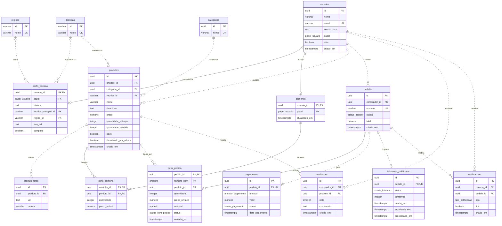

# Origem · Modelo lógico relacional v2

**AV2 de Modelagem e Projeto de Banco de Dados · 25/11/2026**

## Changelog do v1 para o v2

O registro da AV1 confirma ausência de correções formais. A versão avaliada foi o ER de 20/08. O diagrama de classes de 26/08 explica a inclusão posterior do carrinho. O modelo v1 permanece como referência histórica. [Registro da AV1](../../docs/bd-av2/00-correcoes-professor-av1.md) · [V1](../semana-06-07/01-Modelo-Logico-BD.md) · [Auditoria e decisão sobre o checkout](../../docs/bd-av2/01-auditoria-modelo-fisico.md)

| Origem | Mudança | Resultado no v2 |
|---|---|---|
| Evolução do sistema real | Vocabulário compartilhado | Técnicas e regiões ganham tabelas próprias. O perfil referencia ambas opcionalmente. Cada peça exige sua técnica. |
| Evolução do sistema real | Catálogo e logística | O produto separa moderação de atividade e acumula vendas. Cada linha vendida ganha estado e data de envio. |
| Evolução do sistema real | Mensageria | A intenção do v1 continua ligada ao pedido. O aviso ao destinatário entra no modelo com unicidade para reprocessamento. |
| Exigência da rubrica AV2 | Identificação e especializações | O carrinho identifica cada produto pelo par. Perfil e carrinho herdam o usuário e fixam o papel por FK composta. |
| Exigência da rubrica AV2 e evolução do sistema real | Entidade fraca | A compra aceita produto repetido. A decisão de 25/11 identifica a linha por (pedido_id, numero_item). O número é local ao pedido. |
| Exigência da rubrica AV2 | Campos obrigatórios | `pedidos.numero`, `pedidos.total`, `itens_pedido.preco_unitario` e `itens_pedido.subtotal` passam a exigir valor. |
| Exigência da rubrica AV2 | Tipos e domínios | Email recebe formato e minúsculas obrigatórias. Nota e ordem usam SMALLINT. Slugs e nomes recebem limites explícitos. O perfil adota foto_url. |
| Exigência da rubrica AV2 | Defaults e chaves alternativas | O banco gera UUID sem extensão. Estoque começa em zero. PKs, FKs, UNIQUEs, NOT NULL e CHECKs recebem nomes. |
| Exigência da rubrica AV2 | Ações referenciais | A exclusão preserva o histórico. Atualizações propagam renomeações dos slugs e restringem mudanças de UUID. |
| Exigência da rubrica AV2 | Consistência | CHECKs validam textos, faixas, subtotal, estados e cronologia. Os enums preservam os domínios fechados. |
| Evolução do sistema real | Numeração e consultas | Uma sequência gera o número legível. Índices cobrem as FKs e a vitrine cronológica. |
| Exigência da rubrica AV2 | Isolamento e rastreabilidade | A entrega usa origem, nomes lógicos e dependências ordenadas. O ER de 20/08 fundamenta a correspondência da seção 8. |

## 1. Objetivo

Representar quinze tabelas com regras suficientes para implementar o DDL acadêmico. Onze pertencem ao domínio, duas guardam referências e duas sustentam notificações. O dicionário segue a ordem de criação. Cada relação indica a cardinalidade e a ação referencial.

## 2. Convenções

Todos os objetos acadêmicos pertencem ao schema `origem`. Os scripts previstos em `database/av2/` são independentes do Prisma. A recriação fica limitada a esse schema, em PostgreSQL local descartável. Os identificadores usam ASCII e tabelas em plural `snake_case`. O alvo é PostgreSQL 13+ com validação planejada na versão 16. A entrega usa SQL puro, sem extensões, variáveis ou metacomandos do psql.

- Chaves próprias usam UUID com `gen_random_uuid()`. Chaves herdadas recebem o valor parental. As referências técnica e região usam slugs `VARCHAR(40)`.
- Valores monetários usam `NUMERIC(10,2)`. Quantidades e contadores usam `INTEGER`. Nota, ordem da foto e número da linha usam `SMALLINT`.
- Datas usam `TIMESTAMPTZ`. O default temporal vale na inserção. A aplicação atualiza os campos que acompanham transições.
- Nomes das referências usam `VARCHAR(120)`, por analogia ao nome de usuário. Nomes de produto, categoria e email conservam os limites específicos do dicionário.
- A sequência global `origem.pedidos_numero_seq` usa BIGINT de 1 a 999999, sem ciclo. O default “número ORG” concatena `ORG-`, ano corrente, hífen e próximo valor com seis dígitos. A mudança do ano preserva o contador. A sequência pertence a `pedidos.numero`.
- D8 ordena enums, sequência, tabelas das seções 4.1–4.15 e índices. Declarar PK, FK, UNIQUE e CHECK dentro da tabela. O dicionário registra os nomes e os campos obrigatórios para o critério 2.
- Cada FK mostra as ações completas. Renomeações de slugs propagam pela FK. Atualizações de chaves UUID ficam restritas. Para referências opcionais no perfil, RESTRICT preserva a classificação existente. Uma reatribuição explícita libera a referência antiga.
- Os índices de PK e UNIQUE são implícitos. Um prefixo cobre a FK quando contém todas as suas colunas na ordem. As duas especializações recebem índices explícitos no par completo. O predicado da vitrine aparece no dicionário de produtos.

| Tipo enumerado | Valores, na ordem da declaração |
|---|---|
| `papel_usuario` | `comprador`, `artesao`, `admin` |
| `status_pedido` | `pendente`, `confirmado`, `cancelado` |
| `status_item_pedido` | `aguardando_envio`, `enviado` |
| `metodo_pagamento` | `pix_simulado` |
| `status_pagamento` | `aprovado`, `recusado` |
| `status_intencao` | `pendente`, `publicada`, `processada`, `falha` |
| `tipo_notificacao` | `novo_pedido` |

## 3. Diagrama ER

Cada ligação corresponde a uma FK do dicionário. As linhas contínuas identificam relações que participam da PK da filha. No pedido, a cardinalidade mínima de um item é uma regra da transação de checkout. A seção 7 indica onde ela é aplicada. As marcações PK e FK mostram todos os componentes, inclusive o discriminador de papel nas FKs compostas.

## 4. Dicionário das tabelas

“Não” identifica uma coluna obrigatória. Seu nome de NOT NULL aparece na última coluna. “Nenhum” indica valor sem default declarado. As ações e expressões descrevem o contrato do futuro DDL.

### 4.1 `regioes`

Vocabulário regional compartilhado pelos perfis.

| Coluna | Tipo | Aceita NULL? | Default | Observação | NOT NULL nomeado |
|---|---|---|---|---|---|
| `id` | `VARCHAR(40)` | Não | Nenhum | Código regional estável para buscas. | `nn_regioes_id` |
| `nome` | `VARCHAR(120)` | Não | Nenhum | Nome da região exibido ao público. | `nn_regioes_nome` |

**Restrições nomeadas**

| Nome | Definição |
|---|---|
| `pk_regioes` | `PRIMARY KEY (id)` |
| `uq_regioes_nome` | `UNIQUE (nome)` |
| `ck_regioes_nome_preenchido` | `CHECK (length(trim(nome)) > 0)` |
| `ck_regioes_slug_valido` | `CHECK (id ~ '^[a-z0-9]+(-[a-z0-9]+)*$')` |

**Índices.** A PK e as UNIQUEs cobrem as chaves desta tabela.

### 4.2 `tecnicas`

Vocabulário das técnicas usadas nas peças e nos perfis.

| Coluna | Tipo | Aceita NULL? | Default | Observação | NOT NULL nomeado |
|---|---|---|---|---|---|
| `id` | `VARCHAR(40)` | Não | Nenhum | Código textual da técnica. | `nn_tecnicas_id` |
| `nome` | `VARCHAR(120)` | Não | Nenhum | Nome da técnica exibido ao público. | `nn_tecnicas_nome` |

**Restrições nomeadas**

| Nome | Definição |
|---|---|
| `pk_tecnicas` | `PRIMARY KEY (id)` |
| `uq_tecnicas_nome` | `UNIQUE (nome)` |
| `ck_tecnicas_nome_preenchido` | `CHECK (length(trim(nome)) > 0)` |
| `ck_tecnicas_slug_valido` | `CHECK (id ~ '^[a-z0-9]+(-[a-z0-9]+)*$')` |

**Índices.** A PK e as UNIQUEs cobrem as chaves desta tabela.

### 4.3 `categorias`

Classificação das peças no catálogo.

| Coluna | Tipo | Aceita NULL? | Default | Observação | NOT NULL nomeado |
|---|---|---|---|---|---|
| `id` | `UUID` | Não | `gen_random_uuid()` | Identidade da categoria. | `nn_categorias_id` |
| `nome` | `VARCHAR(80)` | Não | Nenhum | Denominação única da categoria. | `nn_categorias_nome` |

**Restrições nomeadas**

| Nome | Definição |
|---|---|
| `pk_categorias` | `PRIMARY KEY (id)` |
| `uq_categorias_nome` | `UNIQUE (nome)` |
| `ck_categorias_nome_preenchido` | `CHECK (length(trim(nome)) > 0)` |

**Índices.** A PK e as UNIQUEs cobrem as chaves desta tabela.

### 4.4 `usuarios`

Identidade comum a compradores, artesãos e administradores.

| Coluna | Tipo | Aceita NULL? | Default | Observação | NOT NULL nomeado |
|---|---|---|---|---|---|
| `id` | `UUID` | Não | `gen_random_uuid()` | Identidade pública da conta. | `nn_usuarios_id` |
| `nome` | `VARCHAR(120)` | Não | Nenhum | Nome de exibição. | `nn_usuarios_nome` |
| `email` | `VARCHAR(160)` | Não | Nenhum | Endereço normalizado em minúsculas. | `nn_usuarios_email` |
| `senha_hash` | `TEXT` | Não | Nenhum | Hash de autenticação. | `nn_usuarios_senha_hash` |
| `papel` | `papel_usuario` | Não | `'comprador'` | Discriminador da especialização. | `nn_usuarios_papel` |
| `ativo` | `BOOLEAN` | Não | `true` | Permite desativação preservando o histórico. | `nn_usuarios_ativo` |
| `criado_em` | `TIMESTAMPTZ` | Não | `CURRENT_TIMESTAMP` | Instante do cadastro. | `nn_usuarios_criado_em` |

**Restrições nomeadas**

| Nome | Definição |
|---|---|
| `pk_usuarios` | `PRIMARY KEY (id)` |
| `uq_usuarios_email` | `UNIQUE (email)` |
| `uq_usuarios_id_papel` | `UNIQUE (id, papel)` |
| `ck_usuarios_email_minusculo` | `CHECK (email = lower(email))` |
| `ck_usuarios_email_formato` | `CHECK (email ~ '^[^@\s]+@[^@\s]+\.[^@\s]+$')` |
| `ck_usuarios_hash_preenchido` | `CHECK (length(senha_hash) > 0)` |
| `ck_usuarios_nome_preenchido` | `CHECK (length(trim(nome)) > 0)` |

**Índices.** A PK e as UNIQUEs cobrem as chaves desta tabela.

### 4.5 `perfis_artesao`

Extensão opcional da conta de artesão.

| Coluna | Tipo | Aceita NULL? | Default | Observação | NOT NULL nomeado |
|---|---|---|---|---|---|
| `usuario_id` | `UUID` | Não | Nenhum | Identidade herdada do usuário. | `nn_perfis_artesao_usuario_id` |
| `papel` | `papel_usuario` | Não | `'artesao'` | Discriminador fixo da FK composta. | `nn_perfis_artesao_papel` |
| `historia` | `TEXT` | Sim | Nenhum | História pública do artesão. | Opcional |
| `tecnica_principal_id` | `VARCHAR(40)` | Sim | Nenhum | Opcional enquanto o perfil estiver incompleto. | Opcional |
| `regiao_id` | `VARCHAR(40)` | Sim | Nenhum | Referência geográfica do artesão. | Opcional |
| `foto_url` | `TEXT` | Sim | Nenhum | URL da foto do perfil. | Opcional |
| `completo` | `BOOLEAN` | Não | `false` | Completude calculada pela aplicação. | `nn_perfis_artesao_completo` |

**Restrições nomeadas**

| Nome | Definição |
|---|---|
| `pk_perfis_artesao` | `PRIMARY KEY (usuario_id)` |
| `fk_perfis_artesao_usuario_id_papel` | `FOREIGN KEY (usuario_id, papel) → usuarios (id, papel) ON DELETE CASCADE ON UPDATE RESTRICT` |
| `fk_perfis_artesao_tecnica_principal_id` | `FOREIGN KEY (tecnica_principal_id) → tecnicas (id) ON DELETE RESTRICT ON UPDATE CASCADE` |
| `fk_perfis_artesao_regiao_id` | `FOREIGN KEY (regiao_id) → regioes (id) ON DELETE RESTRICT ON UPDATE CASCADE` |
| `ck_perfis_artesao_papel_artesao` | `CHECK (papel = 'artesao')` |

**Índices.** Os índices dedicados atendem às consultas abaixo.

| Índice dedicado | Colunas e predicado | Uso |
|---|---|---|
| `ix_perfis_artesao_usuario_id_papel` | `(usuario_id, papel)` | FK composta de especialização. |
| `ix_perfis_artesao_tecnica_principal_id` | `(tecnica_principal_id)` | Filtragem por técnica do artesão. |
| `ix_perfis_artesao_regiao_id` | `(regiao_id)` | Filtragem regional. |

### 4.6 `carrinhos`

Extensão opcional da conta de comprador.

| Coluna | Tipo | Aceita NULL? | Default | Observação | NOT NULL nomeado |
|---|---|---|---|---|---|
| `usuario_id` | `UUID` | Não | Nenhum | Identidade herdada do usuário. | `nn_carrinhos_usuario_id` |
| `papel` | `papel_usuario` | Não | `'comprador'` | Discriminador fixo da FK composta. | `nn_carrinhos_papel` |
| `atualizado_em` | `TIMESTAMPTZ` | Não | `CURRENT_TIMESTAMP` | A aplicação renova a data ao alterar itens. | `nn_carrinhos_atualizado_em` |

**Restrições nomeadas**

| Nome | Definição |
|---|---|
| `pk_carrinhos` | `PRIMARY KEY (usuario_id)` |
| `fk_carrinhos_usuario_id_papel` | `FOREIGN KEY (usuario_id, papel) → usuarios (id, papel) ON DELETE CASCADE ON UPDATE RESTRICT` |
| `ck_carrinhos_papel_comprador` | `CHECK (papel = 'comprador')` |

**Índices.** Os índices dedicados atendem às consultas abaixo.

| Índice dedicado | Colunas e predicado | Uso |
|---|---|---|
| `ix_carrinhos_usuario_id_papel` | `(usuario_id, papel)` | FK composta de especialização. |

### 4.7 `produtos`

Peça publicada por artesão e classificada no catálogo.

| Coluna | Tipo | Aceita NULL? | Default | Observação | NOT NULL nomeado |
|---|---|---|---|---|---|
| `id` | `UUID` | Não | `gen_random_uuid()` | Identidade pública da peça. | `nn_produtos_id` |
| `artesao_id` | `UUID` | Não | Nenhum | Usuário proprietário da publicação. | `nn_produtos_artesao_id` |
| `categoria_id` | `UUID` | Não | Nenhum | Categoria da peça. | `nn_produtos_categoria_id` |
| `tecnica_id` | `VARCHAR(40)` | Não | Nenhum | Técnica efetivamente usada na peça. | `nn_produtos_tecnica_id` |
| `nome` | `VARCHAR(160)` | Não | Nenhum | Título da publicação. | `nn_produtos_nome` |
| `descricao` | `TEXT` | Não | Nenhum | Descrição da peça. | `nn_produtos_descricao` |
| `preco` | `NUMERIC(10,2)` | Não | Nenhum | Preço de catálogo. | `nn_produtos_preco` |
| `quantidade_estoque` | `INTEGER` | Não | `0` | Unidades disponíveis. | `nn_produtos_quantidade_estoque` |
| `quantidade_vendida` | `INTEGER` | Não | `0` | Unidades acumuladas pelo checkout. | `nn_produtos_quantidade_vendida` |
| `ativo` | `BOOLEAN` | Não | `true` | Disponibilidade definida pelo artesão. | `nn_produtos_ativo` |
| `desativado_por_admin` | `BOOLEAN` | Não | `false` | Moderação independente da decisão do artesão. | `nn_produtos_desativado_por_admin` |
| `criado_em` | `TIMESTAMPTZ` | Não | `CURRENT_TIMESTAMP` | Instante da publicação. | `nn_produtos_criado_em` |

**Restrições nomeadas**

| Nome | Definição |
|---|---|
| `pk_produtos` | `PRIMARY KEY (id)` |
| `fk_produtos_artesao_id` | `FOREIGN KEY (artesao_id) → usuarios (id) ON DELETE RESTRICT ON UPDATE RESTRICT` |
| `fk_produtos_categoria_id` | `FOREIGN KEY (categoria_id) → categorias (id) ON DELETE RESTRICT ON UPDATE RESTRICT` |
| `fk_produtos_tecnica_id` | `FOREIGN KEY (tecnica_id) → tecnicas (id) ON DELETE RESTRICT ON UPDATE CASCADE` |
| `ck_produtos_preco_positivo` | `CHECK (preco > 0)` |
| `ck_produtos_estoque_nao_negativo` | `CHECK (quantidade_estoque >= 0)` |
| `ck_produtos_vendas_nao_negativas` | `CHECK (quantidade_vendida >= 0)` |
| `ck_produtos_nome_preenchido` | `CHECK (length(trim(nome)) > 0)` |

**Índices.** Os índices dedicados atendem às consultas abaixo.

| Índice dedicado | Colunas e predicado | Uso |
|---|---|---|
| `ix_produtos_artesao_id` | `(artesao_id)` | Catálogo e pedidos por artesão. |
| `ix_produtos_categoria_id` | `(categoria_id)` | Filtro de categoria. |
| `ix_produtos_tecnica_id` | `(tecnica_id)` | Filtro de técnica. |
| `ix_produtos_criado_em_vitrine` | `(criado_em DESC) WHERE ativo AND NOT desativado_por_admin AND quantidade_estoque > 0` | Índice parcial para a vitrine por publicação recente. |

### 4.8 `produto_fotos`

Fotos ordenadas de uma peça.

| Coluna | Tipo | Aceita NULL? | Default | Observação | NOT NULL nomeado |
|---|---|---|---|---|---|
| `id` | `UUID` | Não | `gen_random_uuid()` | Identidade da foto. | `nn_produto_fotos_id` |
| `produto_id` | `UUID` | Não | Nenhum | Produto fotografado. | `nn_produto_fotos_produto_id` |
| `url` | `TEXT` | Não | Nenhum | Localização da imagem. | `nn_produto_fotos_url` |
| `ordem` | `SMALLINT` | Não | `0` | Posição única dentro do produto. | `nn_produto_fotos_ordem` |

**Restrições nomeadas**

| Nome | Definição |
|---|---|
| `pk_produto_fotos` | `PRIMARY KEY (id)` |
| `uq_produto_fotos_produto_id_ordem` | `UNIQUE (produto_id, ordem)` |
| `fk_produto_fotos_produto_id` | `FOREIGN KEY (produto_id) → produtos (id) ON DELETE CASCADE ON UPDATE RESTRICT` |
| `ck_produto_fotos_ordem_nao_negativa` | `CHECK (ordem >= 0)` |

**Índices.** A UNIQUE (produto_id, ordem) cobre a FK produto_id.

### 4.9 `itens_carrinho`

Associação entre carrinho e produto com quantidade e preço.

| Coluna | Tipo | Aceita NULL? | Default | Observação | NOT NULL nomeado |
|---|---|---|---|---|---|
| `carrinho_id` | `UUID` | Não | Nenhum | Primeira parte da chave do item. | `nn_itens_carrinho_carrinho_id` |
| `produto_id` | `UUID` | Não | Nenhum | Segunda parte da chave do item. | `nn_itens_carrinho_produto_id` |
| `quantidade` | `INTEGER` | Não | Nenhum | Unidades daquele produto no carrinho. | `nn_itens_carrinho_quantidade` |
| `preco_unitario` | `NUMERIC(10,2)` | Não | Nenhum | Preço registrado na inclusão ou atualização do item. | `nn_itens_carrinho_preco_unitario` |

**Restrições nomeadas**

| Nome | Definição |
|---|---|
| `pk_itens_carrinho` | `PRIMARY KEY (carrinho_id, produto_id)` |
| `fk_itens_carrinho_carrinho_id` | `FOREIGN KEY (carrinho_id) → carrinhos (usuario_id) ON DELETE CASCADE ON UPDATE RESTRICT` |
| `fk_itens_carrinho_produto_id` | `FOREIGN KEY (produto_id) → produtos (id) ON DELETE RESTRICT ON UPDATE RESTRICT` |
| `ck_itens_carrinho_quantidade_positiva` | `CHECK (quantidade > 0)` |
| `ck_itens_carrinho_preco_unitario_positivo` | `CHECK (preco_unitario > 0)` |

**Índices.** A PK começa em carrinho_id e cobre essa FK.

| Índice dedicado | Colunas e predicado | Uso |
|---|---|---|
| `ix_itens_carrinho_produto_id` | `(produto_id)` | Carrinhos contendo o produto. |

### 4.10 `pedidos`

Cabeçalho da compra efetuada pelo comprador.

| Coluna | Tipo | Aceita NULL? | Default | Observação | NOT NULL nomeado |
|---|---|---|---|---|---|
| `id` | `UUID` | Não | `gen_random_uuid()` | Identidade interna do pedido. | `nn_pedidos_id` |
| `comprador_id` | `UUID` | Não | Nenhum | Usuário que realizou a compra. | `nn_pedidos_comprador_id` |
| `numero` | `VARCHAR(30)` | Não | número ORG | Identificador legível com ano e seis dígitos. | `nn_pedidos_numero` |
| `status` | `status_pedido` | Não | `'pendente'` | O checkout confirma explicitamente a venda. | `nn_pedidos_status` |
| `total` | `NUMERIC(10,2)` | Não | Nenhum | Soma dos subtotais do pedido. | `nn_pedidos_total` |
| `criado_em` | `TIMESTAMPTZ` | Não | `CURRENT_TIMESTAMP` | Instante da compra. | `nn_pedidos_criado_em` |

**Restrições nomeadas**

| Nome | Definição |
|---|---|
| `pk_pedidos` | `PRIMARY KEY (id)` |
| `uq_pedidos_numero` | `UNIQUE (numero)` |
| `fk_pedidos_comprador_id` | `FOREIGN KEY (comprador_id) → usuarios (id) ON DELETE RESTRICT ON UPDATE RESTRICT` |
| `ck_pedidos_numero_formato` | `CHECK (numero ~ '^ORG-[0-9]{4}-[0-9]{6}$')` |
| `ck_pedidos_total_nao_negativo` | `CHECK (total >= 0)` |

**Índices.** Os índices dedicados atendem às consultas abaixo.

| Índice dedicado | Colunas e predicado | Uso |
|---|---|---|
| `ix_pedidos_comprador_id_criado_em` | `(comprador_id, criado_em DESC)` | Histórico por comprador. |

### 4.11 `itens_pedido`

Entidade fraca identificada pelo pedido e pela posição da linha.

| Coluna | Tipo | Aceita NULL? | Default | Observação | NOT NULL nomeado |
|---|---|---|---|---|---|
| `pedido_id` | `UUID` | Não | Nenhum | Pedido proprietário. | `nn_itens_pedido_pedido_id` |
| `numero_item` | `SMALLINT` | Não | Nenhum | Discriminador positivo, atribuído dentro do pedido. | `nn_itens_pedido_numero_item` |
| `produto_id` | `UUID` | Não | Nenhum | A mesma peça pode aparecer em outras linhas. | `nn_itens_pedido_produto_id` |
| `quantidade` | `INTEGER` | Não | Nenhum | Quantidade desta linha. | `nn_itens_pedido_quantidade` |
| `preco_unitario` | `NUMERIC(10,2)` | Não | Nenhum | Preço histórico no instante da compra. | `nn_itens_pedido_preco_unitario` |
| `subtotal` | `NUMERIC(10,2)` | Não | Nenhum | Valor armazenado e conferido por linha. | `nn_itens_pedido_subtotal` |
| `status` | `status_item_pedido` | Não | `'aguardando_envio'` | Estado de envio desta linha. | `nn_itens_pedido_status` |
| `enviado_em` | `TIMESTAMPTZ` | Sim | Nenhum | Instante do envio, quando realizado. | Opcional |

**Restrições nomeadas**

| Nome | Definição |
|---|---|
| `pk_itens_pedido` | `PRIMARY KEY (pedido_id, numero_item)` |
| `fk_itens_pedido_pedido_id` | `FOREIGN KEY (pedido_id) → pedidos (id) ON DELETE RESTRICT ON UPDATE RESTRICT` |
| `fk_itens_pedido_produto_id` | `FOREIGN KEY (produto_id) → produtos (id) ON DELETE RESTRICT ON UPDATE RESTRICT` |
| `ck_itens_pedido_numero_item_positivo` | `CHECK (numero_item > 0)` |
| `ck_itens_pedido_quantidade_positiva` | `CHECK (quantidade > 0)` |
| `ck_itens_pedido_preco_unitario_positivo` | `CHECK (preco_unitario > 0)` |
| `ck_itens_pedido_subtotal_calculado` | `CHECK (subtotal = quantidade * preco_unitario)` |
| `ck_itens_pedido_data_envio_status` | `CHECK ((status = 'enviado') = (enviado_em IS NOT NULL))` |

**Índices.** A PK começa em pedido_id e cobre essa FK.

| Índice dedicado | Colunas e predicado | Uso |
|---|---|---|
| `ix_itens_pedido_produto_id` | `(produto_id)` | Histórico do produto e compra verificada. |

### 4.12 `pagamentos`

Resultado do pagamento simulado de um pedido.

| Coluna | Tipo | Aceita NULL? | Default | Observação | NOT NULL nomeado |
|---|---|---|---|---|---|
| `id` | `UUID` | Não | `gen_random_uuid()` | Identidade do pagamento. | `nn_pagamentos_id` |
| `pedido_id` | `UUID` | Não | Nenhum | Pedido liquidado ou recusado. | `nn_pagamentos_pedido_id` |
| `metodo` | `metodo_pagamento` | Não | `'pix_simulado'` | Método da simulação. | `nn_pagamentos_metodo` |
| `valor` | `NUMERIC(10,2)` | Não | Nenhum | Valor informado na confirmação. | `nn_pagamentos_valor` |
| `status` | `status_pagamento` | Não | Nenhum | Resultado da simulação, informado na escrita. | `nn_pagamentos_status` |
| `data_pagamento` | `TIMESTAMPTZ` | Não | `CURRENT_TIMESTAMP` | Instante de registro do pagamento. | `nn_pagamentos_data_pagamento` |

**Restrições nomeadas**

| Nome | Definição |
|---|---|
| `pk_pagamentos` | `PRIMARY KEY (id)` |
| `uq_pagamentos_pedido_id` | `UNIQUE (pedido_id)` |
| `fk_pagamentos_pedido_id` | `FOREIGN KEY (pedido_id) → pedidos (id) ON DELETE RESTRICT ON UPDATE RESTRICT` |
| `ck_pagamentos_valor_positivo` | `CHECK (valor > 0)` |

**Índices.** A UNIQUE sobre pedido_id também cobre a FK.

### 4.13 `avaliacoes`

Nota do comprador sobre um produto adquirido.

| Coluna | Tipo | Aceita NULL? | Default | Observação | NOT NULL nomeado |
|---|---|---|---|---|---|
| `id` | `UUID` | Não | `gen_random_uuid()` | Identidade da avaliação. | `nn_avaliacoes_id` |
| `comprador_id` | `UUID` | Não | Nenhum | Autor da avaliação. | `nn_avaliacoes_comprador_id` |
| `produto_id` | `UUID` | Não | Nenhum | Produto avaliado. | `nn_avaliacoes_produto_id` |
| `nota` | `SMALLINT` | Não | Nenhum | Pontuação inteira de um a cinco. | `nn_avaliacoes_nota` |
| `comentario` | `TEXT` | Sim | Nenhum | Texto opcional de até 500 caracteres. | Opcional |
| `criado_em` | `TIMESTAMPTZ` | Não | `CURRENT_TIMESTAMP` | Instante da avaliação. | `nn_avaliacoes_criado_em` |

**Restrições nomeadas**

| Nome | Definição |
|---|---|
| `pk_avaliacoes` | `PRIMARY KEY (id)` |
| `uq_avaliacoes_comprador_id_produto_id` | `UNIQUE (comprador_id, produto_id)` |
| `fk_avaliacoes_comprador_id` | `FOREIGN KEY (comprador_id) → usuarios (id) ON DELETE RESTRICT ON UPDATE RESTRICT` |
| `fk_avaliacoes_produto_id` | `FOREIGN KEY (produto_id) → produtos (id) ON DELETE RESTRICT ON UPDATE RESTRICT` |
| `ck_avaliacoes_nota_valida` | `CHECK (nota BETWEEN 1 AND 5)` |
| `ck_avaliacoes_comentario_tamanho` | `CHECK (length(comentario) <= 500)` |

**Índices.** A UNIQUE (comprador_id, produto_id) cobre a FK comprador_id.

| Índice dedicado | Colunas e predicado | Uso |
|---|---|---|
| `ix_avaliacoes_produto_id` | `(produto_id)` | Notas e média por produto. |

### 4.14 `intencoes_notificacao`

Intenção persistida junto com o pedido para publicação posterior.

| Coluna | Tipo | Aceita NULL? | Default | Observação | NOT NULL nomeado |
|---|---|---|---|---|---|
| `id` | `UUID` | Não | `gen_random_uuid()` | Identidade da intenção. | `nn_intencoes_notificacao_id` |
| `pedido_id` | `UUID` | Não | Nenhum | Origem da intenção. | `nn_intencoes_notificacao_pedido_id` |
| `status` | `status_intencao` | Não | `'pendente'` | Estado da publicação e processamento. | `nn_intencoes_notificacao_status` |
| `tentativas` | `INTEGER` | Não | `0` | Contador de tentativas. | `nn_intencoes_notificacao_tentativas` |
| `criado_em` | `TIMESTAMPTZ` | Não | `CURRENT_TIMESTAMP` | Registro inicial da intenção. | `nn_intencoes_notificacao_criado_em` |
| `atualizado_em` | `TIMESTAMPTZ` | Não | `CURRENT_TIMESTAMP` | A aplicação renova a data nas transições. | `nn_intencoes_notificacao_atualizado_em` |
| `processada_em` | `TIMESTAMPTZ` | Sim | Nenhum | Instante da conclusão do processamento. | Opcional |

**Restrições nomeadas**

| Nome | Definição |
|---|---|
| `pk_intencoes_notificacao` | `PRIMARY KEY (id)` |
| `uq_intencoes_notificacao_pedido_id` | `UNIQUE (pedido_id)` |
| `fk_intencoes_notificacao_pedido_id` | `FOREIGN KEY (pedido_id) → pedidos (id) ON DELETE RESTRICT ON UPDATE RESTRICT` |
| `ck_intencoes_notificacao_tentativas_nao_negativas` | `CHECK (tentativas >= 0)` |
| `ck_intencoes_notificacao_data_processamento_status` | `CHECK ((status = 'processada') = (processada_em IS NOT NULL))` |
| `ck_intencoes_notificacao_cronologia_atualizacao` | `CHECK (atualizado_em >= criado_em)` |
| `ck_intencoes_notificacao_cronologia_processamento` | `CHECK (processada_em >= criado_em)` |

**Índices.** A UNIQUE sobre pedido_id também cobre a FK.

### 4.15 `notificacoes`

Aviso persistente destinado ao usuário sobre um pedido.

| Coluna | Tipo | Aceita NULL? | Default | Observação | NOT NULL nomeado |
|---|---|---|---|---|---|
| `id` | `UUID` | Não | `gen_random_uuid()` | Identidade do aviso. | `nn_notificacoes_id` |
| `usuario_id` | `UUID` | Não | Nenhum | Destinatário. | `nn_notificacoes_usuario_id` |
| `pedido_id` | `UUID` | Não | Nenhum | Pedido que motivou o aviso. | `nn_notificacoes_pedido_id` |
| `tipo` | `tipo_notificacao` | Não | Nenhum | Evento comunicado. | `nn_notificacoes_tipo` |
| `lida` | `BOOLEAN` | Não | `false` | Marca de leitura pelo destinatário. | `nn_notificacoes_lida` |
| `criado_em` | `TIMESTAMPTZ` | Não | `CURRENT_TIMESTAMP` | Instante de criação do aviso. | `nn_notificacoes_criado_em` |

**Restrições nomeadas**

| Nome | Definição |
|---|---|
| `pk_notificacoes` | `PRIMARY KEY (id)` |
| `uq_notificacoes_usuario_id_pedido_id_tipo` | `UNIQUE (usuario_id, pedido_id, tipo)` |
| `fk_notificacoes_usuario_id` | `FOREIGN KEY (usuario_id) → usuarios (id) ON DELETE RESTRICT ON UPDATE RESTRICT` |
| `fk_notificacoes_pedido_id` | `FOREIGN KEY (pedido_id) → pedidos (id) ON DELETE RESTRICT ON UPDATE RESTRICT` |

**Índices.** A UNIQUE (usuario_id, pedido_id, tipo) cobre a FK usuario_id.

| Índice dedicado | Colunas e predicado | Uso |
|---|---|---|
| `ix_notificacoes_pedido_id` | `(pedido_id)` | Avisos vinculados ao pedido. |

## 5. Mapeamento de relacionamentos

A primeira quantidade indica quantos pais cada filha admite. A segunda indica quantas filhas cada pai admite. A FK fica sempre na filha. Na tabela abaixo, N representa qualquer quantidade positiva.

| Pai | Filha e FK | Pais por filha | Filhas por pai | Motivo da ação de exclusão |
|---|---|---|---|---|
| `usuarios` | `perfis_artesao (usuario_id, papel)` | 1 | 0..1 | O perfil depende da identidade e do papel de artesão. |
| `tecnicas` | `perfis_artesao (tecnica_principal_id)` | 0..1 | 0..N | Perfil incompleto admite ausência. Preservar a técnica já atribuída. |
| `regioes` | `perfis_artesao (regiao_id)` | 0..1 | 0..N | Perfil incompleto admite ausência. Preservar a localização já atribuída. |
| `usuarios` | `carrinhos (usuario_id, papel)` | 1 | 0..1 | O carrinho depende da identidade e do papel de comprador. |
| `usuarios` | `produtos (artesao_id)` | 1 | 0..N | Preservar a autoria da publicação. |
| `categorias` | `produtos (categoria_id)` | 1 | 0..N | Preservar a classificação de peças existentes. |
| `tecnicas` | `produtos (tecnica_id)` | 1 | 0..N | Preservar a técnica da peça e propagar renomeações do slug. |
| `produtos` | `produto_fotos (produto_id)` | 1 | 0..N | A foto compõe a publicação. |
| `carrinhos` | `itens_carrinho (carrinho_id)` | 1 | 0..N | Remover o carrinho encerra seus itens transitórios. |
| `produtos` | `itens_carrinho (produto_id)` | 1 | 0..N | A indisponibilidade do produto usa exclusão lógica. |
| `usuarios` | `pedidos (comprador_id)` | 1 | 0..N | Preservar o titular da compra. |
| `pedidos` | `itens_pedido (pedido_id)` | 1 | 1..N | Preservar linhas históricas e seu pedido. |
| `produtos` | `itens_pedido (produto_id)` | 1 | 0..N | Preservar a peça vendida em cada linha. |
| `pedidos` | `pagamentos (pedido_id)` | 1 | 0..1 | Preservar o histórico da transação. |
| `usuarios` | `avaliacoes (comprador_id)` | 1 | 0..N | Preservar a autoria da avaliação. |
| `produtos` | `avaliacoes (produto_id)` | 1 | 0..N | Preservar a peça avaliada. |
| `pedidos` | `intencoes_notificacao (pedido_id)` | 1 | 0..1 | Preservar a origem da publicação assíncrona. |
| `usuarios` | `notificacoes (usuario_id)` | 1 | 0..N | Preservar o destinatário do aviso. |
| `pedidos` | `notificacoes (pedido_id)` | 1 | 0..N | Preservar o pedido que originou o aviso. |

**Especializações e relações 1:1 opcionais.** Perfil e carrinho compartilham a PK do usuário. O papel fixo na filha e a FK para a UNIQUE `usuarios(id, papel)` impedem combinações incompatíveis. Cada conta admite até uma linha da especialização correspondente. Um administrador pode não possuir nenhuma. Nos pagamentos e intenções, a UNIQUE sobre `pedido_id` limita cada relação a uma linha por pedido.

**Associações N:M.** Cada carrinho referencia vários produtos e vice-versa. O par do item do carrinho determina quantidade e preço. As avaliações ligam compradores a produtos com nota e comentário. A UNIQUE do par limita cada avaliação. As notificações ligam usuários a pedidos por evento. A UNIQUE na tripla torna a entrega idempotente.

**Entidade fraca.** Cada pedido reúne linhas de venda. `numero_item` diferencia as linhas dentro dele. A mesma peça pode ocupar duas posições distintas. A FK `produto_id` preserva a referência histórica. A PK `(pedido_id, numero_item)` resolve a relação N:M entre pedidos e produtos, inclusive suas repetições. O dono do produto permite consultar os pedidos por artesão.

## 6. Formas normais

**1FN.** Fotos, itens e avaliações ocupam linhas individuais. Cada posição da foto possui sua própria coluna. O pedido referencia seus itens sem listas de produtos serializadas.

**2FN.** No carrinho, quantidade e preço dependem do par `(carrinho_id, produto_id)`. O mesmo produto pode ter quantidades diferentes em dois carrinhos. No pedido, `numero_item = 1` pode designar peças diferentes em compras distintas. Produto, quantidade, preço histórico e envio pertencem à linha identificada pelo par completo `(pedido_id, numero_item)`.

**3FN.** O nome da técnica depende do seu slug. O nome regional depende do slug regional. Separar esses vocabulários evita dependências transitivas nos perfis e produtos. A região de uma peça é consultada pelo perfil do artesão. O preço histórico pertence à venda e sobrevive aos reajustes do catálogo.

**Redundâncias deliberadas.** O subtotal armazenado deriva de quantidade e preço e recebe CHECK de igualdade. O total, o contador de vendas e a completude do perfil materializam fatos da aplicação. O discriminador constante nas especializações permite a FK composta. Essas escolhas limitam uma afirmação de normalização estrita de todo o modelo.

## 7. Limites conhecidos

CHECKs avaliam a própria linha. A tabela identifica onde as regras entre linhas são aplicadas hoje. Os caminhos referem-se ao backend publicado sob a convenção Prisma. A auditoria contém as referências de linha e os limites da troca de papel. [Regras e funções auditadas](../../docs/bd-av2/01-auditoria-modelo-fisico.md#6-regras-entre-tabelas-e-garantias-atuais)

| Regra | Garantia e alcance no fluxo atual | Fonte |
|---|---|---|
| Produto pertence a artesão ativo ao publicar | PrismaGestaoProdutosRepository.criar bloqueia e verifica o proprietário. A FK da publicação preserva a identidade. | [gestao-produtos.repository.ts, L86](../../backend/src/repositories/gestao-produtos.repository.ts#L86) |
| Pedido pertence ao comprador autenticado | createPedidoRouter exige comprador. PedidoController.criar envia a identidade da sessão ao checkout. | [pedido.routes.ts, L45](../../backend/src/routes/pedido.routes.ts#L45) |
| Avaliação pertence a comprador | createAvaliacaoRouter exige comprador. AvaliacaoController.criar usa a identidade autenticada. | [avaliacao.routes.ts, L10](../../backend/src/routes/avaliacao.routes.ts#L10) |
| Avaliação exige compra confirmada daquele produto | PrismaAvaliacaoRepository.criar cruza comprador, pedido e item dentro da transação. Uma compra ausente bloqueia a avaliação. | [avaliacao.repository.ts, L56](../../backend/src/repositories/avaliacao.repository.ts#L56) |
| Pedido tem ao menos um item | validateCriarPedido exige lista não vazia. PrismaPedidoRepository.criar grava cabeçalho e itens atomicamente. | [pedido.validator.ts, L118](../../backend/src/validators/pedido.validator.ts#L118) |
| Pedido soma os subtotais e o pagamento corresponde ao total | PrismaPedidoRepository.criar usa Decimal na soma e reutiliza o resultado no pagamento. | [pedido.repository.ts, L385](../../backend/src/repositories/pedido.repository.ts#L385) |
| Disponibilidade, estoque e vendas acompanham a compra | PrismaPedidoRepository.criar agrega as quantidades para o estoque. A gravação conserva cada entrada como linha. | [pedido.repository.ts, L326](../../backend/src/repositories/pedido.repository.ts#L326) |
| Envio exige pedido confirmado e autoria do produto | PrismaPedidoRepository.enviarItem verifica o pedido e o proprietário antes de marcar o envio. | [pedido.repository.ts, L155](../../backend/src/repositories/pedido.repository.ts#L155) |
| Pedido confirmado gera intenção de notificação | PrismaPedidoRepository.criar grava a intenção na mesma transação. | [pedido.repository.ts, L442](../../backend/src/repositories/pedido.repository.ts#L442) |
| Troca de papel com especialização existente | UsuarioService.alterarPapel delega a atualização de Usuario.papel. No publicado, o vínculo existente pode persistir. No acadêmico, ON UPDATE RESTRICT exige resolver previamente o perfil ou carrinho incompatível. | [usuario.repository.ts, L133](../../backend/src/repositories/usuario.repository.ts#L133) |

## 8. Rastreabilidade conceitual (20/08) → lógico v2

As páginas 1 e 2 enumeram nove entidades e 49 atributos. A tabela registra também a retirada do atributo sem destino. Os códigos C1–C22 remetem às justificativas seguintes. [PDF conceitual entregue, 20/08/2026](../semana-02-03/Origem_PI4-13_Modelo-Conceitual.pdf)

| Elemento no PDF | Classe | Destino no v2 | Correspondência |
|---|---|---|---|
| `Usuario` | Entidade | `usuarios` | Tabela correspondente. |
| `Usuario.id` | Atributo | `usuarios.id` | Chave UUID. C3. |
| `Usuario.nome` | Atributo | `usuarios.nome` | Atributo preservado. |
| `Usuario.email` | Atributo | `usuarios.email` | Chave alternativa em minúsculas. C19. |
| `Usuario.senha_hash` | Atributo | `usuarios.senha_hash` | Atributo preservado. |
| `Usuario.papel` | Atributo | `usuarios.papel` | Atributo preservado. |
| `Usuario.criado_em` | Atributo | `usuarios.criado_em` | Atributo preservado. |
| `PerfilArtesao` | Entidade | `perfis_artesao` | Tabela correspondente. |
| `PerfilArtesao.usuario_id` | Atributo | `perfis_artesao.usuario_id` | PK compartilhada. Também participa da FK com papel. C18. |
| `PerfilArtesao.historia` | Atributo | `perfis_artesao.historia` | Atributo preservado. |
| `PerfilArtesao.tecnica_principal` | Atributo | `perfis_artesao.tecnica_principal_id` | FK opcional para tecnicas.id. C14. |
| `PerfilArtesao.regiao` | Atributo | `perfis_artesao.regiao_id` | FK opcional para regioes.id. C14. |
| `PerfilArtesao.foto_url` | Atributo | `perfis_artesao.foto_url` | URL opcional. Nome retomado do ER. C7. |
| `Categoria` | Entidade | `categorias` | Tabela correspondente. |
| `Categoria.id` | Atributo | `categorias.id` | Chave UUID. C3. |
| `Categoria.nome` | Atributo | `categorias.nome` | Atributo preservado. |
| `Categoria.descricao` | Atributo | Sem coluna | Removida no v1 e ausente no catálogo real. C4. |
| `Produto` | Entidade | `produtos` | Tabela correspondente. |
| `Produto.id` | Atributo | `produtos.id` | Chave UUID. C3. |
| `Produto.artesao_id` | Atributo | `produtos.artesao_id` | Vínculo preservado por FK. |
| `Produto.categoria_id` | Atributo | `produtos.categoria_id` | Vínculo preservado por FK. |
| `Produto.nome` | Atributo | `produtos.nome` | Atributo preservado. |
| `Produto.descricao` | Atributo | `produtos.descricao` | Atributo preservado. |
| `Produto.preco` | Atributo | `produtos.preco` | Atributo preservado. |
| `Produto.estoque` | Atributo | `produtos.quantidade_estoque` | Nome explicita unidades disponíveis. C8. |
| `Produto.ativo` | Atributo | `produtos.ativo` | Atributo preservado. |
| `Produto.criado_em` | Atributo | `produtos.criado_em` | Atributo preservado. |
| `ProdutoFoto` | Entidade | `produto_fotos` | Tabela correspondente. |
| `ProdutoFoto.id` | Atributo | `produto_fotos.id` | Chave UUID. C3. |
| `ProdutoFoto.produto_id` | Atributo | `produto_fotos.produto_id` | Vínculo preservado por FK. |
| `ProdutoFoto.url` | Atributo | `produto_fotos.url` | Atributo preservado. |
| `ProdutoFoto.ordem` | Atributo | `produto_fotos.ordem` | Atributo preservado. |
| `Pedido` | Entidade | `pedidos` | Tabela correspondente. |
| `Pedido.id` | Atributo | `pedidos.id` | Chave UUID. C3. |
| `Pedido.comprador_id` | Atributo | `pedidos.comprador_id` | Vínculo preservado por FK. |
| `Pedido.status` | Atributo | `pedidos.status` | Atributo preservado. |
| `Pedido.total` | Atributo | `pedidos.total` | Atributo preservado. |
| `Pedido.criado_em` | Atributo | `pedidos.criado_em` | Atributo preservado. |
| `ItemPedido` | Entidade | `itens_pedido` | Tabela correspondente. |
| `ItemPedido.id` | Atributo | `itens_pedido.(pedido_id, numero_item)` | A chave local à compra substitui o ID global. C16. |
| `ItemPedido.pedido_id` | Atributo | `itens_pedido.pedido_id` | Vínculo preservado por FK. |
| `ItemPedido.produto_id` | Atributo | `itens_pedido.produto_id` | Vínculo preservado por FK. |
| `ItemPedido.quantidade` | Atributo | `itens_pedido.quantidade` | Atributo preservado. |
| `ItemPedido.preco_unitario` | Atributo | `itens_pedido.preco_unitario` | Atributo preservado. |
| `Pagamento` | Entidade | `pagamentos` | Tabela correspondente. |
| `Pagamento.id` | Atributo | `pagamentos.id` | Chave UUID. C3. |
| `Pagamento.pedido_id` | Atributo | `pagamentos.pedido_id` | Vínculo preservado por FK. |
| `Pagamento.metodo` | Atributo | `pagamentos.metodo` | Permanece pix_simulado. C11. |
| `Pagamento.valor` | Atributo | `pagamentos.valor` | Atributo preservado. |
| `Pagamento.status` | Atributo | `pagamentos.status` | Aprovado ou recusado. C12. |
| `Pagamento.criado_em` | Atributo | `pagamentos.data_pagamento` | Data do evento financeiro. C13. |
| `Avaliacao` | Entidade | `avaliacoes` | Tabela correspondente. |
| `Avaliacao.id` | Atributo | `avaliacoes.id` | Chave UUID. C3. |
| `Avaliacao.comprador_id` | Atributo | `avaliacoes.comprador_id` | Vínculo preservado por FK. |
| `Avaliacao.produto_id` | Atributo | `avaliacoes.produto_id` | Vínculo preservado por FK. |
| `Avaliacao.nota` | Atributo | `avaliacoes.nota` | Atributo preservado. |
| `Avaliacao.comentario` | Atributo | `avaliacoes.comentario` | Atributo preservado. |
| `Avaliacao.criado_em` | Atributo | `avaliacoes.criado_em` | Atributo preservado. |

### Resolução das divergências registradas na AV1

| Registro | Ponto | Resolução e justificativa |
|---|---|---|
| C1 | Carrinho | Carrinho e itens permanecem desde o diagrama de 26/08. US11 e US12 precisam persistir a compra em preparação. |
| C2 | Contagem | Nove entidades avaliadas mais duas do carrinho formam onze de domínio. Técnicas, regiões, intenções e avisos completam quinze. |
| C3 | Chaves inteiras do ER | UUIDs dão identidade pública não sequencial. Slugs das referências e identificadores dependentes têm regras próprias. |
| C4 | Descrição de categoria | O catálogo real classifica por ID e nome. A descrição retirada no v1 continua fora. |
| C5 | Atividade do usuário | usuarios.ativo preserva a conta e seu histórico durante moderação. |
| C6 | Completude do perfil | perfis_artesao.completo registra o resultado da validação de US03. |
| C7 | Foto do perfil | foto_url comunica o conteúdo e recupera o nome do ER. |
| C8 | Estoque | quantidade_estoque expressa unidades e permite conferir o saldo. |
| C9 | Número do pedido | pedidos.numero identifica a compra para o comprador. Uma sequência global garante atribuição concorrente. |
| C10 | Subtotal da linha | Conservar o subtotal armazenado. O CHECK confere seu cálculo. |
| C11 | Método de pagamento | O escopo da simulação usa somente pix_simulado. A opção cartao_simulado sai do domínio. |
| C12 | Resultado do pagamento | US20 produz resposta imediata. Permanecem aprovado e recusado. |
| C13 | Data do pagamento | data_pagamento identifica o instante do evento financeiro. |
| C14 | Técnica principal e região | FKs opcionais no perfil apontam para vocabulários normalizados. Os nomes podem ser consultados nas tabelas de referência. |
| C15 | Técnica da peça | produtos.tecnica_id é obrigatório. Uma peça pode usar técnica diferente da principal do artesão. |
| C16 | Item de pedido | O checkout grava entradas repetidas separadamente. Em 25/11, o responsável aprovou (pedido_id, numero_item). O produto permanece FK. |
| C17 | Item de carrinho | A PK (carrinho_id, produto_id) promove a chave candidata do v1. Cada par representa um saldo no carrinho. |
| C18 | Especializações | PK compartilhada garante a cardinalidade. Papel fixo e FK composta garantem a especialização declarativamente. |
| C19 | Email | VARCHAR(160), minúsculas obrigatórias, formato mínimo e UNIQUE nomeada fixam representação e unicidade. |
| C20 | Geração de UUID | gen_random_uuid() é nativa no alvo PostgreSQL 13+. A instalação dispensa pgcrypto. |
| C21 | Evolução da U2 | Acrescentam-se vendas e moderação do produto, estado e data de envio do item, e notificações ao destinatário. A intenção já constava no v1. |
| C22 | Índices | O dicionário cobre todas as FKs. A vitrine usa índice parcial. As otimizações por trigramas pertencem ao sistema publicado. |

## 9. Fora do modelo físico entregue

| Objeto da aplicação | Responsabilidade e motivo da exclusão |
|---|---|
| `pgboss.*` | A biblioteca pg-boss administra jobs, retentativas e agendamentos. A entrega representa somente a intenção e o aviso persistentes. |
| Schema `recomendacao` | O microsserviço mantém seu próprio armazenamento. O schema acadêmico cobre as relações da aplicação. |
| `rec_produtos_elegiveis` | View de contrato para leitura do catálogo pelo microsserviço. Seus dados derivam das tabelas do domínio. |
| `rec_compras_confirmadas` | View de contrato para o histórico de compras. O checkout já persiste pedido e itens. |
| Índices GIN com `pg_trgm` | A otimização textual depende de extensão. O entregável deve funcionar em PostgreSQL sem extensões adicionais. |

## 10. Cobertura da rubrica

| Requisito | Cobertura do modelo | Evidência que depende dos próximos commits |
|---|---|---|
| R1 | O ER e a rastreabilidade cobrem entidades, atributos, especializações e cardinalidades. | Conferir correspondência do DDL com as quinze tabelas. |
| R2 | Cada coluna possui tipo e domínio no dicionário. | Inspecionar tipos criados no PostgreSQL. |
| R3 | Quinze PKs nomeadas incluem as duas chaves compostas de itens. | Exercitar duplicatas e repetição legítima de produto no pedido. |
| R4 | As dezenove FKs especificam ações de exclusão e atualização. | Testar referências inválidas e ações com dados sintéticos. |
| R5 | O dicionário define NOT NULL, chaves alternativas e defaults. | Verificar aplicação dos defaults e rejeição de valores inválidos. |
| R6 | CHECKs nomeados cobrem D7, incluindo status, datas e subtotal. | Executar a bateria de violações controladas. |
| R7 | A sequência de criação está definida. O seed exige três registros válidos por tabela. | Executar DDL e seed do início ao fim e repetir no PostgreSQL 16 local. |
| Critério 2 | Cada PK, FK, UNIQUE, NOT NULL e CHECK recebe nome no modelo. As ações e a ordem estão especificadas. | Validar sintaxe, dependências e restrições no DDL executável. |

O commit 02 entrega o contrato lógico. A execução dos scripts, as evidências de restrições e a demonstração individual permanecem nas etapas seguintes.
